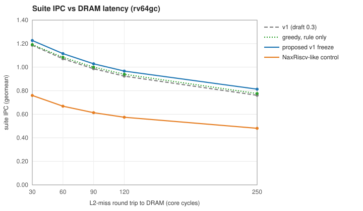
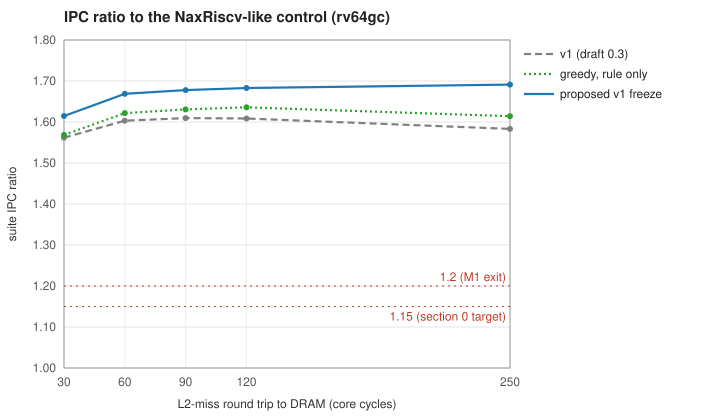

# Tanager M1: performance model and design-space exploration

*Milestone M1 (plan draft 0.3, §10.1, §11): `tgsim` calibrated, sweeps at the latency points, early-retirement go/no-go, and a v1 parameter freeze through the acceptance rule.*

| | |
|---|---|
| Status | M1 deliverable. **Freeze approved 2026-10-13** and adopted in plan draft 0.4. The CoreMark target was restated as ≥ 1.21× the NaxRiscv control (D11), and 3-wide is reserved by parameters (plan §4.15). |
| Date | 2026-10-13 |
| Model | `tgsim` model version 3, suite revision 2, built with GCC 15.2; workloads built with GCC 15.2 (xPack `riscv-none-elf-gcc` 15.2.0-1). See [`perfmodel/README.md`](../../perfmodel/README.md). |
| Plan | [architecture_plan.md](../architecture_plan.md) draft 0.3 |
| Ledger | [feature_ledger.md](feature_ledger.md) |
| Generated data | [dse_tables.md](dse_tables.md) (rv64gc); [dse_tables_rv64gcb.md](dse_tables_rv64gcb.md); [ledger_table.md](ledger_table.md) |

Every number here is a model result, not a measurement. LUT costs are estimates derived from the plan §8.2 budget, until synthesis spikes S2–S6 replace them.

**Naming (plan draft 0.4, D16).**
- **This report's "v1 freeze"** is the single-thread configuration, now called **ST**: the bring-up stage.
- **The first release (v1)** is ST plus the SMT2 configuration of plan §6.5.
- **"v1 (draft 0.3)"** here is the pre-freeze configuration.

---

## 1. Summary

### 1.1 Verdicts against the plan

"Proposed freeze" is the v1 configuration this report recommends (§8). Unless stated otherwise, all results are on rv64gc binaries at a 120-cycle DRAM round trip.

| Criterion (plan) | Target | Draft 0.3 v1 | Proposed freeze | Verdict |
|---|---|---|---|---|
| NaxRiscv-like model vs NaxRiscv's published RV32 IPC (§10.1) | within 10% | worst error 8.9% | — | **met** |
| Suite IPC ratio to the control at 30 / 60 / 90 / 120 / 250 cycles (§0, §2.5) | ≥ 1.15 (§0)<br>≥ 1.2 (M1 exit) | 1.56 / 1.60 / 1.61 / 1.61 / 1.58 | **1.62 / 1.67 / 1.68 / 1.68 / 1.69** | **met** |
| Ratio at 90/120/250 not below the native ratio (§2.5 criterion 1) | — | the 250-cycle ratio is 1.2% below the 60-cycle one | rises with latency | **met** with the freeze |
| No benchmark below 1.0 at native latency (§0) | — | worst: single-chain pointer chase 1.000 | 1.000 | met: one dependent miss chain has nothing to overlap |
| Eight concurrent misses at 120 cycles, 8-chain test (§2.5 criterion 2) | ≥ 8 | 7.88 | 7.88 | **unattainable as written** (§4); the 16-chain test sustains 15.65 |
| CoreMark/MHz vs the control on identical binaries (§0, D11 as decided 2026-10-13) | ≥ 1.21× per flag set | 1.48× / 1.34× | **1.46× / 1.34×** | **met** |
| CoreMark/MHz, absolute (reported; 6.0 is now the 3-wide version's target) | — | 5.36 / 5.16 (flag sets A / B) | 5.31 / 5.16; 5.86 / 5.70 with Zba/Zbb | 6.0 not reachable at 2-wide decode (§5) |
| DMIPS/MHz (§0) | ≥ 3.2 | 3.36 | 3.98 | **met** |
| Embench-IoT, soft float, vs NaxRiscv's published 1.84 (§0) | ≥ 2.0 | 2.45 | 2.49 | **met** |
| Early retirement go/no-go (§4.5) | — | — | **GO** (§7) | |
| v1 parameter freeze through the acceptance rule (M1 exit) | — | — | §8 | **approved 2026-10-13** |

### 1.2 Findings

1. **Tanager holds a 1.6–1.7× IPC lead at every latency.**
   - The control is a NaxRiscv-like core on the same memory system, running identical binaries.
   - The memory kernels carry most of the lead: 2.2–2.4× in v1. The integer kernels and Embench are 1.30× and 1.32×.
   - Under the proposed freeze the lead grows with DRAM latency, from 1.62× at 30 cycles to 1.69× at 250.
2. **The decoder is the binding limit.**
   - Behind a 2-wide decoder, extra execution bandwidth barely helps:
     - a second load pipe adds 0.4%;
     - a second FMA pipe adds 0.1%;
     - a third ALU adds 1.2%;
     - an ideal µop cache adds 1.4%.
   - Only 3-wide decode with a third ALU moves the needle: +13% suite IPC and 6.08 CoreMark/MHz, for an estimated ~10K LUTs per core (§9).
3. **Several draft-0.2 "slot efficiency" features don't pay on this suite with GCC 15 and TAGE-lite:**
   - SFB predication (0.17% gain for 1.2% of the LUTs);
   - the fusion list (0.14% for 1.0%);
   - jump folding (0.01%);
   - the wait table (0.02%);
   - branch-first select (−0.03%).
   SFB-shaped mispredicting branches are rare (78 conversions in 6.7M CoreMark instructions), and the plan's fusion pairs are almost absent from hot loops.
4. **The window has to be sized as a whole.**
   - Shrinking the issue queues and the ROB *together* costs 3.2% suite IPC (gather −56%), even though each trim looked cheap on its own.
   - The freeze therefore applies the acceptance rule greedily to the combined design (§8.1).
5. **The FPU's leverage is divide/sqrt latency, not width.**
   - A Goldschmidt divide/sqrt on otherwise idle DSPs adds +1.3% suite IPC (st +67%, minver +14%) for about 0.2K LUTs.
   - A second FMA pipe adds nothing behind the 2-wide decoder (§6).
6. **At long latency, L2 miss handling becomes a bandwidth-delay problem.** At 250 cycles, memcpy halves unless the L2 has more MSHRs and the stream prefetcher runs deeper. 48 L2 MSHRs with distance 16 and degree 4 fix the 250-cycle criterion (§4).
7. **The proposed freeze is faster and smaller.** It is +4.6% suite IPC over draft-0.3 v1, with an estimated **−3.3K LUTs per core** and +0.8K in the shared L2. The dual-core SoC estimate falls from about 94K to about 89K LUTs (76% of the XCK26).

### 1.3 Decisions

| # | Decision | Outcome |
|---|---|---|
| M1-1 | Approve the v1 freeze (§8), including five provisional exceptions (E1–E5) | **Approved 2026-10-13.** The exceptions are re-judged with Linux/SPEC-like workloads at M5. |
| M1-2 | CoreMark target: 6.0 is out of reach on rv64gc at 2-wide decode | **Decided 2026-10-13 (plan D11):** ≥ 1.21× the control on identical binaries, per flag set (met: 1.46× / 1.34×). 3-wide is committed for a later version, with 6.0 as its target, and is reserved in v1 by parameters (plan §4.15). |
| M1-3 | MLP criterion: "≥ 8" on the 8-chain test is unattainable by construction | **Adopted in draft 0.4:** ≥ 8 on the 16-chain test, and ≥ 95% of 8 on the 8-chain test |
| M1-4 | Make decode width and ALU count RTL parameters, with a 3-wide build in CI | **Adopted in draft 0.4 (D13)** |
| M1-5 | Fold the results into plan draft 0.4 (§10) | **Done 2026-10-13** |

---

## 2. Method

**Model.** `tgsim` is an execution-driven, cycle-level model written for this project.
- **How it runs:** a functional RV64/RV32 simulator (IMAFDC, Zicsr, Zba, Zbb, Zbs, Zicond, with real F/D arithmetic) supplies the correct-path instruction stream. The timing model charges each instruction its costs.
- **What it models:** every mechanism in plan §4.
  - **Front end:**
    - decoupled fetch with an FTQ;
    - micro-BTB, block BTB, TAGE-lite, RAS;
    - fetch-directed and next-line I$ prefetch.
  - **Decode and rename:**
    - fusion, SFB predication and jump folding;
    - banked rename;
    - checkpoints, or recovery at commit.
  - **Scheduling:** distributed issue queues with branch-first select, speculative load wakeup and shadow cancel.
  - **Early retirement:** long-latency tags, a completion buffer and deferred free.
  - **Load/store:**
    - a split LQ;
    - an SQ with forwarding and ordering checks;
    - the wait table.
  - **FPU:**
    - an FMA pipe;
    - an iterative or Goldschmidt divide/sqrt unit;
    - its own queue and register banks.
  - **Memory system:**
    - L1D MSHRs;
    - stride and stream prefetchers;
    - a 1 MiB L2 with MSHRs;
    - a DRAM with fixed latency and per-line occupancy.
- **Wrong path:** not simulated. A mispredict stalls fetch until it resolves.
- **Deviation from plan §10.1:** the plan called for a trace-driven model fed by Spike traces. The clean-sheet rule meant writing our own simulator, and execution-driven gives the same correct-path timing.

**Suite (revision 2): 33 workloads per ISA.** Only the timed region is measured.

| Group | Workloads | Build |
|---|---|---|
| kernels | CoreMark (flag sets A and B), Dhrystone 2.1 | A: `-O2 -funroll-loops -fpeel-loops -fgcse-sm -fgcse-las`<br>B: `-O3 -funroll-loops`<br>Dhrystone: `-O3 -fno-inline` |
| embench | the 19 Embench-IoT 1.0 programs | `-O2` |
| memsuite | 11 own kernels, 8–32 MiB working sets:<br>pointer chases with 1, 8 or 16 chains, plus 8 chains with 16 independent instructions per hop;<br>STREAM triad, memcpy, hash probe, CSR SpMV, binary search;<br>**strided walk** and **gather with dependent work** (added in revision 2) | `-O2` |

- **Why revision 2 added two kernels:** the first DSE pass had no memory kernel whose misses had dependent work waiting in the window. It therefore recommended issue-queue and ROB trims, and the combined check showed those trims cost 3.2% overall and −56% on gather. Every result here uses revision 2.
- **Targeted kernels outside the suite** cover what it doesn't exercise:
  - about 200 KiB of code;
  - an L2-resident binary search (47 branch mispredicts per 1,000 instructions);
  - a store-to-load aliasing histogram;
  - an L1-resident blocked matrix multiply.

**Figure of merit.** Suite IPC is the geometric mean of three equally weighted group geometric means: kernels, embench and memsuite.
- **Why equal weights:** the 19 Embench programs would otherwise outvote CoreMark and the memory kernels.
- **What memsuite stands in for:** plan §0 asks for a "Linux/SPEC-like suite". That needs a licence or further downloads, and none exists yet, so memsuite is the proxy for memory-intensive behaviour.
- **The nbody caveat:** GCC 15 hoists nbody's work out of its timed loop, leaving 770 instructions. Decisions that turn on FP are also checked without it.

**Control.** The `nax` preset is NaxRiscv's documented core on Tanager's uncore (L2, prefetcher, DRAM), running the same binaries.
- In the freeze validation, each candidate's control uses that candidate's uncore settings.
- The control's FMA latency (7 cycles) is our assumption; NaxRiscv documents none. With 5 cycles, the control's suite IPC rises 0.5% and every ratio falls by the same amount.

**Latency points.**
- **Native:** the KV260's PL-to-DDR latency has not been measured yet (spike S1). It is bracketed by 30 and 60 cycles.
- **The others:** 90, 120 (the decision point) and 250 (stress).
- **Definition:** latency is the L2-miss round trip in core cycles; DRAM delivers one 64 B line per 4 cycles.

**Acceptance rule (plan §2.5), as applied.**
- **The test:** a feature or size step passes if its suite-IPC gain at 120 cycles (%) is at least its LUT increase (%).
  - The LUT base is the ≈41K-LUT core, or the ≈94K-LUT SoC for shared features.
  - Guards: a loss worse than −0.25% at 30 or at 250 cycles fails.
- **Features** are judged by removing each one from v1 (an ablation).
- **Sizes** are frozen by a greedy pass over the combined design (§8.1).
- **Anything below the line** is removed, or kept as a written exception with evidence.

**Model corrections made during M1.** All results here are from the corrected model.

| # | Problem | Fix | Effect |
|---|---|---|---|
| 1 | The Makefile's `CXX ?= g++-15` never applied, because make predefines `CXX`. `tgsim` had been built with GCC 13.3. | Forced `g++-15` | All 124 re-simulated runs bit-identical |
| 2 | Instruction prefetches could never get an L1I MSHR with 2 MSHRs | Prefetch may use the last MSHR while a demand miss is outstanding (model v2) | I-side prefetch now works; full rerun |
| 3 | FP divide/sqrt latency (20/24 cycles double) was faster than the plan's radix-4 unit (30–60) | 17/31 cycles single/double (model v3), found after your FPU question | FP-heavy programs slower; full rerun |
| 4 | The suite had no memory kernel with dependent work on misses | Suite revision 2 | Window trims reversed |
| 5 | One-at-a-time sweeps missed interactions between the IQs and the ROB | Greedy combined freeze (§8.1) | Freeze method |

---

## 3. Calibration

### 3.1 RV32 against NaxRiscv's published IPC (the M1 criterion)

The calibration preset (`nax_cal`) is NaxRiscv's documented core with its own memory system: 16 KB L1s, 2 refill slots, no L2. It runs our rv32im builds.
- **No fitting:** each row is one reading of NaxRiscv's documentation; no free parameter was fitted.
- **Re-run on the final model:** unchanged, because rv32im has no FPU and the control uses no I-side prefetch.

| Reading of the documentation | Dhrystone IPC | CoreMark IPC | Embench IPC | Worst error |
|---|---|---|---|---|
| Published (NaxRiscv RV32 build A) | 1.65 | 1.28 | 1.42 | |
| BTB per instruction, 1-cycle taken bubble | 1.456 (−11.8%) | 1.296 (+1.2%) | 1.212 (−14.6%) | 14.6% |
| BTB per fetch word, 1-cycle bubble | 1.511 (−8.4%) | 1.292 (+0.9%) | 1.218 (−14.2%) | 14.2% |
| BTB per fetch word, no bubble | 1.825 (+10.6%) | 1.397 (+9.1%) | 1.348 (−5.1%) | 10.6% |
| **+ returns corrected by the RAS at decode (preset)** | **1.654 (+0.2%)** | **1.394 (+8.9%)** | **1.339 (−5.7%)** | **8.9%** |

In published units the preset gives:
- 2.98 DMIPS/MHz (published 2.93);
- 4.92 CoreMark/MHz (published 5.02);
- an Embench score of 1.73 (published 1.67).

### 3.2 RV64 cross-checks (beyond the criterion)

| Metric | NaxRiscv RV64, published | Model (`nax`) | Our build |
|---|---|---|---|
| DMIPS/MHz | 2.94 | 2.99 (+1.7%) | rv64gc, `-O3 -fno-common -fno-inline` |
| Embench-IoT score | 1.84 | 1.80 (−2.0%) | rv64imac, soft float (the published RV64 core has no FPU) |
| CoreMark/MHz | 4.94 | 3.91 (−21%) | `coremark_N`: `-O3 -funroll-loops`, `ee_u32` as `int32_t` |

**Dhrystone and Embench agree within 2%. CoreMark differs because of the binary, not the core model.**
- **What NaxRiscv published:** its build changed CoreMark's types ("u32 as s32") and used "many other flags" that are not listed.
- **Instruction counts:** its RV32 numbers imply about 255K instructions per iteration. Our builds execute 283K (rv32im), 304K (`coremark_N` on rv64gc) and 338K (rv64gc, flag set A).
- **Consequence:** neither 4.94 nor the 6.0 target derived from it can be compared directly with scores from standard binaries (§5).

---

## 4. IPC across DRAM latency





| DRAM round trip | v1 suite IPC (ratio) | Proposed freeze suite IPC (ratio) | Control (same uncore) |
|---|---|---|---|
| 30 cycles | 1.187 (1.562) | 1.227 (**1.615**) | 0.760 |
| 60 | 1.072 (1.603) | 1.115 (**1.669**) | 0.668 |
| 90 | 0.987 (1.610) | 1.029 (**1.678**) | 0.613 |
| 120 | 0.924 (1.609) | 0.967 (**1.683**) | 0.575 |
| 250 | 0.761 (1.583) | 0.813 (**1.691**) | 0.481 |

**By group.**
- **Kernels and Embench:** the lead is constant (1.30× and 1.32× in v1), because these programs run from the caches.
- **Memsuite:** the lead peaks at 2.42× at 90 cycles. A few kernels can't benefit:
  - the single-chain pointer chase (1.00×, one dependent miss at a time);
  - the hash probe (1.07–1.10×, where each lookup's mispredicted branch waits for its miss);
  - Embench wikisort (1.10×).

**Retention (IPC at 250 cycles ÷ IPC at 30).**
- **Draft-0.3 v1:** 0.641, against the control's 0.633. In draft 0.3 the ratio sagged at 250 (1.583 vs 1.603 at 60 cycles).
- **Why it sagged:** memcpy halved at 250 cycles. A stream prefetch distance of 8 lines and 32 L2 MSHRs cannot cover the bandwidth-delay product: two streams need about 28 lines in flight.
  - With 64 L2 MSHRs and distance 32, memcpy holds 1.80 IPC at 250 cycles.
  - With 48 MSHRs, distance 16 and degree 4, it holds 1.57.
- **The fix:** the freeze adopts the latter (exception E4), and the ratio then rises with latency at every point.

**Memory-level parallelism (MLP)** is the time-averaged number of demand L1D misses in flight.

| Test (120 cycles) | Draft 0.3 v1 | Proposed freeze | Control |
|---|---|---|---|
| 8 chains | 7.88 | 7.88 | 2.00 |
| 16 chains | 11.99 (all 12 MSHRs) | 15.65 (16 MSHRs) | 2.00 |
| 8 chains with 16 independent instructions per hop | 7.88 | 7.88 | 1.93 |

**The 8-chain criterion cannot reach 8.0.**
- **Why:** each chain spends about 2 cycles between a fill and its next miss (wakeup, address generation, tag check), so the time average is at most 8 × (round trip ÷ (round trip + 2)). That is 7.87 at 120 cycles and 7.93 at 250.
- **Tanager reaches the ceiling:** 98.5% of 8.
- **Recommendation (M1-3):** restate the criterion.

---

## 5. CoreMark and the 6.0 target

**Instruction count sets the ceiling.** CoreMark/MHz = 10⁶ × IPC ÷ instructions per iteration, and 2-wide decode caps IPC at 2.

| Build | Instructions per iteration | IPC needed for 6.0 | v1 IPC → CoreMark/MHz | Proposed freeze |
|---|---|---|---|---|
| rv64gc, flag set A | 337.8K | **2.03** | 1.810 → 5.36 | 5.31 |
| rv64gc, flag set B | 341.9K | **2.05** | 1.767 → 5.17 | 5.16 |
| rv64gcb (Zba/Zbb/Zbs/Zicond), A | 302.8K | 1.82 | 1.792 → 5.92 | 5.86 |
| rv64gcb, B | 306.3K | 1.84 | 1.757 → 5.74 | 5.70 |
| `coremark_N` on rv64gc (NaxRiscv-style, not a valid score) | 303.7K | 1.82 | 1.751 → 5.77 | 5.75 |

- **On rv64gc, 6.0 needs IPC above 2, which no 2-wide decoder can deliver.**
- **Why RV64 costs more instructions:** RV64 needs extra extensions for CoreMark's 32-bit unsigned arithmetic. Zba/Zbb remove 10.3% of the instructions.
- **Where cycles go in v1:**
  - taken-branch bubbles when the micro-BTB isn't confident (8.9% of cycles);
  - a full LQ (5.0%);
  - full issue queues (3.3%);
  - direction mispredicts are only 0.8 per 1,000 instructions, so eliminating them would gain about 1.5%.

**Levers measured** (CoreMark/MHz, flag set A):

| Change | rv64gc | rv64gcb | Cost |
|---|---|---|---|
| v1 | 5.36 | 5.92 | |
| micro-BTB 32 → 64 | 5.37 | 5.93 | in the freeze (+2.0% suite) |
| + pair-decode fusion (a fused pair takes one decode slot) | 5.46 | **6.07** | ALU+branch and plan fusion pairs; about 1K LUTs |
| Greedy freeze + pair-decode fusion | 5.40 | 5.98 | |
| 3-wide decode with a 3rd ALU (on the greedy freeze) | **6.08** | — | ~10K LUTs per core (§9) |

**Against the relative goal.** 6.0 vs NaxRiscv's 4.94 is a 1.21× goal. On identical binaries Tanager v1 is well above it against the control:
- 1.48× on flag set A;
- 1.34× on flag set B;
- 1.47× on `coremark_N`.

**Routes to 6.0:**
- rv64gcb binaries with pair-decode fusion, flag set A only, and only with v1's larger queues;
- or 3-wide decode with a third ALU.

**Decision (M1-2, 2026-10-13).** v1's target is the relative one, ≥ 1.21× per flag set, which it meets. 6.0 on rv64gc moves to the 3-wide version, which is committed for later and reserved in v1 by parameters (plan §4.15).

---

## 6. FPU

The FPU has been part of the plan and the model throughout:
- **Plan:** RV64**GC** (G includes F and D), with a from-scratch FPU (§4.12): one FMA pipe, an iterative divide/sqrt unit and FMISC. It has its own queue (IQ-FP, P4) and register banks (F0/F1), and costs ≈4.5K of the core's LUTs.
- **Benchmarks:** all rv64gc builds are hard float.

FP share of dynamic instructions:

| Workload | FP share |
|---|---|
| embench nbody | 52% (only 770 instructions) |
| ms_stream | 44% |
| embench st | 41% |
| embench minver | 34% |
| ms_spmv | 30% |
| embench cubic, wikisort, ud | 1–4% |
| everything else | 0% |

| Option | Suite IPC at 120 (without nbody) | Most affected | Est. cost | Verdict |
|---|---|---|---|---|
| FMA 5 → 4 cycles | +0.22% (+0.12%) | st +4.3%, cubic +1% | timing; about +150–250 LUTs | keep 5; decide at synthesis |
| FMA 5 → 6 cycles | −0.22% | | | — |
| Radix-16 divide/sqrt (10/17 cycles, unpipelined) | +1.67% (+1.09%) | st +47%, minver +13% | 1.2K LUTs (2.9%) | reject |
| **Goldschmidt divide/sqrt, 10-bit seed** (18/23 divide, 20/26 sqrt, a new op every 4 cycles) | **+2.23% (+1.31%)** | st +67%, minver +14% | about +0.2K LUTs, +24 DSPs, +1 BRAM18 | **adopt** |
| Goldschmidt, 14-bit seed | +2.35% (+1.35%) | | +0.1K LUTs and 2–4 BRAM36 more than the 10-bit seed | reject (+0.04% over 10-bit) |
| Second FMA pipe | +0.08% | st +2.3%; blocked matmul +0.6% | about 4.4K LUTs | reject |
| FP issue queue 6 → 10 (in the freeze context) | +0.07% | blocked matmul +12.7% | 0.3K LUTs | keep as exception E5 |

**Why width doesn't help but latency does.**
- At 2-wide decode, even the densest FP code (the blocked matrix multiply, 44% FMAs) needs about 0.9 FMAs per cycle, so one pipelined FMA is never saturated.
- Divide/sqrt latency, by contrast, sits on the critical path of minver and st.
- The Goldschmidt unit spends DSPs, which the XCK26 has in excess (about 108 of 1,248 used with it), to buy that latency. It is also pipelined, unlike the digit-recurrence units.
- **Correctness note for the FPU spec:** Goldschmidt needs a remainder step for correct rounding, and TestFloat must cover it.

**The control's FPU.** Its FMA latency (7 cycles) is assumed. With 5 cycles, its suite IPC rises 0.5% and the ratios fall by 0.5%.

---

## 7. Early retirement: go/no-go

The plan's criterion (§4.5): early retirement must reach the MLP of the 16-filler pointer chase more cheaply than enlarging the ROB, *or* let the ROB shrink to 48 at no IPC cost.

| Configuration | Suite IPC @120 | 16-filler chase MLP @120 | That chase's IPC |
|---|---|---|---|
| v1: ER on, ROB 64 | 0.924 | 7.88 | 1.036 |
| ER on, ROB 48 | 0.916 | 7.88 | 1.036 |
| ER off, ROB 48 | 0.886 | 2.87 | 0.377 |
| ER off, ROB 64 | 0.903 | 3.79 | 0.498 |
| ER off, ROB 96, LQ 24 | 0.927 | 5.61 | 0.738 |
| ER off, ROB 128, LQ 32, 96 registers per bank | 0.941 | 7.39 | 0.972 |
| ER off, ROB 160, LQ 32, 96 registers per bank | 0.943 | 7.88 | 1.036 |

**Verdict: GO.**
- **The criterion is met.** Without early retirement, matching its MLP on the 16-filler chase needs ROB 160, LQ 32 and 96 registers per bank: an estimated ~5K LUTs against ≈0.9K for early retirement.
- **The rule is passed.** Early retirement contributes +2.39% at 120 cycles in v1 (cost 2.20%), and +3.4% in the ROB-48 freeze, where it substitutes for ROB entries.
- **Caveat 1: suite IPC per LUT is comparable.** A larger ROB without early retirement (ROB 96, LQ 24) matches v1's suite IPC at a similar cost.
- **Caveat 2: misses with dependents.** Early retirement only helps when the instructions after a miss don't depend on it. When they do (gather, strided walk), the dependents block the ROB head and only window size helps.
- **Conditions from the plan:** early retirement ships behind its enable bit and passes the verification gates (§9 of the plan), given its high verification surface.

---

## 8. The v1 freeze

### 8.1 Method: the acceptance rule on the combined design

The first freeze attempt applied the one-at-a-time sweeps independently. The validation run caught the flaw: issue queues of 6 and a 48-entry ROB together cost 3.2% suite IPC, while each sweep had shown under 1%.

The freeze therefore applies the rule greedily (`dse.py --greedy`):
1. **Fix the features** from the ablations: those below the line are removed; the I-side exception E1 is kept.
2. **Start every structure at its smallest size:** ROB 48, all issue queues 6 (STA 4), LQ 16, SQ 12, completion buffer 8, 16 long-latency tags, 12 L1D MSHRs, no checkpoints.
3. **Each round**, add the single increment with the best gain per LUT at 120 cycles, provided its gain (%) ≥ its LUT cost (%) and it passes the 30/250-cycle guards.
4. **Stop** when no increment qualifies.

| Round | Suite IPC @120 | Chosen | Gain vs LUT share |
|---|---|---|---|
| 1 | 0.9038 | ALU issue queues 6 → 8 | +1.50% vs 0.78% |
| 2 | 0.9174 | L1D MSHRs 12 → 16 | +1.26% vs 0.73% |
| 3 | 0.9289 | ALU issue queues 8 → 10 | +1.17% vs 0.78% |
| 4 | 0.9398 | none (stop) | |

Best rejected increments in round 4:
- 4 checkpoints: +0.63% vs 1.22%;
- ROB +16: +0.45% vs 1.17%;
- ALU issue queues +2: +0.29% vs 0.78%;
- SQ +4: +0.21% vs 0.49%.

Full candidate lists are in [dse_tables.md](dse_tables.md).

### 8.2 Exceptions and adoptions on top of the rule

| # | Item | Suite evidence (gain vs LUT share) | Other evidence | Status |
|---|---|---|---|---|
| E1 | I-side prefetch (fetch-directed + next line) and 4 L1I MSHRs | +0.03% vs 0.49%; +0.01% vs 0.29% | ~200 KiB-code kernel: prefetch +34%, 2 → 4 MSHRs +30% (the suite has no large code) | provisional |
| E2 | 4 checkpoints | +0.6% vs 1.22% | L2-resident binary search +5.7%; nbody, qrduino, huffbench +3.5–8.5% | provisional |
| E3 | 1 MiB L2 | +0.10% vs 0.21% (SoC) | its cost is UltraRAM, otherwise unused; no suite workload sits between 0.5 and 1 MiB | provisional |
| E4 | 48 L2 MSHRs, stream prefetch distance 16 / degree 4 (run-time defaults) | 0.0% at 120 | needed for §2.5 criterion 1 at 250 cycles; memcpy at 250: 0.84 → 1.57 IPC | adopted for the guard |
| E5 | FP issue queue 10 | +0.07% vs 0.78% | blocked matmul +12.7%; the suite has only 5 FP-heavy workloads | provisional |
| A1 | Goldschmidt divide/sqrt, 10-bit seed | +1.31% (without nbody) vs 0.49% | +24 DSPs, +1 BRAM18 | **passes the rule** |

### 8.3 Validation of the candidates (all five latency points)

Suite IPC (ratio to the control with the same uncore):

| Candidate | 30 | 60 | 90 | 120 | 250 | CoreMark A / B | DMIPS |
|---|---|---|---|---|---|---|---|
| v1 (draft 0.3) | 1.187 (1.562) | 1.072 (1.603) | 0.987 (1.610) | 0.924 (1.609) | 0.761 (1.583) | 5.36 / 5.16 | 3.36 |
| Greedy, rule only | 1.192 (1.569) | 1.084 (1.622) | 1.000 (1.631) | 0.940 (1.636) | 0.776 (1.614) | 5.28 / 5.11 | 3.98 |
| A: greedy + E1–E4 | 1.200 (1.579) | 1.091 (1.632) | 1.006 (1.641) | 0.946 (1.646) | 0.796 (1.654) | 5.31 / 5.16 | 3.98 |
| B: A + Goldschmidt | 1.226 (1.613) | 1.115 (1.668) | 1.028 (1.676) | 0.966 (1.682) | 0.813 (1.690) | 5.31 / 5.16 | 3.98 |
| **C: B + E5 (proposed)** | **1.227 (1.615)** | **1.115 (1.669)** | **1.029 (1.678)** | **0.967 (1.683)** | **0.813 (1.691)** | **5.31 / 5.16** | **3.98** |

**Proposed freeze on the targeted kernels at 120 cycles** (v1 in brackets):

| Kernel | IPC |
|---|---|
| large code | 1.40 (1.06) |
| L2-resident binary search | 0.64 (0.65) |
| aliasing histogram | 2.00 (2.00) |
| blocked matmul | 1.94 (1.97) |

On rv64gcb, the proposed freeze's ratio is 1.65–1.73×, with CoreMark/MHz 5.86 / 5.70 ([dse_tables_rv64gcb.md](dse_tables_rv64gcb.md)).

### 8.4 The frozen parameters

| Structure | Draft 0.3 | **v1 freeze** | Basis |
|---|---|---|---|
| Micro-BTB | 32, fully associative, flip-flops | **64, 2-way LUTRAM** | 32 → 64: +2.0% vs 0.24%. Its LUTRAM read sits in the next-PC loop (the plan's fallback), so spike S5 must confirm it. |
| TAGE-lite tagged tables | 4 × 1K | **4 × 4K** | +0.45% and +0.22% per doubling vs 0.07%; +6 BRAM36 |
| Block BTB / RAS / FTQ | 1K × 4 / 32 / 32 | unchanged | not swept |
| I-side prefetch / L1I MSHRs | on / 2 | on / **4** | E1 |
| Fusion, SFB predication, jump folding | on | **off** (RTL options) | below the line |
| Checkpoints | 8 | **4** | E2 |
| ROB | 64 | **48** | greedy |
| Long-latency tags | 32 | **16** | no gain above 16 |
| Issue queues A0 / A1 / LD / STA / FP | 12 / 12 / 12 / 8 / 12 | **10 / 10 / 6 / 4 / 10** | greedy; FP from E5 |
| Branch-first select | on | **off** | −0.03% |
| Speculative wakeup | on | on | +3.0% vs 1.22% |
| Early retirement | hooks, go/no-go | **on** | §7 |
| LQ CAM / completion buffer / SQ | 16 / 16 / 16 | **16 / 8 / 12** | greedy |
| Wait table | 1K | **off** | +0.02% vs 0.24%; no ordering violations even in the aliasing histogram |
| Ownership prefetch | on | on | +1.6% vs 0.24% |
| L1D stride prefetcher | on | on | +0.96% vs 0.73% |
| L1D MSHRs | 12 | **16** | greedy |
| L1I / L1D | 32 KiB, 8-way | unchanged | +0.85% vs 0.49% |
| L2 / L2 MSHRs / stream prefetcher | 1 MiB / 32 / distance 8, degree 2 | 1 MiB / **48** / **distance 16, degree 4** | E3, E4 |
| FMA | 4–5 cycles | **5 cycles** | 5 → 4 gains +0.22%; it's a timing question |
| FP divide/sqrt | radix-4 digit recurrence | **Goldschmidt, 10-bit seed, pipelined** | A1 |
| Second load pipe / second FMA pipe | options | rejected | +0.40% vs 3.66% / +0.08% vs 10.7% |

**Estimated resource change vs draft 0.3, per core:**
- **LUTs:** −4.1K removed, +0.8K added, so **−3.3K net**.
- **Shared L2:** +0.8K LUTs.
- **DSPs:** +24.
- **BRAM:** about +6.5 BRAM36.

**Dual-core SoC estimate:**
- **LUTs:** about 89K (76% of the XCK26), down from about 94K (80%).
- **BRAM:** about 103 of 144.
- **DSPs:** about 108 of 1,248.

---

## 9. Decode width (your questions)

Relative to the 2-wide greedy freeze, at 120 cycles:

| Option | Suite IPC | CoreMark/MHz A / B | Est. LUTs per core |
|---|---|---|---|
| µop cache, upper bound (no taken-branch bubbles, one fewer stage) | +1.4% | 5.33 / 5.15 | ~1–2K, plus about 4 BRAM36 |
| 3rd ALU at 2-wide decode | +1.2% | 5.36 / — | ~4–5K |
| 3-wide decode/rename/commit, 2 ALUs | +5.0% | 5.56 / 5.34 | ~4.7K |
| **3-wide with a 3rd ALU** | **+13.2%** | **6.08 / 5.92** | **~10K (~24%)** |
| 3-wide, 3rd ALU, ROB 64, ALU queues 12 | +14.4% | 6.09 / 5.96 | ~11.5K |

**The width question by option.**
- **The decoder sets the ceiling.** Tanager already issues wider than it decodes: 5 ports behind 2-wide decode.
- **Extra ports behind a 2-wide decoder** only drain bursts.
  - Most of the 3rd ALU's +1.2% at 2-wide comes from its extra queue entries holding miss dependents.
- **A µop cache:**
  - It doesn't widen rename and commit, which are the real 2-wide limit.
  - RISC-V decode is cheap, since instruction length is known from two bits.
- **Intel E-core decode clusters** solve x86's serial length decoding. They don't reduce the cost of wide rename and commit, and RISC-V doesn't have the length problem.
- **3-wide with a 3rd ALU** is the only option that pays off in IPC, but it fails the rule: +13% for about 24% of the LUTs.
  - The register file needs 9 read ports, more than the 7 a LUTRAM bank provides, so every bank must be duplicated.
  - The SoC would land near 106K LUTs (≈91%), and 3-wide rename and wakeup at 200 MHz is a timing risk.

**Building 3-wide on top of 2-wide.** Write decode, rename, dispatch and commit width-generic, plus the ALU-port count and a register-file generator that can replicate banks.
- **Then 3-wide is a parameter change** plus timing work and verification, not a redesign.
- **Recommendation (M1-4):**
  - make `DECODE_WIDTH` and `N_ALU` RTL parameters in v1 and keep a 3-wide build compiling in CI;
  - synthesise it at M6, as the plan does for the thread-ID width = 1 build.
- **v2:** 3-wide (single-thread and CoreMark) versus SMT2 (throughput; planning estimate +20–40% for +10–20% logic) should be decided with an SMT2-capable model.

---

## 10. Plan changes (adopted in draft 0.4, 2026-10-13, except item 5)

1. **Parameters:** §4.14 and the §0 comparison table get the v1 freeze values (§8.4). Fusion, SFB predication, jump folding, the wait table and branch-first select become DSE options, off in v1, with their RTL hooks kept cheap.
2. **Divider:** §4.12 replaces the radix-4 divide/sqrt with a pipelined Goldschmidt unit on dedicated DSPs (seed table in a BRAM18). The trim-ladder step "divide/sqrt through Newton-Raphson on the FMA" stays as the fallback.
3. **Prefetch and miss handling:** §4.2 gets 4 L1I MSHRs. §5.1 gets 48 L2 MSHRs and stream prefetch defaults of distance 16 / degree 4, still run-time registers.
4. **MLP criterion (§2.5):** ≥ 8 on the 16-chain test, and ≥ 95% of 8 on the 8-chain test.
5. **CoreMark target (§0):** as decided under M1-2.
6. **Width parameters:** `DECODE_WIDTH` and `N_ALU` become RTL parameters with a 3-wide CI build (§6.2-style rule), and the register-file generator supports bank replication.
7. **Resource budget (§8.2):** −3.3K LUTs per core and +24 DSPs per core.
8. **Performance methodology (§10):**
   - the suite gains the gather and strided kernels;
   - freezes use the combined greedy method;
   - exceptions are re-judged with Linux/SPEC-like workloads at M5.

---

## 11. Limitations, and what later milestones must check

**Model limitations.**
- Correct path only.
- Fixed-latency DRAM with per-line occupancy.
- No MMU or supervisor code.
- A single core with a single thread. The SMT2 model is a proposed follow-up.

**Workload gaps.**
- **No SPEC-like or Linux workloads yet:**
  - large code;
  - branchy integer code;
  - working sets of 0.5–4 MiB;
  - dense FP.
  The targeted kernels stand in for these, so the five exceptions stay provisional.
- **What comes next:** sqlite, zstd/xz, a Lua interpreter, a gcc compile and Linux boot traces (plan §10.2). They need downloads and porting.

**Cost basis.** LUT costs are estimates. Several verdicts sit close enough to the line that synthesis could flip them:
- early retirement (2.39% vs 2.20%);
- the SQ step (0.21% vs 0.49%);
- the checkpoint exception;
- the micro-BTB timing.

**Later milestones.**
- **M2–M3:** RTL counters must match the model within 10% on CoreMark, Dhrystone and three memsuite kernels.
- **M4:** the latency injector reproduces the 30/120/250-cycle points on the board.
- **M4/M6:** NaxRiscv's own RV64 RTL runs as a control on the same binaries. That would also settle the CoreMark discrepancy in §3.2, but it needs a download you would have to approve.

## 12. Reproducing these results

From `perfmodel/` in WSL Ubuntu 24.04 (see [`perfmodel/README.md`](../../perfmodel/README.md)):

```bash
make -j8
ISAS="rv64gc rv64gcb rv32im rv64imac" bash bench/build_all.sh
bash bench/build_extra.sh
python3 scripts/calib.py
python3 scripts/dse.py rv64gc
python3 scripts/dse.py rv64gc --targeted
python3 scripts/dse.py rv64gc --greedy
python3 scripts/dse.py rv64gc --freeze
python3 scripts/dse.py rv64gc --width --alu3
python3 scripts/dse.py rv64gcb --baseline
python3 scripts/dse.py rv64gcb --freeze
python3 scripts/report.py rv64gc
python3 scripts/report.py rv64gcb
```

**Where results live.** Results are cached per configuration in `perfmodel/results/dse/`, keyed by model version and suite revision. The first-pass results (model v1/v2, suite revision 1) are kept as `results/*_suite1.json` for traceability.
