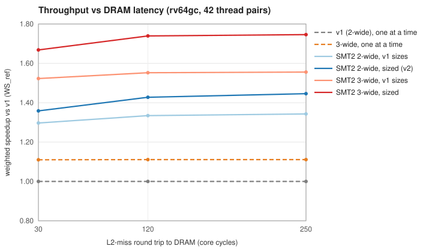

# Tanager SMT2 study

*What two-thread SMT gives Tanager, what an SMT2 core needs to be sized at, and how SMT2 and the committed 3-wide decode should be ordered and combined (plan §6.4, D14).*

| | |
|---|---|
| Status | Study for review: input to plan §6.4 (the order and combination of SMT2 and 3-wide) and to the feature ledger |
| Date | 2026-10-13 |
| Model | `tgsim` model version 3 with SMT2 (`threads=2`, `SMT_VERSION` 1); suite revision 2; rv64gc binaries built with GCC 15.2. See [`perfmodel/README.md`](../../perfmodel/README.md). |
| Baseline | The approved v1 freeze ([feature_ledger.md](feature_ledger.md)), preset `v1_freeze` |
| Plan | [architecture_plan.md](../architecture_plan.md) draft 0.4: §6 (SMT), §4.15 (3-wide reserve), D11, D13, D14 |
| Generated data | [smt2_tables.md](smt2_tables.md), with per-pair results and every greedy round; `perfmodel/results/smt2_rv64gc.json` |

Every number here is a model result, not a measurement. LUT costs are estimates, as in M1, until synthesis replaces them.

**Naming (plan draft 0.4, D16).** This report predates the renaming:
- its "v1" and "v1 freeze" are the single-thread bring-up configuration **ST**;
- its "v2" (the 2-wide SMT2 core) is the **first release, v1**;
- its 3-wide SMT2 core is **v2**.

**Decisions taken on this study (2026-10-13; plan draft 0.4, D14, D15 and D16).**
- **Adopted:** the 2-wide column of §1.2 (ROB 80, LQ 24, SQ 20, 24 LLTs, 75% issue-queue caps) as the **first release**.
- **Then:** 3-wide added to the SMT2 core as the next release, all on the KV260.
- **What this overrides:** where this report says the combined core needs a larger device, the project owner decided otherwise. The plan's area-recovery plan (§8.5) is how v3 is to fit the XCK26.

---

## 1. Summary

### 1.1 Findings

1. **SMT2 adds a third to the v1 core's throughput, with no size change.**
   - **Measured:** two programs on the v1 freeze reach a weighted speedup of **1.30 / 1.33 / 1.34** at 30 / 120 / 250 cycles of DRAM latency. The plan's planning estimate was +20–40% (§6.1).
   - **Cost:** the SMT2 logic is estimated at **6.4K LUTs per core** (range 4.3–8.8K, i.e. 10–21%; §8.3), and 6.75K on a 3-wide core.
   - **Acceptance rule:** it passes by a factor of about 2, at +33% throughput for 15.6% of the LUTs.
2. **Who benefits.**
   - **Memory-bound threads gain the most.** Alone they use only 4–27% of the decode slots, and SMT2 fills the rest: memory + memory pairs reach 1.43, mixed pairs 1.44.
   - **Compute pairs barely gain on the 2-wide core.** The 2-wide decoder pins their combined IPC at 2.00, so they reach only 1.15.
   - So SMT2 helps most where Tanager is slow (memory-latency-bound work) and little for CoreMark or Dhrystone (CoreMark + CoreMark: +11%).
3. **SMT2 makes the window binding, and the acceptance rule grows it.**
   - **What binds:** each thread's half of the v1 window (ROB 24, LQ 8, SQ 6) and the 16 shared long-latency tags.
   - **The rule's answer:** applied to SMT2 throughput, with whole-window steps allowed (§8.2), it grows the ROB to 80, the LQ to 24, the SQ to 20 and the long-latency tags to 24. That is +1.9K LUTs per core.
   - **The result:** weighted speedup **1.36 / 1.43 / 1.45**, +7% over SMT2 at v1 sizes. One thread alone also gains 2.5%, because it gets the whole larger window.
   - **What stays at v1 sizes:** the issue queues, the completion buffer, the 16 L1D MSHRs and the 48 L2 MSHRs. Once the window has grown, no step of theirs passes the rule.
4. **Partitioning and fetch: the plan's SMT2 line holds, with one condition.**
   - **What works:** static ROB/LSQ halves, ICOUNT fetch (+0.5% over round robin), and alternating rename and commit with shared slots.
   - **The condition:** caps on the shared issue queues (75% per thread) are a precondition for any window sharing. Without them, a sharing thread clogs the queues.
   - **Shared window:** with the caps in place, a shared window with a 75% per-thread cap would add a further 2.7%. It needs age-ordered ROB and LSQ logic that static halves avoid; it is an option for later (§5).
5. **At 2-wide decode, SMT2 doesn't change M1's verdicts on execution width.** A second load pipe, a second FMA pipe or a third ALU each still add 0–2% (§7).
6. **SMT2 and 3-wide decode are complements, so their order is the question (§9).**
   - **Each makes the other worth more:**
     - 3-wide adds 11% throughput to a single-thread core, but 22% to the sized SMT2 core;
     - SMT2 adds 43% to the 2-wide core, but 57% to the 3-wide core;
     - at the same (v1) sizes, the combined core is 4.7% above the product of the two alone (1.552 against 1.335 × 1.111).
   - **The combined core, sized by the same rule (plan §6.2 rule 12):** ROB 96, LQ 32, SQ 20, completion buffer 16 and 24 long-latency tags.
     - Weighted speedup: **1.67 / 1.74 / 1.75**.
     - Single thread: +18% (CoreMark 6.11/MHz, DMIPS 4.99).
     - Cost: ≈19.5K LUTs per core.
   - **Throughput per LUT,** in points of throughput per percent of the core's LUTs:

     | Core | Throughput per LUT % |
     |---|---|
     | SMT2 on the 2-wide core | 2.1 |
     | 3-wide alone | 0.46 |
     | the combined core | 1.56 |
7. **The data favours SMT2 first.** All three orders end at the same combined core; they differ in what the next version delivers and whether it fits:

   | Order | Next version: share of the combined core's throughput gain | Share of its LUTs | Share of its single-thread gain | Dual-core LUTs (XCK26 share) |
   |---|---|---|---|---|
   | **SMT2 first** | **58%** | 42% | 14% | ≈106K (90%) |
   | 3-wide first | 15% | 51% | 74% (CoreMark 6.11, the 3-wide version's target) | ≈109K (93%) |
   | Both at once | 100% | 100% | 100% | ≈128K: needs a larger device |

   - **SMT2 first** gives the most throughput for the least logic, fits the XCK26, and makes the later 3-wide step worth more: +22% throughput and +15% single thread.
   - **3-wide first** is the choice only if single-thread speed must come first.
   - **Both at once** is the efficient end point if the next version moves to a larger device anyway.

### 1.2 Proposed SMT2 cores

| Structure | v1 freeze | **SMT2, 2-wide (next step)** | SMT2, 3-wide (plan rule 12; later, larger device) |
|---|---|---|---|
| Hardware threads | 1 (`TID_W` = 0) | **2** (`TID_W` = 1); 2 cores × 2 harts = 4 Linux CPUs | 2 |
| Decode / rename / commit; ALUs | 2-wide; 2 | 2-wide; 2 | 3-wide; 3 |
| ROB | 48 | **80**, static halves of 40 | 96, halves of 48 |
| LQ CAM / completion buffer | 16 / 8 | **24** / 8, halves of 12 / 4 | 32 / 16, halves of 16 / 8 |
| SQ | 12 | **20**, halves of 10 | 20, halves of 10 |
| Long-latency tags | 16 | **24**, shared | 24, shared |
| Issue queues A0 / A1 (/ A2) / LD / STA / FP | 10 / 10 / 6 / 4 / 10 | unchanged, shared; **each thread ≤ 75% of each queue** | unchanged (A2 10); ≤ 75% per thread |
| Checkpoints | 4 | 4 per thread | 4 per thread |
| L1D / L2 MSHRs; physical registers | 16 / 48; 3 × 64 integer, 2 × 64 FP | unchanged, shared; never binding | unchanged, shared; never binding |
| Fetch | — | **ICOUNT**, one thread per cycle | ICOUNT |
| Decode, rename, commit order | — | the thread served first alternates; a thread uses the slots its sibling leaves idle | same |
| Predictors | — | shared tables with the TID hashed in; history, RAS and FTQ per thread | same |
| **Estimated cost per core** | | **+8.3K LUTs** (+1.9K sizes, +6.4K SMT2 logic; range +6.2K to +10.7K) | +19.5K (+10K 3-wide, +6.75K SMT2, +2.7K sizes) |
| WS_ref at 30 / 120 / 250 | 1.00 | **1.36 / 1.43 / 1.45** | 1.67 / 1.74 / 1.75 |
| Single-thread suite IPC @120 | 0.967 | +2.5% | +18.0% |

### 1.3 Decisions for you

| # | Decision | Recommendation |
|---|---|---|
| V2-1 | Order of SMT2 and 3-wide (plan §6.4, D14) | **SMT2 first** while the KV260 is the platform. Then add 3-wide to the SMT2 core when moving to a larger device. If the next version moves to a larger device anyway, build both at once (the rule-12 core of §1.2). Choose 3-wide first only if single-thread speed must come first. |
| V2-2 | Sizes | **The 2-wide SMT2 column of §1.2** for the next step (ROB 80, LQ 24, SQ 20, 24 long-latency tags). The 3-wide column is the rule-12 sizing to carry into the 3-wide version's own freeze (§4.15). |
| V2-3 | Partitioning | **Static halves plus 75% issue-queue caps**, as plan §6.4 says. A shared ROB/LSQ with 75% caps (+2.7%) is an option for later, to be judged on RTL cost. |
| V2-4 | SoC fit: the dual-core 2-wide SMT2 is ≈106K LUTs (90%), against the plan's ≈80% goal; the combined core does not fit | Accept it as a risk of the SMT2 version. Replace the estimate with the `TID_W = 1` synthesis already planned at M6 (§6.3), and keep the trims of §10 ready. |
| V2-5 | Fold the results into plan §6.4 and the feature ledger | Proposed text in §10 |

---

## 2. Method

### 2.1 What the model adds

`tgsim` gains a `threads` parameter. With `threads=2`, two programs run at once, one per hardware thread, each on its own functional simulator. What is per thread and what is shared follows plan §6.2 (rules 1–11) and the v2 line of §6.4 ("static ROB/LSQ partitions, capped shared queues, ICOUNT-style fetch, shared tagged TLBs and caches").

| Per thread | Shared |
|---|---|
| Program, functional simulator and instruction stream | Fetch: one thread per cycle (one 16 B I$ access) |
| Fetch state, instruction queue (16), FTQ-directed prefetch | Decode, rename/dispatch and commit slots (2 each) |
| Global history and RAS | Issue queues, kept in dispatch order across threads, with a per-thread cap |
| Rename map; 4 checkpoints | Physical register banks; they hold both threads' committed registers |
| ROB, LQ, SQ and completion-buffer share | Long-latency tags; every execution unit, including the Goldschmidt divider and the FMA |
| Commit order; in-order store drain | L1I, L1D, L2, MSHRs, prefetchers, DRAM bandwidth |
| Flushes and redirects, which touch only the thread's own uops | Predictor tables (BTB, micro-BTB, TAGE, hit predictor), with the thread ID hashed into their index and tag |

**Front end.**
- **Fetch:** one thread fetches per cycle. A thread that is waiting for an I$ miss, a taken-branch bubble or a branch resolution leaves the slot to its sibling.
- **ICOUNT** (the default) gives the slot to the thread with fewer uops in the instruction queue, the decode-to-rename stages and the issue queues. Round robin is the alternative.
- **Decoupling:** each thread has its own instruction queue and its own 6-uop queue between decode and rename. A thread stalled at rename therefore does not block its sibling's decode (rule 9).

**Decode, rename and commit.**
- **Slots:** 2 per cycle, shared.
- **Order:** the thread served first alternates every cycle. Slots that thread cannot use go to the other thread in the same cycle (`smt_mix`).
- **Why ICOUNT stops at fetch:** applied at rename, ICOUNT starves the thread whose uops are waiting (§3.3).

**Window.**
- **Static halves** (the default): ROB, LQ, SQ and completion buffer. The alternative is a shared pool with a per-thread cap.
- **Single-thread mode:** a configuration run with `threads=1` gives its one thread every entry. This is the "alone" reference.

**Memory.**
- **Address spaces:** the programs run in separate address spaces. Thread 1's physical addresses are offset, so the threads never share a line, and two copies of one program do not alias set for set in the L2.
- **Store port:** one D$ store port drains both threads' committed stores. The thread tried first alternates.

**Recovery.**
- A flush touches only its own thread's uops. Early-retired operations are never cancelled (rule 11).
- The speculative-wakeup shadow cancel is not selective (plan §4.6 cancels whatever issued in the shadow, on all ports), so one thread's wrong hit guess also cancels its sibling's issues.

### 2.2 How a pair is measured

A thread's IPC is taken over the marked region of its program's **first run**, the same region the M1 single-thread results use. The two regions have different lengths, so:
- **Restarts:** a program that finishes while the other thread's first run is still going is restarted, with a fresh functional simulator; its caches, predictors and in-flight IDs carry on.
- **Coverage:** both threads are therefore loaded for the whole of both measured regions.
- **End:** the run ends when both first runs are complete.

Memory kernels start their regions at cycle 0 (fast-forwarded set-up). The other programs start theirs after their own start-up code.

Every pair run is checked for functional correctness on both threads, exactly as single-thread runs are:
- CoreMark CRCs;
- Dhrystone output;
- exit codes.

### 2.3 Thread pairs

The pairs cover all 13 required programs:
- **compute:** CoreMark (flag set A), Dhrystone, and four Embench programs:
  - nsichneu (large, branchy state machine);
  - huffbench (branchy, data-dependent);
  - minver (FP, divide-heavy);
  - matmult-int (multiply-heavy, IPC 2.0 alone).
- **memory:** gather, stride, spmv, hashprobe, chase8, stream and copy.

| Group | Pairs | Construction |
|---|---|---|
| memory + memory | 15 | each kernel with its next and second-next neighbour in the list (every kernel appears four times), plus chase8 + chase8 |
| compute + compute | 13 | the same construction over the six compute programs, plus CoreMark + CoreMark |
| mixed | 14 | each memory kernel with two compute programs (each compute program appears two or three times) |

The full list, with per-pair results, is in [smt2_tables.md](smt2_tables.md).

### 2.4 Metrics

For a pair on configuration C at one DRAM latency:

| Metric | Definition |
|---|---|
| Throughput | IPC₀ + IPC₁ (the two threads' IPC over their regions) |
| Per-thread speedup | IPCᵢ / IPCᵢ,alone(C), where alone(C) is the same program on C with `threads=1` |
| **WS** (weighted speedup) | the sum of the two per-thread speedups. WS = 1 means SMT2 is no better than running the two programs one after the other on the same core. |
| **WS_ref** | the same, with every IPC_alone taken on the **v1 freeze**: throughput normalised to the v1 core running one program at a time. It compares configurations, and it is the figure the v2 sizing pass uses. |
| Fairness | harmonic mean of the two per-thread speedups (Luo et al.): 1.0 for two unimpeded threads, 0.5 when both run at half speed |

- **Aggregation:** like M1's suite IPC, each figure is the geometric mean of the three group geometric means.
- **WS and WS_ref:** they coincide on the v1 freeze sizes. They differ where a configuration also changes single-thread performance.

### 2.5 Configurations and cost basis

**Starting point.**
- **Configuration:** the approved v1 freeze (preset `v1_freeze`), with `threads=2`.
- **Partitions:** each thread then has a 24-entry ROB, an 8-entry LQ, a 6-entry SQ and a 4-entry completion buffer.
- **Shared structures:** issue queues 10/10/6/4/10, 16 long-latency tags, 16 L1D MSHRs and 48 L2 MSHRs.

**LUT costs.**
- **Per-entry costs:** as `scripts/report.py` and the M1 greedy pass:

  | Structure | LUTs per entry |
  |---|---|
  | ROB | 30 |
  | issue queue | 80 |
  | LQ | 40 |
  | SQ | 50 |
  | completion buffer | 8 |
  | L1D MSHR | 75 |
  | long-latency tag | 25 |
  | L2 MSHR | 50 (SoC) |

- **M1 options:**

  | Option | LUTs |
  |---|---|
  | second load pipe | 1.5K |
  | second FMA pipe | 4.4K |
  | third ALU at 2-wide decode | 4.5K |
  | 3-wide decode/rename/commit with a third ALU | 10K |

- **Bases:** the core is ≈41K LUTs and the SoC ≈94K. The rule-of-thumb shares in this report use the same bases as M1.
- **Against plan draft 0.4's estimates** (core ≈37.7K, dual-core SoC ≈89K, §8.2), every LUT share here is 9% larger. Every step chosen for the 2-wide SMT2 core still passes. Of the 3-wide pass's steps, only the last (LQ 24 → 32: +0.81% against 0.85%) would not.
- **The SMT2 overhead itself** is estimated item by item in §8.3.

---

## 3. Validation

### 3.1 Single-thread results are unchanged

`threads=1` (the default) must reproduce M1 bit for bit. Three checks show it does, so `MODEL_VERSION` stays 3 and the M1 cache in `results/dse/` remains valid.

| Check | What it compares | Result |
|---|---|---|
| A/B against the M1 binary | Full JSON output, minus the parameter list (which gained the new keys), of 9 runs on `v1_freeze`, `tanager_v1` and `nax` at 30, 120 and 250 cycles | identical |
| `scripts/recheck.py rv64gc 4` | `tanager_v1` and `nax` at 120 and 30 cycles: every suite workload, every region statistic, against the cache | 132 runs, **0 differ** |
| `scripts/recheck.py --freeze` (new) | `--preset v1_freeze` at 30, 120 and 250 cycles: every suite workload against the cached M1 freeze runs | 99 runs, **0 differ** |

### 3.2 SMT2 consistency checks

(`scripts/smt.py --validate`, 120 cycles, base SMT2 configuration)

| Check | Expectation | Result |
|---|---|---|
| **Near-idle sibling.** A program paired with `tests/idle.c` (uncached MMIO loads, about 0.23 IPC; issue queues uncapped), against the same program alone with half the ROB, LQ, SQ and completion buffer | equal, apart from the slots the sibling uses | gather 0.995, stride 0.998, spmv 0.999, chase8 1.000. Front-end-bound programs lose the slots the sibling takes: copy 0.967, CoreMark 0.934, huffbench 0.922. |
| **Shared window capped at 50%** against static halves | identical limits through a different code path, so identical results | identical on every pair |
| **Thread order:** five pairs as (A, B) and as (B, A) | the same | WS_ref within 0.05% (gather + CoreMark 1.6062 / 1.6057; chase8 + stream 1.9404 / 1.9403) |
| **Overlap window:** IPC while both first-run regions are open, against IPC over each thread's own region | close | mean difference 0.36% over 84 threads. WS_ref 1.3416 by regions against 1.3372 by overlap windows (geometric mean over pairs). |
| **Functional correctness** of both threads in every pair run (CoreMark CRCs, Dhrystone output, exit codes) | all pass | all pass |

**One measurement effect: regions need not coincide.**
- **The restart method reads 0.3% higher** than the overlap window, because a thread's region can overlap its sibling's start-up code or restart gaps.
- **Largest single case:** huffbench in huffbench + minver (7.9%). minver restarts five times inside huffbench's region, and huffbench takes more slots while minver starts up.
- **The same effect** lets a pair's summed IPC exceed the decode width slightly (2.06 at most, the same pair). Every other pair stays at or below 2.013.
- It shifts absolute values by about 0.3%. Comparisons between configurations, which all use the same pairs and the same method, are affected less.

### 3.3 Model fixes made during the study

Two problems surfaced in the first SMT2 runs. Both are fixed, and neither affects single-thread runs.

1. **ICOUNT at rename starves a thread.**
   - **What happened:** the first version ordered rename by ICOUNT as well as fetch. A thread whose uops were waiting at rename (in gather + stream, gather's) always had the higher count, so its sibling took both rename slots every cycle. Waiting only raised its count further, and it never dispatched again.
   - **Fix:** ICOUNT now applies only to fetch, where it corrects itself (fetching raises the fetching thread's count). Decode, rename and commit alternate.
2. **A store whose line was evicted never drained.**
   - **What happened:** the store-drain model requests the line once, then waits for it to be present. With SMT, the sibling's misses can evict that line before the store drains, and the store then waited forever.
   - **Fix:** with `threads=2`, a store whose line is gone asks again.
   - **Single thread:** the case never occurs. Instrumented runs of the whole suite on `tanager_v1` and `v1_freeze` at 30, 120 and 250 cycles found no instance. Single-thread runs therefore keep M1's code path.
   - **For the LSU spec:** the RTL store drain must handle the same case. A line granted for a committed store can be evicted before the store writes it.

---

## 4. SMT2 on the v1 freeze

**Configuration.** The approved v1 freeze, run with `threads=2`:
- **Window per thread:** a 24-entry ROB, 8-entry LQ, 6-entry SQ and 4-entry completion buffer.
- **Policies:** ICOUNT fetch; each issue queue capped at 75% per thread.

On these sizes WS and WS_ref coincide.

| DRAM latency | WS, all pairs | memory + memory | compute + compute | mixed | Fairness | Summed IPC (mean over pairs) |
|---|---|---|---|---|---|---|
| 30 cycles | 1.297 | 1.377 | 1.148 | 1.380 | 0.632 | 1.697 |
| 120 | **1.335** | 1.433 | 1.149 | 1.444 | 0.647 | 1.550 |
| 250 | 1.343 | 1.446 | 1.150 | 1.456 | 0.650 | 1.503 |

**What the numbers say.**

1. **SMT2 adds 30–34% throughput with no size change.** That is inside the plan's +20–40% planning range (§6.1). The gain grows slightly with latency, because there are more stalled cycles for the sibling to fill.
2. **Compute pairs are pinned by the 2-wide decoder.**
   - The two threads' IPC sums to 2.00 in every compute pair.
   - A pair gains only what its programs leave unused of the decoder when they run alone. Single-thread decode-slot use at 120 cycles:

     | Program | Decode-slot use |
     |---|---|
     | Dhrystone | 100% |
     | matmult | 99% |
     | minver | 96% |
     | CoreMark | 90% |
     | huffbench | 86% |
     | nsichneu | 61% |

   - So matmult + Dhrystone gains 0.3%, CoreMark + CoreMark 11%, and the pairs with nsichneu up to 40%. Seven of the 13 compute pairs gain under 10%.
3. **Memory pairs range from 0.91 (copy + stride) to 1.94 (hashprobe + chase8, chase8 + stream).** Each thread's half of the window is the limit:

   | Thread | Stalls at dispatch on | Share of cycles |
   |---|---|---|
   | gather, stride, spmv | their 24-entry ROB half | 57–88% |
   | chase8 | its 8-entry LQ half (eight chains need eight loads in flight plus their successors) | 49–95%, depending on the sibling |
   | copy | its 6-entry SQ half | 52% |
   | chase8 + chase8 | the 16 shared long-latency tags | 83–89% |

   Copy + stride loses throughput outright (WS 0.91), because both programs need the whole window.
4. **Mixed pairs:** the memory thread keeps 63% of its single-thread speed and the compute thread 80% (geometric means, 120 cycles).
5. **Fairness is 0.63–0.65:** on average each thread runs at about two thirds of its speed alone.
6. **Memory-bound threads leave the decoder idle, which is where SMT2 earns its gain.** Alone at 120 cycles they use only a small share of the decode slots:

   | Kernel | Decode-slot use |
   |---|---|
   | gather | 15% |
   | stride | 27% |
   | spmv | 18% |
   | hashprobe | 9% |
   | chase8 | 4% |

   - **The memory+memory and mixed groups** carry SMT2's gain.
   - **Stream and copy** are not latency-bound here: they use 100% and 78% of the decode slots, because the prefetchers cover them. They behave like compute programs.

## 5. Partitioning, fetch policy and caps

**Change in WS_ref against the SMT2 base** (v1 sizes; every other setting as the base):

| Change | 30 cycles | 120 | 250 |
|---|---|---|---|
| Round-robin fetch instead of ICOUNT | −0.76% | −0.57% | −0.42% |
| One thread per decode, rename and commit cycle (no slot sharing) | −0.86% | −0.42% | −0.27% |
| Predictor entries shared by PC (no TID hashing) | −0.22% | −0.07% | −0.01% |
| Issue queues not capped | −0.18% | −0.05% | −0.02% |
| Issue queues capped at 50% | −1.68% | −1.82% | −1.93% |
| L1D MSHRs capped at 75% per thread | 0 | 0 | 0 |
| Long-latency tags capped at 75% per thread | 0 | 0 | 0 |
| Shared ROB/LQ/SQ/CB, 50% cap per thread | identical to static halves, pair for pair | | |
| **Shared ROB/LQ/SQ/CB, 75% cap per thread** | **+2.96%** | **+3.65%** | **+3.91%** |
| Shared ROB/LQ/SQ/CB, no cap | +3.05% | +1.55% | +1.17% |

**Fetch policy.**
- ICOUNT beats round robin at every latency, by 0.4–0.8%.
- The gain is in the compute and mixed groups: ICOUNT keeps feeding the thread that is draining its queues.
- ICOUNT cannot be applied at rename (§3.3).

**Caps.**
- A 75% issue-queue cap is neutral on its own. A 50% cap hurts, because a thread can then never use more than half of a 6-entry load queue.
- MSHR and long-latency-tag caps never bind at these sizes: each thread's LQ and completion-buffer halves already bound its misses.

**Static halves against a shared window.**
- **Plan §6.4** specifies static ROB/LSQ partitions. The model says a shared window with a 75% per-thread cap is worth +3–4% throughput: a memory thread borrows ROB, LQ and SQ entries that its compute sibling does not need.
- **It depends on the issue-queue cap.** WS_ref at 120 cycles, v1 sizes:

  | Window | Issue queues capped at 50% | 75% | not capped |
  |---|---|---|---|
  | Static halves | 1.310 | **1.335** | 1.334 |
  | Shared, 75% cap per thread | 1.363 | **1.383** | 1.311 |
  | Shared, no cap | 1.353 | 1.355 | 1.249 |

  - With uncapped queues, a shared window loses: −1.7% with the 75% cap and −6.4% with no cap.
  - The reason: a thread waiting on misses fills the shared ROB and the queues with its dependants, and its sibling starves.
- **It costs more than the model charges:**
  - a thread's entries are no longer contiguous, so the ROB needs per-thread linked order or age tracking;
  - the LQ and SQ need age matrices for forwarding and ordering instead of the per-thread pointer comparison of rule 3.
  - Neither cost is in the LUT estimates.
- **The same throughput is available more simply** by growing the static halves (§8).
- **Recommendation:**
  - keep static halves, as the plan says;
  - make the issue-queue caps (75%) mandatory;
  - treat a shared window as a v2.x option to revisit with RTL cost data. At the proposed v2 sizes it still adds +2.7% (§8.4).

**Slot sharing and TID hashing.**
- Letting a thread use the decode, rename and commit slots its sibling leaves idle is worth 0.3–0.9%.
- Hashing the TID into the predictor tables costs nothing here (−0.07% without it). It is required anyway for Spectre-v2-style isolation (rule 6).

## 6. Window and miss-handling sizes under SMT2

**Change in WS_ref against the SMT2 base**, with single-thread suite IPC (the same sizes, one program) for comparison:

| Change (total entries) | Est. LUTs | 30 | 120 | 250 | Single thread @120 |
|---|---|---|---|---|---|
| ROB 48 → 64 | 480 | +1.24% | +1.19% | +1.15% | +0.50% |
| ROB 48 → 96 | 1,440 | +1.96% | +2.97% | +3.43% | +0.56% |
| SQ 12 → 16 | 200 | +0.75% | +0.98% | +0.99% | +0.46% |
| SQ 12 → 24 | 600 | +0.96% | +1.30% | +1.38% | +0.46% |
| LQ 16 → 24, or → 32 | 320, 640 | −0.14% | −0.20% | −0.27% | +0.04% |
| Completion buffer 8 → 16 | 64 | −0.56% | −0.25% | −0.29% | 0.00% |
| Long-latency tags 16 → 24, or → 32 | 200, 400 | −0.03% | +0.59% | +0.62% | +0.02% |
| L1D MSHRs 16 → 24, or → 32 | 600, 1,200 | 0.00% | 0.00% | 0.00% | 0.00% |
| L2 MSHRs 48 → 64 | 800 (SoC) | 0.00% | 0.00% | 0.00% | 0.00% |
| Doubled window: ROB 96, LQ 32, SQ 24, CB 16 | 2,744 | +5.29% | +7.29% | +7.95% | +3.05% |
| … plus 32 L1D MSHRs and 32 long-latency tags | 4,344 | +5.96% | +9.36% | +9.61% | +3.25% |

**What SMT2 makes binding.**
- **The ROB and SQ halves.** One ROB step is worth 1.2% under SMT2, about 2.5 times its single-thread value. It still lands on the acceptance line (1.17% of the LUTs).
- **The shared long-latency tags.** Two threads keep more long operations in flight than one.

**What does not help on its own.**
- **A larger LQ or completion buffer slightly hurts.** More loads in flight hold more of the 16 shared long-latency tags, so the sibling stalls for tags. With 24 tags the same growth pays: the greedy pass takes the completion buffer right after the tags (§8.1).
- **MSHRs never bind.** 16 L1D and 48 L2 MSHRs suffice: each thread's LQ and completion-buffer halves cap its misses below them.
  - The ledger expected miss handling to grow for SMT2 (its re-evaluation triggers). That does not hold at these window sizes.
  - Even at the proposed v2 sizes, four more L1D MSHRs are worth +0.27% for 0.73% of the LUTs (§8.2, round 5).

**The window must still be sized as a whole.**
- Doubling every window structure is worth 7.3% at 120 cycles, against 6.7% of the LUTs, so it passes the rule as a bundle.
- Its single steps do not: ROB +16 sits at the line, and LQ +8 is negative.
- This is the same lesson as M1 (finding 4). It is why §8 runs the greedy pass twice.

## 7. The M1 options under SMT2

| Option | Est. LUTs | Single thread, suite IPC @120 | SMT2, v1 sizes: 30 | 120 | 250 | SMT2, proposed v2 sizes @120 |
|---|---|---|---|---|---|---|
| Second load pipe | 1.5K | +0.14% | +0.24% | +0.26% | +0.34% | +0.28% |
| Second FMA pipe | 4.4K | 0.00% | +0.01% | +0.02% | −0.02% | +0.01% |
| Third ALU (2-wide decode) | 4.5K | +1.17% | +0.15% | +0.38% | +0.41% | +2.29% |
| **3-wide decode/rename/commit + third ALU** | **10K** | **+13.3%** | **+17.4%** | **+16.3%** | **+15.9%** | **+19.1%** |

(Single-thread figures are against the v1 freeze. M1's §9 quoted the width options against the rule-only greedy freeze.)

- **SMT2 does not rescue the execution-width options.**
  - **At v1 sizes:** behind the 2-wide decoder, a second load pipe, a second FMA pipe or a third ALU each add under 0.5% throughput. Two threads share the same two decode slots, so the issue ports are, on average, no busier than with one thread.
  - **At v2 sizes:** the third ALU's own queue is worth 2.3%, because the larger window makes the issue queues the commonest stall (§8.4). That is still far below its 11% of the LUTs.
  - **The M1 rejections stand.**
- **3-wide decode gains more under SMT2 than for one thread:** +16–19% throughput, against +11% for a single-thread core running one program at a time. The compute pairs, pinned at a summed IPC of 2.00, rise to a WS of 1.52 (from 1.15). 3-wide is committed (D14), so the acceptance rule does not decide it; §9 treats the order and combination.

---

## 8. Sizing the 2-wide SMT2 core ("v2")

### 8.1 The acceptance rule, single steps

The rule is the one M1 used for the v1 freeze, applied to SMT2 throughput:
- **Start:** the v1 freeze with `threads=2`.
- **Each round:** add the size increment with the best WS_ref gain per LUT at 120 cycles. It qualifies only if:
  - its gain (%) is at least its LUT increase (%);
  - it loses no more than 0.25% at 30 or at 250 cycles.
- **Candidates:** the M1 increments plus L2 MSHRs:

  | Increment | Step |
  |---|---|
  | ROB | +16 |
  | ALU, LD, FP and STA issue queues | +2 |
  | LQ | +8 |
  | SQ | +4 |
  | completion buffer | +8 |
  | L1D MSHRs | +4 |
  | long-latency tags | +8 |
  | L2 MSHRs | +16 (SoC) |

| Round | WS_ref @120 | Chosen | Gain vs LUT share | Guards @30 / @250 |
|---|---|---|---|---|
| 1 | 1.3346 | SQ +4 | +0.98% vs 0.49% | +0.75% / +0.99% |
| 2 | 1.3476 | long-latency tags +8 | +0.67% vs 0.49% | +0.09% / +0.67% |
| 3 | 1.3567 | completion buffer +8 | +0.20% vs 0.16% | +0.12% / +0.19% |
| 4 | 1.3595 | stop; the best rejected step is ROB +16: +1.12% vs 1.17% | | |

The result, "v2 (single steps)" (SQ 16, completion buffer 16, 24 long-latency tags):
- **Throughput:** WS_ref 1.310 / 1.359 / 1.368, i.e. +1.9% at 120 cycles.
- **Cost:** 464 LUTs.

**The ROB sits on the line.** Each ROB step is worth just under its cost in every round, and the greedy stops. This is M1's lesson again (finding 4): a single step looks too expensive while the whole step does not.

### 8.2 The acceptance rule with whole-window steps

**Why bundle.** With static halves, the window grows per thread. A natural unit is therefore one more step of each window structure at once: ROB +16, LQ +8, SQ +4, which is +8 / +4 / +2 entries per thread and 1.0K LUTs (2.44%). A double ROB step (ROB +32) is offered as well.

| Round | WS_ref @120 | Chosen | Gain vs LUT share | Guards @30 / @250 |
|---|---|---|---|---|
| 1 | 1.3346 | SQ +4 | +0.98% vs 0.49% | +0.75% / +0.99% |
| 2 | 1.3476 | long-latency tags +8 | +0.67% vs 0.49% | +0.09% / +0.67% |
| 3 | 1.3567 | **window step** (ROB +16, LQ +8, SQ +4) | **+3.61% vs 2.44%** | +2.89% / +3.85% |
| 4 | 1.4057 | ROB +16 | +1.56% vs 1.17% | +0.95% / +2.00% |
| 5 | 1.4277 | stop: window step +1.84% vs 2.44%; ROB +16 +0.79% vs 1.17%; ALU queues +2 +0.47% vs 0.78% | | |

**The window step pays.** In the same round its parts alone are worth +1.15% (ROB), −0.01% (LQ) and +0.40% (SQ), but together +3.61%. With more long-latency tags (round 2), a larger LQ finally has something to feed: a larger ROB.

**The result is the proposed v2.**
- **Sizes:** ROB 80, LQ 24, SQ 20, 24 long-latency tags.
- **Throughput:** WS_ref 1.359 / 1.428 / 1.446.
- **Cost:** 1.88K LUTs.
- **Every step passed the rule on its own**, and each was the best step of its round.

**Robustness checks** ([smt2_tables.md](smt2_tables.md)):

- **Whole-window bundles on the single-step v2** (SQ 16, completion buffer 16, 24 long-latency tags). Each step adds ROB +16, LQ +8 and SQ +4 (1.0K LUTs, 2.44%) and is judged against the one before:

  | Configuration | WS_ref @30 | @120 | @250 | Step gain @120 | Step LUT share |
  |---|---|---|---|---|---|
  | v2 (single steps) | 1.310 | 1.359 | 1.368 | | |
  | + one window step (ROB 64, LQ 24, SQ 20) | 1.346 | 1.406 | 1.420 | **+3.45%** | 2.44% |
  | + two window steps (ROB 80, LQ 32, SQ 24) | 1.364 | 1.435 | 1.449 | +2.03% | 2.44% |
  | + three window steps (ROB 96, LQ 40, SQ 28) | 1.376 | 1.457 | 1.469 | +1.55% | 2.44% |
  | + three steps, 32 L1D MSHRs, 32 long-latency tags | 1.375 | 1.462 | 1.473 | +0.34% | 3.41% |

- **The two passes agree.** From either starting point, exactly one whole-window step pays. The proposed v2 then adds one more ROB step (+1.56% for 1.17%) and leaves the completion buffer at 8. It reaches 1.428 for 1.88K LUTs, against 1.406 for 1.46K with one window step on the single-step v2.
- **Further steps stay below the line,** and so do more MSHRs and tags.

### 8.3 SMT2 overhead estimate

The SMT2 logic itself, per core, beyond v1's thread hooks (plan §6.3 estimates those hooks at under 1%):

| Item | Low | Central | High | Basis |
|---|---|---|---|---|
| Second rename map and committed map | 500 | 800 | 1,100 | 2 × (32 × 8 + 32 × 7) flip-flops; every rename read port selects among 64 entries, not 32 |
| Second set of 4 rename checkpoints | 400 | 500 | 600 | ~125 LUTs per checkpoint, the M1 cost model |
| Second FTQ, global history, RAS and fetch PC | 500 | 700 | 950 | 32-entry FTQ and RAS in LUTRAM with their read ports, history repair, redirect muxing |
| Per-thread instruction queue and decode-to-rename queue | 150 | 300 | 450 | the 16-entry instruction queue already sits in 32-deep LUTRAM (pointers only); a 6-uop holding queue per thread |
| ICOUNT arbitration, per-thread occupancy counters and caps | 200 | 300 | 450 | pre-issue uop counters, comparators, cap checks |
| TID tags and partitions in ROB, LQ, SQ and completion buffer | 300 | 500 | 700 | per-partition pointers, TID match in the forwarding and ordering CAMs, TID-qualified kill |
| Sibling stores on the snoop path; per-hart LR reservation (rule 4) | 50 | 100 | 150 | reuses the existing snoop port |
| Second CSR file, trap, interrupt, timer and debug state | 1,500 | 2,000 | 2,800 | M/S CSRs, fcsr and 16 PMP entries per hart (PMP check logic shared) |
| Second set of performance counters | 600 | 1,000 | 1,300 | mcycle, minstret and 16 HPM counters per hart |
| MMU: TID in TLB and walk-cache tags, per-thread walk requests | 100 | 200 | 300 | tags already sized for the TID in v1 (plan §4.10) |
| **Total** | **4,300 (10.5%)** | **6,400 (15.6%)** | **8,800 (21.5%)** | of the ≈41K-LUT core |

- **Fit with the plan:** the central estimate falls inside the plan's +10–20% (§6.1).
- **On a 3-wide core:** +0.35K more (range +0.2–0.5K), 6.75K central. The rename read ports that select between the two maps grow 1.5 times, and each thread's decode-to-rename queue holds 9 uops.
- **Biggest items:** the second CSR file and the counters, which are architectural state, not performance logic.
- **Cheapest trims:**
  - share the 4 checkpoints between the threads (−0.5K);
  - give hart 1 fewer HPM counters (−0.5K);
  - their throughput cost is untested.

### 8.4 The proposed v2 at the three latency points

| | 30 cycles | 120 | 250 |
|---|---|---|---|
| WS_ref (against v1, one program at a time) | 1.359 | **1.428** | 1.446 |
| … memory + memory / compute + compute / mixed | 1.522 / 1.151 / 1.431 | 1.645 / 1.152 / 1.536 | 1.664 / 1.153 / 1.575 |
| WS (against v2 itself, one program at a time) | 1.299 | 1.365 | 1.403 |
| Fairness | 0.639 | 0.671 | 0.690 |
| Summed IPC (mean over pairs) | 1.773 | 1.616 | 1.563 |
| Single-thread suite IPC (against v1) | 1.257 (+2.4%) | 0.991 (+2.5%) | 0.828 (+1.8%) |

- **Limits that remain** at 120 cycles, averaged over the 84 threads:

  | Dispatch stalls on | Share of cycles |
  |---|---|
  | issue queues (the 75% caps or full queues) | 15% |
  | ROB | 4.4% |
  | LQ | 3.5% |
  | register banks, long-latency tags | never |

- **Compute pairs** stay pinned by the decoder: lowest WS matmult + Dhrystone and stream + matmult, both 1.003.
- **chase8 + chase8** now reaches 2.00: both threads run as fast as alone.
- **Policy checks on v2:**

  | Change | WS_ref at 120 |
  |---|---|
  | Round-robin fetch | −0.5% |
  | Shared window, 75% cap | +2.7% |
  | Shared window, no cap | +2.3% |

---

## 9. SMT2 and 3-wide: order and combination

**The question.**
- **Both are coming.** 3-wide decode is committed for a later version (plan D14), and SMT2 is planned (§6.4).
- **So this section asks:** in which order, and whether to combine them.
- **Rule 12** keeps a 2-thread, 3-wide core a valid configuration, with its per-thread structures sized for both. This study sizes it with the same acceptance-rule pass as the 2-wide SMT2 core (§8.2), starting from the v1 freeze with 3-wide decode/rename/commit, a third ALU and two threads.



### 9.1 The three cores

**How throughput is measured.** Throughput is WS_ref, against the v1 core running one program at a time. A single-thread core also runs each pair one program at a time, so its throughput is the mean of the two programs' speedups.

| Core | WS_ref @30 | @120 | @250 | Single-thread suite IPC @120 | Est. core LUTs vs v1 | Throughput gain per LUT % |
|---|---|---|---|---|---|---|
| v1 freeze (2-wide), one program at a time | 1.000 | 1.000 | 1.000 | 0.967 | — | — |
| A. SMT2 on the 2-wide core, v1 sizes | 1.297 | 1.335 | 1.343 | 0.967 (+0.0%) | +6.4K (15.6%) | 2.14 |
| B. 3-wide single thread, v1 sizes | 1.110 | 1.111 | 1.111 | 1.095 (+13.3%) | +10.0K (24.4%) | 0.46 |
| C. SMT2 on the 3-wide core, v1 sizes | 1.523 | 1.552 | 1.556 | 1.095 (+13.3%) | +16.8K (40.9%) | 1.35 |
| A′. SMT2, 2-wide, sized by the rule (the proposed next step) | 1.359 | 1.428 | 1.446 | 0.991 (+2.5%) | +8.3K (20.2%) | 2.12 |
| **C′. SMT2, 3-wide, sized by the rule (rule 12)** | **1.668** | **1.739** | **1.746** | **1.140 (+18.0%)** | **+19.5K (47.5%)** | **1.56** |
| B′. 3-wide single thread with C′'s sizes (reference) | 1.200 | 1.207 | 1.182 | 1.140 (+18.0%) | +12.7K (31.1%) | 0.67 |

**Costs.**

| Item | LUTs per core | Source |
|---|---|---|
| 3-wide decode/rename/commit + third ALU | ≈10K | M1, plan §4.15 |
| SMT2 logic, 2-wide | 6.4K | §8.3 |
| SMT2 logic, 3-wide | ≈6.75K | 1.5 times the rename read-port selects and deeper decode-to-rename queues add ≈0.35K |
| Window and queue sizes | per entry, as `scripts/report.py` | On a 3-ALU core, an "ALU queues +2" step grows three queues (480 LUTs). |

**Sizing the 3-wide SMT2 core (rule 12)** (every round in [smt2_tables.md](smt2_tables.md)):

| Round | Chosen | Gain vs LUT share @120 | Guards @30 / @250 |
|---|---|---|---|
| 1 | SQ +4 | +1.53% vs 0.49% | +1.37% / +1.48% |
| 2 | ROB +32 | +4.16% vs 2.34% | +3.91% / +5.04% |
| 3 | LQ +8 | +1.66% vs 0.78% | +1.36% / +1.41% |
| 4 | long-latency tags +8 | +0.97% vs 0.49% | +0.20% / +1.16% |
| 5 | completion buffer +8 | +0.35% vs 0.16% | +0.33% / +0.25% |
| 6 | SQ +4 | +0.66% vs 0.49% | +0.54% / +0.14% |
| 7 | ROB +16 | +1.36% vs 1.17% | +0.81% / +1.43% |
| 8 | LQ +8 | +0.81% vs 0.78% | +0.71% / +0.78% |
| 9 | stop: ALU queues +2 +1.06% vs 1.17%; LD queue +2 +0.30% vs 0.39%; window step +1.63% vs 2.44% | | |

- **The wider core needs a larger window** than the 2-wide SMT2 core:
  - ROB 96 against 80, LQ 32 against 24, completion buffer 16 against 8;
  - the reason: three decode slots fill the window faster.
- **What binds next.** Registers and long-latency tags still never bind. The issue queues are the commonest dispatch stall (19% of cycles), and the next step, ALU queues +2, sits just under the line.
- **The compute pairs are freed.** With the 3-wide decoder they rise from 1.15 to 1.47–1.61: the decoder no longer pins them.
- **B′ shows what C′'s window is worth for one thread** on the 3-wide core: +18.0% single thread, against +13.3% at v1 sizes. The 3-wide version's single-thread freeze is its own, later, pass (§4.15).

### 9.2 Order

Three paths lead to the combined core C′. Each step is judged against the core before it. LUT shares are of the ≈41K-LUT core, as in the greedy passes.

| Path | Step | Throughput @120 | Single-thread suite IPC @120 | LUTs | LUT share | Throughput gain per LUT % |
|---|---|---|---|---|---|---|
| **SMT2 first** | v1 → A′ | 1.000 → 1.428 (+42.8%) | 0.967 → 0.991 (+2.5%) | +8.3K | 20.2% | **2.12** |
| | A′ → C′ | 1.428 → 1.739 (+21.8%) | 0.991 → 1.140 (+15.1%) | +11.2K | 27.4% | 0.80 |
| 3-wide first | v1 → B | 1.000 → 1.111 (+11.1%) | 0.967 → 1.095 (+13.3%) | +10.0K | 24.4% | 0.46 |
| | B → C′ | 1.111 → 1.739 (+56.6%) | 1.095 → 1.140 (+4.2%) | +9.5K | 23.2% | 2.44 |
| Both at once | v1 → C′ | 1.000 → 1.739 (+73.9%) | 0.967 → 1.140 (+18.0%) | +19.5K | 47.5% | 1.56 |

**What the data says.**
1. **The two are complements.** Each makes the other worth more:
   - 3-wide adds 11% throughput to a single-thread core, but 22% to an SMT2 core: the second thread fills the third decode slot.
   - SMT2 adds 43% to the 2-wide core, but 57% to the 3-wide core: the wider decoder frees the compute pairs that two slots pin.
   - At the same (v1) sizes, the combined core is 4.7% above the product of the two alone.
2. **Every order ends at the same core; the order sets what the next version delivers.**

   | First step | Share of C′'s throughput gain | Share of C′'s LUTs | Share of C′'s single-thread gain |
   |---|---|---|---|
   | SMT2 first | 58% | 42% | 14% |
   | 3-wide first | 15% | 51% | 74% (CoreMark 6.11/MHz on rv64gc, which meets the 3-wide version's 6.0 target, D11) |

3. **SMT2 is the cheaper step in either position.**
   - SMT2 earns 2.1–2.4 points of throughput per LUT percent wherever it goes.
   - 3-wide earns 0.46–0.80 as throughput.
   - 3-wide's case is single-thread speed: 0.55 points of single-thread IPC per LUT percent in either position (+13.3% for 24.4%, or +15.1% for 27.4%).
4. **Fit decides how far each version gets on the KV260** (§9.3). A′ and B each fit the XCK26, above the 80% goal; C′ does not.

**The order the data favours:**
- **SMT2 first, on the XCK26.** It is the larger and cheaper throughput step, and it makes the later 3-wide step worth more (+22% throughput, +15% single thread).
- **Then 3-wide, combined with SMT2, on a larger device.**
- **If the next version moves to a larger device anyway,** build both at once (C′): the same end point, without an intermediate design.
- **3-wide first** fits only a goal of single-thread speed (CoreMark 6.0 on rv64gc) before throughput.

### 9.3 Fit

Dual-core SoC LUTs, from plan draft 0.4's ≈89K (76%) for v1 (§8.2), adding twice each core's estimated change:

| Configuration | SoC LUTs | Share of the XCK26 (117,120 LUTs) | Linux CPUs |
|---|---|---|---|
| v1 freeze | ≈89K | 76% | 2 |
| A′. SMT2, 2-wide, sized | ≈106K (range ≈101–110K) | **90%** (87–94%) | 4 |
| B. 3-wide single thread | ≈109K | 93% | 2 |
| B′. 3-wide single thread with C′'s sizes | ≈114K | 98% | 2 |
| C′. SMT2, 3-wide, sized | ≈128K | 109%: does not fit | 4 |

- **A′ and B both exceed the plan's ≈80% goal,** and neither leaves room for the other.
- **C′ needs about 11K more LUTs than the XCK26 has,** before any headroom for timing. Plan §4.15's leaner register-file organisation for the 3-wide version is the first place to look. On a larger device, C′ is the end point.

---

## 10. Recommendations and proposed plan changes

1. **Make SMT2 the next step after v1 (V2-1, V2-2)**, with the 2-wide column of §1.2.
   - **Expected:** +36–45% throughput over v1 at 30–250 cycles, +2.5% single thread, ≈8.3K LUTs per core.
   - **Then add 3-wide to the SMT2 core on a larger device,** with at least the rule-12 window of §1.2 (ROB 96, LQ 32, SQ 20, completion buffer 16, 24 long-latency tags). It adds +22% throughput and +15% single thread.
   - **If the next version moves to a larger device anyway,** build both at once.
   - **Hooks:** plan §6.2's hooks are exactly what the model needed. Keep the M6 `TID_W = 1` and 3-wide syntheses as the real cost measurements.
2. **Plan §6.1:** replace the planning estimate with the model result.
   - On the v1 freeze, SMT2 gives +30% / +33% / +34% weighted throughput at 30 / 120 / 250 cycles. Sized by the rule, +36% / +43% / +45%.
   - The gain comes from memory-bound threads. Compute pairs gain 15% on the 2-wide core and 47–61% on a 3-wide core.
   - Overhead estimate: 6.4K LUTs per core (4.3–8.8K), 6.75K on a 3-wide core.
3. **Plan §6.4, the later-versions line:**

   > "SMT2 first: static ROB/LQ/SQ/completion-buffer halves; shared issue queues with a 75% per-thread cap; ICOUNT fetch; decode, rename and commit alternate between threads and share idle slots; shared TID-hashed predictor tables and tagged TLBs and caches. Sizes: ROB 80, LQ 24, SQ 20, 24 long-latency tags; every other v1 size unchanged.
   >
   > Then 3-wide with SMT2, on a larger device. The rule-12 sizing is ROB 96, LQ 32, SQ 20, completion buffer 16, 24 long-latency tags.
   >
   > Both at once if the next version moves to a larger device."
4. **Plan §6.2, rules 7 and 12:**
   - **Rule 7, issue-queue caps:** required.
   - **Rule 7, MSHR and long-latency-tag caps:** they never bound in the model. Keep them as counters, but their default can be "no cap".
   - **Rule 12:** the 3-wide SMT2 sizing above is the reference for its per-thread structures: halves of ROB 96, LQ 32, SQ 20 and completion buffer 16.
5. **Plan §6.2, new design notes:**
   - **(a)** ICOUNT applies to fetch only. Rename and commit alternate, because ICOUNT at rename starves a waiting thread.
   - **(b)** The store drain must re-request a line evicted after its ownership grant (LSU spec).
   - **(c)** The speculative-wakeup shadow cancel is not selective, so it also cancels the sibling's issues. This is a measured cost inside the numbers above, not a hook to add.
6. **Feature ledger:**
   - **Add an SMT2 section:**
     - SMT2: +33% for 15.6%, adopted for the SMT2 version;
     - the size steps in §8.2;
     - shared window (+2.7%), option;
     - second load pipe, second FMA pipe and third ALU at 2-wide under SMT2: still rejected;
     - 3-wide (committed, D14): +22% throughput and +15% single thread on top of SMT2, with the combined core sized by rule 12 (§9.1).
   - **Update M1's re-evaluation trigger:** "Dual-core and SMT2 models: re-judge the window and miss-handling sizes". SMT2 is now done: the window grows, miss handling does not. The dual-core part stays open.
7. **SoC fit (V2-4).** The dual-core 2-wide SMT2 lands at ≈90% of the XCK26, above the 80% goal.
   - **Trims, cheapest first:**
     - share the 4 checkpoints between threads (−0.5K per core);
     - halve hart 1's HPM counters (−0.5K);
     - drop the window steps back to v2 (single steps), which costs 5% throughput (−1.4K).
   - **Which to apply** follows from the M6 syntheses.
8. **Re-run this study** when multiprogrammed Linux workloads exist (M5), and with a dual-core model for the shared L2 and DRAM bandwidth.

**Open items for M7** (from the board comparison, area_recovery.md §6.12, 2026-10-19):
- **The per-thread issue-queue caps are built but not wired.**
  - `tg_iq` computes each thread's room: its cap, 75% of the queue's rows (`IQ_CAP_PCT`), less its rows.
  - `tg_issue` never uses it (`assign unused = ^{room, wn}`), and rename sizes the ROB, LQ and SQ against the whole structure, not a thread's half.
  - Until M7 that is right: an smt2 core runs one hart, which gets every row and the whole window (ROB 80, LQ 24, SQ 20). The board's figures and the model's match there.
  - M7 must wire both, or a thread waiting on misses fills the queues and starves its sibling (§5: an uncapped shared window loses 1.7–6.4% throughput).
- **Decide what a lone thread gets once they are wired.** Linux often runs one thread per core with its sibling idle. With static halves (ROB 40, LQ 12, SQ 10), the model gives a lone thread:
  - −3.6% on the suite (the SoC's uncore at 100 MHz);
  - −2.5% on Dhrystone;
  - 0 on CoreMark.

  The options:
  - **static halves:** the plan's choice and the cheapest;
  - **the whole window while the sibling is idle:** a mode switch at hart start and stop;
  - **a shared window with a 75% cap:** §5, +3–4% throughput, but with ordering logic not costed.

  The board's numbers until then are the lone-thread, whole-window core's (`scripts/m6_board.py --predict`).
- *Answered for M7's plan in §13 (2026-10-20):*
  - *the caps need a rule that no hart takes all of a dispatch-slot bank's rows;*
  - *a lone thread keeps 98.7–99.95% with D2's merge;*
  - *D3's per-hart free lists deadlock as planned.*


---

## 11. Limitations

**Model.**
- **Correct path only.** A thread waiting on a mispredicted branch fetches nothing. A real thread fetches down the wrong path and takes fetch and decode slots from its sibling until the branch resolves; ICOUNT limits this, because wrong-path uops raise the thread's count.
  - This favours SMT2 slightly, most in branchy compute pairs.
  - The suite's compute programs mispredict rarely (CoreMark: 0.8 per 1,000 instructions), so the effect is small. It is not zero.
- **No operating system.** The programs are bare-metal, in separate address spaces. Absent from the model:
  - context switches;
  - TLB misses (the model has no MMU);
  - memory shared between threads;
  - kernel code competing for the I$ and predictors.
- **One core.** The second core's share of the L2 and DRAM bandwidth is not modelled. With two SMT2 cores, four memory-bound harts would contend for DRAM bandwidth that this study gives to two.
- **Restarted programs.** A program that restarts runs with warm caches, which loads the core a little differently from a first run. Only first runs are measured. The overlap-window check (§3.2) bounds the effect.
- **Costs the model does not charge.** The shared-window option's extra ordering logic (§5) is not in the LUT estimates. Nor is any timing effect of the second thread on the protected loops (plan §8.1), such as the rename read-port select and the ICOUNT arbitration before fetch.

**3-wide single thread.** It is not re-sized by the rule here: its freeze is the 3-wide version's own pass (§4.15). B′ (§9.1) shows what a larger window adds.

**Workloads.** The pairs come from the M1 suite, so M1's gaps carry over: no SPEC-like or Linux workloads, no large code, few FP-heavy programs. Multiprogrammed Linux workloads (M5) should re-run this study.

**Costs.** Every LUT figure is an estimate. The SMT2 overhead in particular (§8.3) is built item by item. Plan §6.3 already schedules the measurement that replaces it: a `TID_W = 1` synthesis at M6.

## 12. Reproducing these results

From `perfmodel/` in WSL Ubuntu 24.04, after the M1 builds (`make`, `bench/build_all.sh`):

```bash
make -j8                                   # tgsim with threads=2
bash tests/build_idle.sh                   # the near-idle sibling for --validate
python3 scripts/recheck.py rv64gc 4        # threads=1 unchanged
python3 scripts/recheck.py --freeze
python3 scripts/smt.py --explore           # policy and cap exploration (§5)
python3 scripts/smt.py                     # the study and the single-step greedy pass
python3 scripts/smt.py --bundles           # the greedy pass with whole-window steps
python3 scripts/smt.py --width3            # the same pass on a 3-wide, 3-ALU SMT2 core (rule 12)
python3 scripts/smt.py --supplementary     # sharing x issue-queue caps; window bundles
python3 scripts/smt.py --validate          # SMT2 consistency checks
python3 scripts/smt_tables.py              # docs/perf/smt2_tables.md and smt2_ws_vs_latency.svg
bash bench/build_m7.sh                     # §13: the FP-restore test (m7_fprestore, m7_fprestore2)
python3 scripts/m7_smt.py --exit2 --policy --deadlock --fp --lone   # §13 on rtl_m2 revision 7 as the smt2 core
python3 scripts/m7_smt.py --prediction     # §13.2's table from the runs above
python3 scripts/m7_smt.py --groups --d3rev # §13.8 and §13.9
python3 scripts/m7_smt.py --pair           # §13.10: verif-2's pair runner (its ELFs in TG_PAIRDIR)
python3 scripts/m7_smt.py --homes          # §13.11: D4's alternatives for hart 1's register homes
python3 scripts/m7_smt.py --calib --final # §13.10's RTL alone comparison; §13.12 on the final set (TG_FINALDIR)
python3 scripts/m7_smt.py --d3fp64         # §13.13: D3 with FP banks of 64 (bash bench/build_m7.sh first, for m7_fpcompute)
python3 scripts/m7_smt.py --rnstall        # §13.14: the RTL's one RN stage and decode's room check (results/pair_rtl_5c_f2936949.json)
python3 scripts/m7_smt.py --bankrule --icount --caplift   # §13.15 on the second final set (bash bench/build_m7.sh first)
```

**Where results live.**
- Pair runs are cached per configuration and pair in `perfmodel/results/smt/`, keyed by model version, suite revision and `SMT_VERSION`. Single-thread runs reuse the M1 cache in `results/dse/`.
- The summary is `results/smt2_rv64gc.json`.
- **Run time:** on 8 threads the study takes about 1.5 hours, each 2-wide greedy pass 20–30 minutes, and the 3-wide pass about 1.5 hours.

---

## 13. M7: the model's answers before the RTL (2026-10-19/20)

*M7 turns on each core's second hart (core-2's plan, `docs/spec/m7-smt2-plan.md`). Before any RTL, the coordinator asked the model five things:*
- *D2: what a lone thread keeps when the halves merge while its sibling sleeps and split when it wakes, and what the transitions cost;*
- *D3: whether per-hart free lists (64 integer and 32 FP renaming registers a hart) bind FP-heavy pairs;*
- *D8: whether fairness in the store drain and the load replays removes the model's five deadlocks;*
- *ICOUNT at fetch against round robin, and the issue-queue cap level;*
- *a blind prediction of exit 2's weighted throughput at 30, 120 and 250 cycles.*

*The model is `rtl_m2` revision 7 as the smt2 core:*
- *M6's set, ROB 80, LQ 24, SQ 20, 24 long-latency tags, and the store ownership prefetch;*
- *tg_vsim's flat memory at 30, 120 and 250 cycles;*
- *M7's policy as planned: static ROB, LQ and SQ halves (D1); ICOUNT at fetch, with decode, rename and commit alternating and sharing idle slots (D7); 75% issue-queue caps; TID-hashed predictors;*
- *a committed store that finds no free L1D miss entry keeps the last free one from loads and prefetches until it allocates; they still use any entry beyond it (D8, §13.4; `drain_guard`).*

*The pairs are §2.3's 42, measured as §2.2 describes. New `tgsim` switches, all off by default, with every earlier result identical with them off: `prf_split` and `prf_steer` (D3), `lone_*` (D2), `smt_drain_rr` and `smt_iq_cap_bank` (D8); later `prf_xfer`, `prf_fp_bank` and `flush_walk` (§13.9), and `smt_align`, `smt_pa_flat` and `smt_restart_ff` with the pair runner's markers (§13.10); `prf_homes` (§13.11), `rfo_pf_reserve` and `rfo_pf_max` for the ownership prefetch's calibration, and `stop_regions` for the runner's REPEAT builds (§13.10). `scripts/m7_smt.py` runs every section here, and `bench/build_m7.sh` builds the FP-restore test.*

### 13.1 Summary

| Question | The model's answer | Recommendation |
|---|---|---|
| Exit 2 (blind) | The plan's 75% caps: **1.327 / 1.316 / 1.297** at 30 / 120 / 250 cycles, short at 250. With 75% caps and a hart never taking all of a dispatch-slot bank's rows: **1.313 / 1.349 / 1.343** | Add that rule (D8). At step 7, 50% caps with a bank's last row kept for a waiting sibling give 1.341 / 1.358 / 1.344 |
| D7: ICOUNT against round robin | ICOUNT +0.2–0.5% | ICOUNT if it reuses the caps' per-hart row counts; otherwise round robin saves its area for 0.4% |
| The cap level | 50% beats 75% by 1.0–3.4% on whole-queue caps; with the bank rule, 50–75% give the same | Keep 75% with the bank rule |
| D8 | Alternation removes no deadlock. The drain's priority for a free miss entry removes the five: 17–18 pairs in today's rerun of the 10-16 setup. On M7's core, 6–8 of 58 pairs then starve a hart's load for an issue-queue row | The drain's priority (check that the RTL keeps it with four entries and the store prefetch), and the bank rule |
| D3 | As planned it deadlocks: a lone hart on 17 of 36 programs. Shared lists deadlock two harts on back-to-back FP restores. FP-heavy pairs that run lose 0–5% at 32 FP registers a hart | Shared lists with a per-hart flush recovery, and FP banks of at least 65 entries (or an fld fallback into F0) |
| D3 as revised (§13.9) | Per-hart lists that take a free register from the sibling's list when short, with FP banks of 96: no deadlock over 87 pairs or the suite, throughput equal to ideal shared lists (shared lists with a flush walk lose 0.5–2.6%), a lone hart −0.2 to −0.3%. FP 128 changes nothing; FP 64 still deadlocks | Build it, with the donor keeping one free register and FP banks of 96 |
| D2 | Static halves cost a lone thread 3–4.5% (memsuite 8–12%). With the merge it keeps 98.7–99.95%: 0.05–0.4% lost at timer-tick wakes, 0.6–1.3% at today's 4,096-cycle WFI timeout | Build the merge; raise WFI's timeout for a sleeping sibling; drain the split only to the half if the halves allow it; merge after 64 cycles |
| Decode, rename and commit groups (§13.8) | Mixed groups gain 0–0.7% over one thread a group | One thread a group (under the 1% bar) |
| Exit 2 on the final pair set (§13.12, blind; REPEAT builds, rtl_m2 revision 10; verif-2's second set since 10-21) | Step 5 (no caps) + the drain's priority: 1.271 / 1.258 / 1.242. Without the priority, 6 of the 42 hang. Step 7: 50% caps with a bank's last row kept, 1.304 / 1.312 / 1.300, on the bar at 250 (the first set: 1.322 / 1.311 / 1.295; 0.03–0.05 over the bar on revision 8, before TAGE-lite's new rule made minver 42% faster alone). Never a whole bank: 1.278 / 1.300 / 1.296. Miss-entry or long-latency-tag caps don't help. The second set's code layout moves single programs alone by up to 26% on the RTL (stream's loop branch now straddles a fetch block) | The drain's priority; at step 7, 50% caps with the on-demand last row; expect step 5 below 1.3, and step 7 within the model's error of the bar |
| D4's homes (§13.11) | Hart 1's integer homes over B1 and B2 take a lone hart from −0.2–0.3% (ms_chase8f16 −8.6%) to 0.0%, with pairs unchanged and no hang. All homes in B0 costs a lone hart 1.2–2.1% with steering and hangs it without | Hart 1's x1–x16 in B1, x17–x31 in B2 |
| Exit 2 on verif-2's pair runner (§13.10, blind) | Step 5 as built: 1.408 / 1.423 / 1.408 with the drain's priority. Without it, 6 of the 42 pairs (chase8's) hang. Step 7 with 50% caps and a bank's last row kept: 1.388 / 1.432 / 1.426. The runner restarts memory kernels with their set-up and so reads up to 0.12 above §13.2's basis. With the kernels repeating their region, step 5 reads 1.324 / 1.306 / 1.288 and step 7's two bank rules 1.31–1.36 | The drain's priority before step 5's pair runs; a `REPEAT` build of the memory kernels for the runner; 50% caps with the on-demand last row at step 7 |

| Step 5's gap: the one RN stage (§13.14) | On the RTL's own basis (alone on its half) the gap is 0.155 (model 1.376, RTL 1.221). One RN register reproduces the stall and closes 62% of it (1.280). core-2's room check recovers 54–68% of the stall at step 5 and fails at step 7 (starving pairs with 50% caps, 1.126 with never a whole bank). A same-cycle check with issue rows reaches 1.22–1.24 at step 7 | A second RN register, one per thread (step 7 1.322 / 1.311 / 1.295 on revision 10; 1.304 / 1.312 / 1.300 on the second final set), if core-2 costs it within DR-154; else the same-cycle check with issue rows |
| Step 7 in fpu-2's form (§13.15, the second final set) | R2 as worded (a bank's last free row kept for the sibling's waiting group) costs 2.5–3.5%: 1.258 / 1.269 / 1.264 with round robin. "Never all of a bank's rows", for every bank the waiting group needs, reads 1.299 / 1.311 / 1.300, with no hang either way. ICOUNT adds 0.0–0.3% over round robin, and counting decode and rename doesn't matter. Lifting the caps while the sibling sleeps costs the waking task up to 0.4K cycles a wake and gives a lone memory thread up to 45% | R2 plus "… and the sibling holds none of that bank's rows"; round robin; keep the lift |
| D3 with FP banks of 64 (§13.13) | Every rule that keeps an op in its own FP bank deadlocks, including a lone hart's single FP restore. Renaming into the other FP bank when the hart's own is exhausted, both ways, never deadlocks (by construction, and 0 of 90 pairs and 37 lone programs). It matches FP 96 when a crossed write costs nothing extra, and loses 0.3–0.6% on FP pairs at 2 cycles more, 0.7–1.0% at 4 | FP 64 with renaming across both ways, if core-2 and fpu-2 cost it well under FP 96's +1,575 LUTs a core |

### 13.2 Exit 2: the blind prediction

*Written before any M7 RTL runs. Exit 2 asks for weighted throughput of at least 1.3× "the same core running one program at a time" at every latency point (the plan's table of targets). The model measures it as the RTL's pair runner (verif-2) should:*
- *§2.3's 42 pairs: memory with memory, compute with compute, and mixed;*
- *each thread's IPC over its program's first run, the shorter program restarted so both stay busy (§2.2);*
- *a program's IPC alone: the same core with hart 1 in WFI, so on the merged window (D2);*
- *a pair's WS: the sum of its two IPCs, each divided by its program's IPC alone;*
- *the group figures are geometric means over the pairs, and the overall figure is the geometric mean of the three groups;*
- *tg_vsim's flat memory, make perf's harness, at 30, 120 and 250 cycles.*

| Configuration | All pairs | memory + memory | compute + compute | mixed |
|---|---|---|---|---|
| The plan: 75% caps | 1.327 / 1.316 / **1.297** | 1.276 / 1.243 / 1.218 | 1.301 / 1.301 / 1.308 | 1.408 / 1.410 / 1.369 |
| **Recommended: 75% caps, a hart never taking all of a dispatch-slot bank's rows** | **1.313 / 1.349 / 1.343** | 1.258 / 1.256 / 1.239 | 1.274 / 1.278 / 1.279 | 1.411 / 1.528 / 1.528 |
| 50% caps, a bank's last row kept while the sibling waits on it | 1.341 / 1.358 / 1.344 | 1.268 / 1.246 / 1.220 | 1.301 / 1.306 / 1.316 | 1.463 / 1.538 / 1.511 |
| The plan, against one program on static halves (D2 not yet built) | 1.410 / 1.364 / 1.338 | 1.412 / 1.316 / 1.279 | 1.313 / 1.312 / 1.320 | 1.513 / 1.470 / 1.420 |

- **The plan's configuration clears 1.3 at 30 and 120 cycles but not at 250 (1.297).**
  - Memory + memory pairs fall from 1.28 to 1.22 as latency grows. Two harts share four L1D miss entries, and chase8 alone keeps all four busy: chase8 + chase8 is exactly 1.000 at every latency.
  - It also deadlocks 6–8 of the 16 working-set pairs (§13.4), though none of these 42.
- **With the bank rule, the plan's caps clear 1.3 at every point: 1.313 / 1.349 / 1.343.**
  - The rule keeps a memory thread from filling a bank, so mixed pairs gain at 120 and 250 cycles (1.41 → 1.53).
  - Compute + compute pairs lose 2% (1.30 → 1.28). Slot steering puts most of a thread's ALU ops in one bank of each queue, and the rule bars that bank's last row.
- **50% caps with the last row kept only while the sibling waits on it give 1.341 / 1.358 / 1.344,** the best found. Two conditions:
  - the rule must cover both banks a waiting decode group needs (§13.4);
  - the caps must lift when the halves merge (§13.6).
- **If D2 is not built when exit 2 is measured,** one program alone runs on static halves, and the plan's configuration reads 1.410 / 1.364 / 1.338.
- **How close the RTL should land:**
  - single-thread, the model is within 2–6% of the RTL on CoreMark and Dhrystone, and within about 14% on memory kernels (ws_copy, ws_hash; area_recovery.md §6.4);
  - WS divides the model's IPC by its own, so much of that cancels;
  - the model fetches only the correct path (§11), so it leans high on branchy pairs.

  I expect the RTL within ±0.05 of these figures, more likely below.

**Per pair** (30 / 120 / 250 cycles):

| Pair | Group | The plan: 75% caps | Recommended: 75% caps, never a whole bank | 50% caps, the last row kept while the sibling waits |
|---|---|---|---|---|
| gather+stride | mem+mem | 1.22 / 1.18 / 1.14 | 1.24 / 1.16 / 1.16 | 1.19 / 1.14 / 1.11 |
| stride+spmv | mem+mem | 1.10 / 1.04 / 1.03 | 1.10 / 1.05 / 1.04 | 1.10 / 1.05 / 1.03 |
| spmv+hashprobe | mem+mem | 1.68 / 1.58 / 1.52 | 1.68 / 1.58 / 1.52 | 1.68 / 1.58 / 1.52 |
| hashprobe+chase8 | mem+mem | 1.52 / 1.34 / 1.28 | 1.58 / 1.40 / 1.34 | 1.61 / 1.45 / 1.38 |
| chase8+stream | mem+mem | 1.07 / 1.05 / 1.06 | 1.10 / 1.07 / 1.07 | 1.10 / 1.08 / 1.06 |
| stream+copy | mem+mem | 1.19 / 1.21 / 1.21 | 1.17 / 1.26 / 1.25 | 1.20 / 1.23 / 1.18 |
| copy+gather | mem+mem | 1.51 / 1.54 / 1.50 | 1.22 / 1.39 / 1.42 | 1.31 / 1.44 / 1.44 |
| gather+spmv | mem+mem | 1.35 / 1.25 / 1.22 | 1.34 / 1.22 / 1.19 | 1.29 / 1.21 / 1.19 |
| stride+hashprobe | mem+mem | 1.52 / 1.38 / 1.31 | 1.59 / 1.61 / 1.57 | 1.60 / 1.46 / 1.39 |
| spmv+chase8 | mem+mem | 1.03 / 1.02 / 1.01 | 1.05 / 1.05 / 1.04 | 1.04 / 1.03 / 1.02 |
| hashprobe+stream | mem+mem | 1.52 / 1.63 / 1.64 | 1.52 / 1.62 / 1.63 | 1.52 / 1.62 / 1.63 |
| chase8+copy | mem+mem | 1.11 / 1.13 / 1.11 | 1.14 / 1.17 / 1.16 | 1.16 / 1.18 / 1.17 |
| stream+gather | mem+mem | 1.32 / 1.31 / 1.28 | 1.22 / 1.23 / 1.17 | 1.20 / 1.21 / 1.18 |
| copy+stride | mem+mem | 1.25 / 1.21 / 1.18 | 1.18 / 1.26 / 1.24 | 1.26 / 1.23 / 1.20 |
| chase8+chase8 | mem+mem | 1.00 / 1.00 / 1.00 | 1.00 / 1.00 / 1.00 | 1.00 / 1.00 / 1.00 |
| CoreMark+Dhrystone | compute+compute | 1.26 / 1.26 / 1.26 | 1.23 / 1.23 / 1.23 | 1.27 / 1.27 / 1.27 |
| Dhrystone+nsichneu | compute+compute | 1.37 / 1.38 / 1.37 | 1.34 / 1.33 / 1.35 | 1.40 / 1.40 / 1.40 |
| nsichneu+huffbench | compute+compute | 1.49 / 1.49 / 1.49 | 1.40 / 1.40 / 1.40 | 1.49 / 1.49 / 1.49 |
| huffbench+minver | compute+compute | 1.39 / 1.39 / 1.44 | 1.38 / 1.39 / 1.37 | 1.43 / 1.39 / 1.44 |
| minver+matmult | compute+compute | 1.19 / 1.17 / 1.18 | 1.19 / 1.19 / 1.20 | 1.17 / 1.19 / 1.22 |
| matmult+CoreMark | compute+compute | 1.13 / 1.13 / 1.13 | 1.12 / 1.13 / 1.13 | 1.13 / 1.13 / 1.14 |
| CoreMark+nsichneu | compute+compute | 1.35 / 1.35 / 1.36 | 1.33 / 1.33 / 1.33 | 1.35 / 1.35 / 1.36 |
| Dhrystone+huffbench | compute+compute | 1.36 / 1.36 / 1.36 | 1.29 / 1.29 / 1.29 | 1.37 / 1.37 / 1.37 |
| nsichneu+minver | compute+compute | 1.45 / 1.46 / 1.49 | 1.43 / 1.46 / 1.43 | 1.45 / 1.47 / 1.48 |
| huffbench+matmult | compute+compute | 1.25 / 1.25 / 1.25 | 1.23 / 1.23 / 1.22 | 1.25 / 1.25 / 1.25 |
| minver+CoreMark | compute+compute | 1.34 / 1.34 / 1.35 | 1.32 / 1.33 / 1.36 | 1.28 / 1.35 / 1.38 |
| matmult+Dhrystone | compute+compute | 1.15 / 1.15 / 1.15 | 1.14 / 1.14 / 1.14 | 1.15 / 1.15 / 1.15 |
| CoreMark+CoreMark | compute+compute | 1.23 / 1.24 / 1.24 | 1.21 / 1.21 / 1.21 | 1.23 / 1.23 / 1.23 |
| gather+CoreMark | mixed | 1.28 / 1.24 / 1.23 | 1.31 / 1.38 / 1.40 | 1.33 / 1.42 / 1.45 |
| gather+huffbench | mixed | 1.38 / 1.33 / 1.26 | 1.35 / 1.35 / 1.30 | 1.39 / 1.37 / 1.31 |
| stride+Dhrystone | mixed | 1.34 / 1.18 / 1.11 | 1.35 / 1.49 / 1.56 | 1.40 / 1.22 / 1.17 |
| stride+minver | mixed | 1.35 / 1.22 / 1.14 | 1.47 / 1.63 / 1.68 | 1.44 / 1.25 / 1.15 |
| spmv+nsichneu | mixed | 1.66 / 1.87 / 1.92 | 1.56 / 1.78 / 1.84 | 1.66 / 1.87 / 1.92 |
| spmv+matmult | mixed | 1.41 / 1.37 / 1.20 | 1.41 / 1.36 / 1.20 | 1.41 / 1.37 / 1.21 |
| hashprobe+huffbench | mixed | 1.72 / 1.73 / 1.67 | 1.65 / 1.66 / 1.61 | 1.72 / 1.74 / 1.68 |
| hashprobe+CoreMark | mixed | 1.71 / 1.80 / 1.83 | 1.64 / 1.72 / 1.75 | 1.71 / 1.80 / 1.84 |
| chase8+minver | mixed | 1.40 / 1.13 / 1.10 | 1.63 / 1.77 / 1.79 | 1.69 / 1.85 / 1.86 |
| chase8+Dhrystone | mixed | 1.34 / 1.10 / 1.05 | 1.52 / 1.67 / 1.69 | 1.63 / 1.82 / 1.88 |
| stream+matmult | mixed | 1.08 / 1.23 / 1.16 | 1.07 / 1.21 / 1.16 | 1.08 / 1.23 / 1.16 |
| stream+nsichneu | mixed | 1.35 / 1.64 / 1.72 | 1.27 / 1.51 / 1.62 | 1.35 / 1.64 / 1.72 |
| copy+CoreMark | mixed | 1.41 / 1.67 / 1.72 | 1.33 / 1.54 / 1.59 | 1.41 / 1.66 / 1.71 |
| copy+huffbench | mixed | 1.42 / 1.55 / 1.47 | 1.34 / 1.46 / 1.41 | 1.42 / 1.55 / 1.48 |

### 13.3 D7: ICOUNT at fetch, and the issue-queue cap

*The 42 pairs' weighted throughput against one program on the merged window, 30 / 120 / 250 cycles. Every row has D8's store priority. Rows that don't say otherwise keep ICOUNT. "Never a whole bank" and "last row kept" are §13.4's rules for the dispatch-slot banks.*

| Configuration | All pairs | memory + memory | compute + compute | mixed | Fairness at 120 |
|---|---|---|---|---|---|
| ICOUNT, 75% caps (the plan) | 1.327 / 1.316 / 1.297 | 1.276 / 1.243 / 1.218 | 1.301 / 1.301 / 1.308 | 1.408 / 1.410 / 1.369 | 0.581 |
| Round robin, 75% caps | 1.320 / 1.312 / 1.294 | 1.277 / 1.241 / 1.220 | 1.300 / 1.300 / 1.306 | 1.386 / 1.399 / 1.362 | 0.577 |
| Round robin, 50% caps | 1.335 / 1.353 / 1.336 | 1.265 / 1.244 / 1.217 | 1.298 / 1.305 / 1.304 | 1.449 / 1.525 / 1.502 | 0.650 |
| 25% caps | 1.299 / 1.339 / 1.338 | 1.187 / 1.203 / 1.200 | 1.296 / 1.298 / 1.302 | 1.422 / 1.539 / 1.533 | 0.648 |
| 37% caps | 1.328 / 1.362 / 1.353 | 1.241 / 1.227 / 1.204 | 1.301 / 1.305 / 1.310 | 1.452 / 1.578 / 1.571 | 0.664 |
| 50% caps | 1.341 / 1.358 / 1.341 | 1.264 / 1.244 / 1.220 | 1.302 / 1.309 / 1.309 | 1.465 / 1.538 / 1.510 | 0.653 |
| 62% caps | 1.338 / 1.350 / 1.335 | 1.277 / 1.243 / 1.220 | 1.302 / 1.305 / 1.309 | 1.439 / 1.518 / 1.489 | 0.639 |
| 87% caps | 1.320 / 1.308 / 1.287 | 1.270 / 1.235 / 1.210 | 1.302 / 1.306 / 1.311 | 1.390 / 1.387 / 1.342 | 0.559 |
| No caps | 1.319 / 1.305 / 1.286 | 1.271 / 1.231 / 1.208 | 1.302 / 1.306 / 1.311 | 1.387 / 1.384 / 1.342 | 0.554 |
| **75% caps, never a whole bank** | **1.313 / 1.349 / 1.343** | 1.258 / 1.256 / 1.239 | 1.274 / 1.278 / 1.279 | 1.411 / 1.528 / 1.528 | 0.661 |
| 50% caps, never a whole bank | 1.312 / 1.350 / 1.343 | 1.251 / 1.260 / 1.240 | 1.276 / 1.275 / 1.278 | 1.415 / 1.531 / 1.530 | 0.663 |
| 50% caps, the last row kept while the sibling waits | 1.341 / 1.358 / 1.344 | 1.268 / 1.246 / 1.220 | 1.301 / 1.306 / 1.316 | 1.463 / 1.538 / 1.511 | 0.654 |
| 75% caps, the last row kept while the sibling waits | 1.343 / 1.327 / 1.302 | 1.285 / 1.251 / 1.225 | 1.307 / 1.306 / 1.312 | 1.441 / 1.432 / 1.375 | 0.609 |

- **ICOUNT gains 0.2–0.5% over round robin** at either cap (0.4% at 50%), as §5 found on the plan's core.
  - The plan puts ICOUNT at about 0.3K LUTs a core (0.6K a chip). It can reuse the per-hart row counts the caps already keep, which should cut that.
  - Both are inside DR-154's limits, so the coordinator decides. Round robin saves the area for 0.4% of throughput.
- **The cap level matters more here than on the plan's core.** These queues are small: 10 rows in each ALU queue and the FP queue, 6 in the load queue, 4 in the store-address queue. At 75%, a thread waiting on misses fills them and its sibling starves.
  - Of whole-queue caps, 50% gains 1.0%, 3.2% and 3.4% over 75% at the three points. Nearly all of it is on memory + compute pairs (1.41 → 1.47–1.54), and fairness rises from 0.58 to 0.65.
  - 37% matches or beats 50% at 120 and 250 cycles (1.362, 1.353), but is 1% lower at 30 (1.328) and loses 2% on memory + memory pairs there. 25% is too tight.
- **With the bank rule that D8 needs, the level barely matters:** 50%, 62% and 75% all give 1.31 / 1.35 / 1.34, because the rule caps each bank at its rows less one. So keep the plan's 75%.
- **The cap's level is a constant:** 50% costs the same LUTs as 75%.
- **What a lone thread pays:** nothing at 75% (+0.2% with them never lifted, §13.6); 2.7% at 50% unless they lift when the halves merge.

### 13.4 D8: the store drain, the issue queues and the deadlocks

*D8 as planned: per-hart fairness in the store drain (the harts' SQ heads alternate) and in the load replays (the harts' replays alternate). The model has had both since §6.2:*
- *the drain tries the two threads' committed SQ heads in turn, the first alternating every cycle (`smt_drain_rr`);*
- *a load that finds no free miss entry replays from its queue in age order across the threads.*

*It also gives a committed store that found no free L1D miss entry the next one, ahead of load misses and prefetches (`drain_guard` 1). That is the rule core-2 described for the RTL with one entry (10-16): a waiting store takes the miss entry ahead of a load miss.*

**(a) The five, in the setup that found them** (area_recovery.md §6.2: v1 as built on `tanager_v1`, one L1D miss entry, the SoC's uncore at 94, 100, 125 and 150 MHz, both profiles; §2.3's 42 pairs and 16 working-set pairs):
- **Without the store's priority, 17–18 of the 58 pairs deadlock at every clock and profile.** They include gather + stride, stride + spmv, hashprobe + chase8, chase8 + stream, chase8 + copy, and the chase pairs at every working-set size. The note's "five" are among them; it named stride + spmv and chase8 + copy.
- **With the priority, none do.**
- **The starver is the sibling's load misses, not its drain.** A load books the miss entry at its access, three cycles ahead of a drain that asks a cycle at a time, so a stream of misses always gets there first. Alternating the drain between the harts cannot fix that, and the model alternated all along.

**(b) M7's core** (four miss entries and the store prefetch; deadlocked pairs of 58):

| Configuration | 30 cycles | 120 | 250 |
|---|---|---|---|
| Alternation only (no priority) | 14 | 14 | 14 |
| D8: the store's priority, with alternation | 6 | 8 | 8 |
| ... without the drain's alternation | 6 | 8 | 8 |
| ... and 75% caps, a hart never taking all of a bank's rows | 0 | 0 | 0 |
| ... and 50% caps, the same | 0 | 0 | 0 |
| ... and the 75% cap applied to each bank too | 0 | 0 | 0 |
| ... and 50% caps, a bank's last row kept while the sibling waits on it | 0 | 0 | 0 |
| ... and 75% caps, the same | 6 | 8 | 8 |
| ... and 50% caps of the whole queue | 0 (none seen; not guaranteed) | 0 | 0 |

- **The priority removes the drain's starvation.** Without it, 14 pairs deadlock even with four entries, because chase8's misses keep all four busy.
- **What remains is a second starvation: a hart's load cannot get an issue-queue row.** In the 6–8 pairs left (the working-set chase1 pairs with chase8 or copy, at 512 KiB and up):
  - the stuck hart's window is empty, and its next load waits for a row of the 6-row load queue;
  - the sibling holds 5 rows, its 75% cap;
  - the free row is in the other dispatch-slot bank. Rows are banked by slot, a decode group dispatches as one, and the cap counts the whole queue.
- **A hart that never takes all of a bank's rows removes it.** Its sibling then always finds a row in either bank, which guarantees progress. It costs compute + compute pairs 2% (1.30 → 1.28), because slot steering puts most of a thread's ALU ops in one bank of each queue.
- **Keeping the last row only while the sibling waits on that bank keeps the full throughput** (1.341 / 1.358 / 1.344 at 50%). At 75% it still deadlocks 6–8 pairs: the waiting decode group needs a row in both banks, and the rule kept only the one it named. A form that names every bank the waiting group needs should close that, but the model has not tested it.
- **The drain's alternation changes no result here.** It is cheap and fair, so keep it as planned.

**D8 for M7, then:**
1. **The store drain's priority** for a free miss entry, ahead of load misses and prefetches. The RTL had it with one entry. Check that it holds with four entries and with the store prefetch, which leaves one entry for loads.
2. **A row in each dispatch-slot bank for the sibling:** a hart never takes the last free row of a bank (guaranteed). For the last 2% on compute pairs, keep the row only while the sibling's waiting group needs it, naming both banks.
3. **The drain's alternation and the replays' alternation, as planned.**

**Cost:**
- The priority is an arbitration rule (no measurable LUTs).
- The bank rule needs a row count per hart per bank; the caps already count per hart per queue.
- Its on-demand form also needs rename's stall signal by queue and bank: about 50–100 LUTs a core, 0.1–0.2K a chip.

### 13.5 D3: free lists per hart

*The plan's D3: a free list per hart in each register bank, in RAM form, each bank's free registers split between the harts, with D4's homes (hart t's x1–x31 in integer bank t, its f0–f31 in F<t>). The model's `prf_split` 1 builds that: hart 0 holds 47, 16 and 32 registers of B0, B1 and B2 and 48 and 16 of F0 and F1 (hart 1 the mirror; B0 keeps the zero register), and a register freed at commit returns to its hart's list. The variants: steering an ALU op away from an ALU whose bank has no free register for the hart (`prf_steer`); per-hart lists in the integer banks only, or in the FP banks only; and today's shared lists.*

**The constraint.** The register banks are writer-sharded: B0 and B1 take the two ALUs' results, B2 the loads', F0 the FP pipe's and F1 the FP loads'. So all of a hart's architectural registers of a kind can end up in one bank:
- all 32 f registers in F1 after a context switch's FP restore (32 flds), or in F0 after 32 FP ops;
- integer registers in B2 after loads, or in the bank of the one ALU that multiplies or divides.

A hart therefore needs, in every bank, room for its architectural registers plus one to rename into: 32 integer, 33 FP. With less, the op that needs that bank cannot rename, every older op has committed, and none is left to free a register: a deadlock.

**One thread with its own lists** (a lone M7 hart; 36 programs: the suite, the dense GEMM and the two FP restores; 30 cycles; IPC against today's shared lists):

| Free lists | Deadlocks | IPC on the programs that finish |
|---|---|---|
| Shared (today) | none | – |
| D3 as planned | 17: CoreMark A and B, Dhrystone, cubic, edn, huffbench, nettle-aes, nettle-sha256, picojpeg, qrduino, sglib, slre, ud, chase8f16, the dense GEMM, both FP restores | −6.7% (stream −24.6%, st −21.9%, minver −16.2%) |
| D3, steered by free list | 7: CoreMark A and B, cubic, qrduino, the dense GEMM, both FP restores | −5.5% |
| Integer per hart (steered), FP shared | 4: CoreMark A and B, cubic, qrduino | −3.9% |
| FP per hart, integer shared | 4: cubic, the dense GEMM, both FP restores | −1.3% (nbody −12.0%) |

- **Steering cannot save the banks with one writer:** the multiplier and divider, the loads and the FP ops each write one bank.
- **The integer side fails at hart 0's 16 registers of B1 and hart 1's of B0:** D4's homes leave each hart only half of the other's home bank's free registers.

**FP-heavy pairs** (weighted speedup against one thread on today's lists; † deadlock):

| Pair | Shared lists, 30 / 120 cycles | FP per hart, integer shared, 30 / 120 |
|---|---|---|
| nbody + nbody | 1.666 / 1.594 | 1.600 / 1.512 |
| nbody + minver | 1.552 / 1.559 | 1.574 / 1.545 |
| nbody + st | 1.651 / 1.623 | 1.575 / 1.554 |
| minver + st | 1.585 / 1.552 | 1.505 / 1.505 |
| st + st | 1.738 / 1.729 | 1.745 / 1.747 |
| nbody, minver or st + CoreMark or Dhrystone | 1.32–1.69 | within 1.6% of shared |
| cubic with anything but nbody; the dense GEMM or an FP restore with anything | runs | † (nbody + cubic runs: 1.655 / 1.651) |
| two harts each restoring their f registers twice in a row | † | † |

- **Do FP-heavy pairs bind at 32?** Where they run, 32 FP renaming registers a hart cost the FP-heavy pairs 0–5% (nbody + nbody −4%, minver + st −5%, st + st 0) and a lone FP thread up to 12% (nbody). The deadlocks come first.
- **Today's shared lists deadlock two harts too, on FP.** Each 64-entry FP bank holds both harts' 32 f registers with none to spare.
  - Two harts that each load all their f registers twice in a row (`m7_fprestore2`, 64 flds a block) deadlock; one hart alone runs.
  - Linux reloads the 32 f registers at each switch to a task that used the FPU, so two harts switching together can get there.
  - The integer banks are safe shared: B0's 63 registers (one is the zero register) hold 31 + 31 + 1, B1 and B2 have one more.
- **So D3 needs one of:**
  - **shared lists** (both kinds), with FP banks of at least 65 entries, and a per-hart recovery at a flush: a walk of the flushed half, pushing its registers back (up to 40 entries, two a cycle; much of it hidden behind fetch's restart), or a free bitmap per bank with per-hart speculative bits;
  - **per-hart lists** with every bank at least 65 entries (integer, with B0's zero register) and 66 (FP), so each hart's share holds 32 or 33;
  - **for FP only, without bigger banks:** an fld that finds F1 empty is cracked into an integer load and a move into F0.

  The register files' depth sets the cost: from 64 to 128 entries roughly doubles a bank's LUTRAM. That is core-2's to cost.

### 13.6 D2: what a lone thread keeps

*A lone thread, its sibling in WFI. The model runs one thread and splits its window as the sibling's wakes would (`lone_*`): at a wake, dispatch stops until the window drains; the thread then keeps its halves while the sibling runs and until the sibling has sat in WFI for the merge delay; then the halves merge. The sibling's own instructions are not simulated, only its wakes. The suite's 33 programs, IPC against the merged window:*

| A lone thread | 30 cycles | 120 | 250 | memsuite at 120 | The sibling's wait for the split's drain, 120 cycles: mean / worst |
|---|---|---|---|---|---|
| Static halves (D1 without D2) | −4.5% | −3.4% | −3.1% | −8.9% | – |
| D2 at today's WFI timeout: a wake every 4,096 cycles, 200 awake, merge after 64, full drain | −0.6% | −0.9% | −1.3% | −2.0% | 115 / 964 |
| ... the drain stops once the window fits its half | −0.2% | −0.3% | −0.3% | −0.7% | 31 / 276 |
| ... merge after 1,024 cycles | −1.5% | −1.7% | −1.8% | −3.8% | 120 / 964 |
| D2 at a 1 ms timer tick: a wake every 100K cycles, 10K awake, merge after 64 | −0.4% | −0.3% | −0.3% | −0.9% | 106 / 963 |
| D2 at a 4 ms tick (HZ 250) | −0.05% | −0.07% | −0.07% | −0.2% | 118 / 922 |
| The merged window with the 75% caps never lifted | +0.2% | +0.2% | +0.2% | −0.1% | – |
| The merged window with 50% caps never lifted | −2.7% | −2.7% | −2.6% | −5.7% | – |

- **What a lone thread keeps:**
  - with D2, 98.7–99.95% of today's single-thread smt2 core, depending on how often the sibling wakes;
  - without D2 (static halves), 95.5–97.0%, memsuite 88–92%;
  - CoreMark and Dhrystone lose under 1% either way: their windows are small.
- **The merge costs nothing.** The halves only widen.
- **The split costs a drain:** dispatch waits for the window to empty. The same wait delays the sibling's wake: 31, 115 and 307 cycles on average at 30, 120 and 250 cycles, 1.9K at worst.
- **Today's 4,096-cycle WFI timeout makes splits frequent** (244 per 1M cycles) and costs 0.6–1.3%. At a timer tick's rate the cost falls to 0.05–0.4%. So the plan's step 6 should raise the timeout for a sleeping sibling.
- **Draining only until the window fits its half** costs a third to a quarter as much, and cuts the sibling's wait to 5–106 cycles on average. It needs the halves' pointers to take a live window in place, rather than restart empty.
- **Keep the merge delay short.** At 1,024 cycles the halves last 30% of the time instead of 6%, which raises the cost 1.4–2.6× at the 4K timeout.
- **At 75% the caps need not lift with the merge:** a merged lone thread loses nothing with them (+0.2%). At 50% they must: capped at 50%, a lone thread loses 2.7% (memsuite 5.7%).
- **The bank rule (§13.4) should lift with the merge too:** it protects a sibling that is then asleep.

### 13.7 What to decide, with costs

1. **The issue-queue caps and the bank rule** (step 7; fpu-2 in `tg_issue`, core-2 in rename).
   - **What it is:** rename refuses a hart a row when the hart holds its cap of the queue (`tg_iq`'s room, computed today and unused), or when the row would be the last free one of its dispatch-slot bank.
   - **The options:**
     - **the plan's 75% caps alone:** 1.327 / 1.316 / 1.297, and the issue-queue starvation of §13.4;
     - **75% caps, never a whole bank:** 1.313 / 1.349 / 1.343, with no deadlock by construction; about +0.1K LUTs a chip over the plan for a count per hart per bank;
     - **50% caps, the last row kept while the sibling's group waits:** 1.341 / 1.358 / 1.344, about +0.2K a chip. The rule has to name both banks a waiting group needs, and the caps have to lift when the halves merge.
   - **Recommendation:** the second now. The third is step 7's tuning if the 2% on compute pairs is worth it.
2. **D8's store priority.**
   - **What it is:** a committed store that finds no free L1D miss entry keeps the last free one from load misses and prefetches until it allocates; they still use any entry beyond it.
   - **Cost:** none measurable. Without it, M7 deadlocks.
   - **Recommendation:** required. core-2 to confirm the RTL keeps it with four entries and the store prefetch. Keep the drain's and the replays' alternation as planned.
3. **D7: ICOUNT or round robin at fetch.**
   - **The trade:** +0.4% throughput for about 0.6K LUTs a chip, less if it reuses the caps' row counts.
   - **Recommendation:** within DR-154's limits, so the coordinator's call. I'd take ICOUNT only if it shares those counts.
4. **D3: the free lists.** Not as planned: per-hart lists deadlock.
   - **Two designs work:**
     - **shared lists** (as today) with a per-hart recovery at a flush, and FP banks of at least 65 entries;
     - **per-hart lists** with every bank at least 65 (integer) or 66 (FP) entries.
   - **For FP only,** an fld that finds F1 short could be cracked into an integer load and a move into F0, in place of deeper banks.
   - **Costs, for core-2:**
     - the flush recovery: a walk of the flushed half (cycles at each flush, up to about 20) or free bitmaps (logic);
     - the FP banks' depth: from 64 to 128 entries roughly doubles their LUTRAM.
   - Doubling the FP banks likely crosses DR-154's 1,200-LUT line, which would make it the user's call.
   - **Revised (§13.9):** core-2's per-hart lists, taking a free register from the sibling's list when short, with FP banks of 96. No deadlock, and throughput equal to ideal shared lists, where shared lists with a flush walk lose 0.5–2.6%. Recommendation: build it, the donor keeping one register; 96 rather than 128, which changes nothing. The cost is the FP banks from 64 to 96 entries (about 1.5× their LUTRAM) and a list-to-list move a cycle.
5. **D2: the merge and split** (step 6).
   - **What it is:** the halves merge when the sibling has sat in WFI for 64 cycles with an empty half, and split after a drain when it wakes. The plan puts it at 0.1K a core.
   - **What it buys:** it keeps a lone thread's 3–4.5% (memsuite 8–12%).
   - **Recommendation:**
     - build it, and raise WFI's 4,096-cycle timeout for a sleeping sibling;
     - drain the split only until the window fits its half, if the halves' pointers allow it;
     - lift the bank rule, and 50% caps if chosen, when the halves merge.
6. **Decode, rename and commit groups** (step 5; §13.8).
   - **What it is:** whether a thread may fill, in the same cycle, slots its sibling leaves idle.
   - **The cost of mixing:** both ROB head windows read every cycle, a second free-list pop port per sub-bank, and tid compares in rename's in-group checks.
   - **What it buys:** 0–0.7% of throughput, under the 1% bar.
   - **Recommendation:** one thread a group.

**Decisions:** none here; D3's redesign is core-2's and the coordinator's, and the caps' level and ICOUNT are the coordinator's under DR-154. The model's new switches are mine and change no earlier result.

**Learned:**
- **A per-hart share of a writer-sharded structure must hold the hart's whole architectural state plus one, in every bank a single writer can fill.** "64 renaming registers a hart" said nothing about the banks, and CoreMark deadlocked.
- **Fairness has to cover every resource a hart can wait on.** Alternating the drain fixed none of the deadlocks. The starvers were the sibling's load misses, for the miss entries, and its rows, in the issue queues' slot banks.
- **A rule that protects one bank can fail a group that needs two.** The on-demand last row named one bank, and a decode group that dispatches as one needed both.
- **Small queues make the cap level matter.** With 4–10-row queues it moved throughput by 3%; on the plan's larger queues it had not.
- **Check every pair at every latency for deadlocks before trusting a throughput table.** The plan's configuration passed the 42 pairs and deadlocked 6–8 of the 16 working-set pairs.

### 13.8 Decode, rename and commit groups: mixed against one thread a group

*Added 2026-10-20 for core-2's step 5. Mixed groups let a thread fill the slots its sibling leaves in the same cycle, as the model has done since §5 (`smt_mix` 1). One thread a group (`smt_mix` 0) takes each cycle's group from one thread: the first-served thread alternates, and an idle thread is skipped. Mixed groups cost the RTL a read of both threads' ROB head windows every cycle, a second free-list pop port per sub-bank, and tid compares in rename's in-group dependency checks. The 42 pairs, against one program on the merged window:*

| Configuration | Mixed groups | One thread a group | Change | One thread a group: memory + memory / compute + compute / mixed at 120 | Deadlocks (58 pairs), one thread a group |
|---|---|---|---|---|---|
| The plan: 75% caps | 1.327 / 1.316 / 1.297 | 1.322 / 1.310 / 1.294 | −0.4% / −0.5% / −0.3% | 1.237 / 1.298 / 1.399 | 6 / 8 / 8 (as mixed) |
| 75% caps, never a whole bank (§13.4) | 1.313 / 1.349 / 1.343 | 1.303 / 1.341 / 1.338 | −0.7% / −0.6% / −0.4% | 1.256 / 1.258 / 1.525 | 0 |
| 50% caps, the last row kept while the sibling waits | 1.341 / 1.358 / 1.344 | 1.339 / 1.359 / 1.344 | −0.2% / +0.1% / 0.0% | 1.241 / 1.303 / 1.552 | 0 |

- **Mixed groups gain 0.7% at most, under the coordinator's 1% bar, so one thread a group stands.** §5 measured 0.4% on the plan's core.
- **The cost falls mostly on compute + compute pairs** (up to 1.6%). There one thread often leaves a slot idle in a cycle its sibling could use.
- **It adds no deadlock.**
- **With one thread a group, the recommended configuration still clears exit 2,** at 1.303 / 1.341 / 1.338, though only just at 30 cycles. With 50% caps and the on-demand last row it clears with margin: 1.339 / 1.359 / 1.344.

### 13.9 D3 as revised: per-hart lists with transfers, FP banks of 96

*core-2's revision of D3, approved in principle by the coordinator (10-20), with the final shape set by the model:*
- *per-hart free lists in RAM form, each recovered at a flush by a pointer reset;*
- *a hart that cannot rename for want of a bank's register takes one a cycle from its sibling's list. The register has been free since commit, so no recovery is involved. A sleeping sibling's spares go the same way: D2's merge, for registers;*
- *FP banks of at least 65 entries: 96 if the LUTRAM composes, else 128.*

*The coordinator's conditions: no deadlock over the suite and the pairs, including two harts reloading all 32 f registers; throughput against shared lists whose flush walks the thread's half of the ROB two entries a cycle, its rename stalled meanwhile; and 96 against 128. core-2 also asked for transfers per kilo-instruction, and whether the donor should keep more than one.*

*The model:*
- *`prf_split` 1 with `prf_xfer` 1 (the donor keeps one free register in the bank) or 2 (it keeps its architectural registers of that kind plus one), and `prf_fp_bank` 96 or 128;*
- *shared lists with `flush_walk` 1 (the whole half) or 2 (only the flushed entries; a mispredict's wrong path is estimated at two a cycle from the branch's dispatch, up to the half, since the model fetches no wrong path);*
- *all on §13's recommended configuration: 75% caps, a hart never taking all of a slot bank's rows.*

| Free lists | WS, 42 pairs (30 / 120 / 250) | Against shared lists without a walk | Deadlocked pairs of 87 | Transfers a kilo-instruction |
|---|---|---|---|---|
| Shared, no walk (FP 96) | 1.313 / 1.349 / 1.343 | – | 0 / 0 / 0 | – |
| Shared, the flush walks the whole half (FP 96) | 1.279 / 1.320 / 1.317 | −2.6% / −2.1% / −1.9% | 0 / 0 / 0 | – |
| Shared, the flush walks the flushed entries (FP 96) | 1.300 / 1.342 / 1.335 | −1.0% / −0.5% / −0.5% | 0 / 0 / 0 | – |
| **Per hart, transfers, the donor keeps one, FP 96** | **1.313 / 1.349 / 1.344** | **0.0% / +0.1% / +0.1%** | **0 / 0 / 0** | 0.26 / 0.24 / 0.22 |
| Per hart, transfers, the donor keeps its own registers plus one, FP 96 | 1.298 / 1.336 / 1.333 | −1.1% / −0.9% / −0.7% | 0 / 0 / 0 | under 0.01 |
| The same two at FP 128 | identical to FP 96 | | 0 / 0 / 0 | |

*The 87 pairs are §2.3's 42, §13.4's 16 working-set pairs, §13.5's 25 FP-heavy pairs, and the 4 with the FP restores, among them two harts each reloading their f registers twice in a row.*

- **No deadlock** with per-hart lists and transfers at FP 96 or 128. That covers the 87 pairs at all three latencies and a lone hart over 36 programs.
  - At FP 64 the same design still deadlocks 2 of 45 pairs (`m7_fprestore2` + nbody, CoreMark + `m7_fprestore`), and today's shared lists deadlock the two-hart double restore.
  - The FP banks therefore need more than 64 entries, and 96 is enough.
- **96 against 128:** every run is identical. 96 holds.
- **The donor should keep one.** That form matches shared lists without a walk, with about a quarter of a transfer per 1,000 instructions.
  - Keeping its own registers plus one blocks nearly every transfer and costs 0.7–1.1%.
  - It prevents no deadlock here: keeping one had none.
- **What the per-hart recovery buys:** shared lists lose 1.9–2.6% when each flush walks the whole half, and 0.5–1.0% when it walks only the flushed entries. Per-hart lists with transfers lose nothing.
- **A lone hart** (its sibling asleep, the sibling's spares taken by transfers) loses 0.2%, 0.3% and 0.2% on the suite against today's one-hart core, with no deadlock.
  - **The cost is hart 1's architectural registers, not the lists.** Asleep, it still holds 31 integer registers in B1 and 32 FP in F1, D4's homes. A lone hart whose values gather in B1 then has about two free registers there, under any list scheme.
  - ms_chase8f16 loses 6.5–8.6% this way, with almost no transfers left to make.
  - **Steering by free list doesn't help:** it recovers chase8f16 at 120 cycles but costs others more (nettle-sha256 −17%, the suite −0.7%).
  - **Spreading hart 1's integer homes** over two banks might ease it. The model has not tried that.
- **Exit 2's prediction (§13.2) stands under this design:** per-hart lists with transfers give the same throughput as the shared lists it assumed.

### 13.10 Exit 2 on verif-2's pair runner: the blind rerun (10-20)

*Written before the RTL runs any pair. verif-2's pair runner (`tests/bench/pair`, `build_pair.sh`) runs §2.3's 42 pairs on the RTL, from this study's 13 programs rebuilt for it:*
- *the memory kernels at 1–2 MiB, with chase8 and copy warmed by one pass first; CoreMark at 3 iterations, Dhrystone at 3,000 runs, Embench as `build_all.sh`;*
- *each program linked at both slots' bases (slot 0 at 0x8010_0000, slot 1 at 0x8810_0000), with a shim for the markers and a restart;*
- *a pair image runs the pair's first program on hart 0 at slot 0 and its second on hart 1 at slot 1;*
- *an alone image runs one program on hart 0 with hart 1 parked.*

*The model now runs those exact ELFs the way the runner does:*
- *no fast-forward anywhere, so each program's set-up runs timed before its region, as on the RTL;*
- *the markers are taken at `tg_pair_mark`'s entry, counted as the shim counts them (the first 1, then the first 2);*
- *the two first regions start together. In the runner, a hart that reaches its first marker spins until the sibling reaches its own. In the model (`smt_align`), the marker waits at its thread's commit head, and nothing behind it dispatches, until the sibling's marker reaches its head;*
- *a program that ends (`_exit`'s entry) runs again from the top, set-up included;*
- *the caches see each program at its own link address (`smt_pa_flat`). The two slots are 128 MiB apart, so a line at the same offset in both programs maps to the same set, as on the RTL. §13.2 instead gave thread 1 its own address space, offset by 21 pages;*
- *a program's IPC alone is its first region's on today's core, one thread on the whole smt2 window, as verif-2's RTL alone runs measure it (hart 1 is still stubbed).*

*The configurations follow core-2's steps. Step 5 is where the RTL pairs first run, and the issue-queue caps only arrive at step 7:*
- *Every configuration has:*
  - *static halves of the ROB, LQ and SQ (D1);*
  - *ICOUNT at fetch;*
  - *one thread a decode, rename and commit group, the first-served thread alternating (D7 as refined);*
  - *per-hart free lists with transfers, the donor keeping one, and FP banks of 96 (D3 as revised);*
  - *the drain alternating between the harts' committed SQ heads (D8 as planned);*
  - *TID-hashed predictors.*
- *"The drain's priority" is §13.4's rule: once a committed store has waited a cycle for a free L1D miss entry, load misses and prefetches leave it the last free one until it allocates; they still use any entry beyond it. The plan does not have it yet.*
- *"Never a whole bank" is §13.4's rule that a hart never takes all of a dispatch-slot bank's rows in an issue queue.*
- *"A bank's last row kept" is §13.4's on-demand form: a hart may not take a bank's last free row while its sibling waits on that bank.*

**Weighted throughput on the runner** (WS over the 42 pairs against each program alone on today's core; geometric means over the pairs that run; 30 / 120 / 250 cycles):

| Configuration | All pairs | memory + memory | compute + compute | mixed | Hung, of the 42 | Hung, of §13.4's 16 working-set pairs |
|---|---|---|---|---|---|---|
| Step 5 as planned: no caps, the drain alternating | 1.420 / 1.464 / 1.451, over the 36–37 that finish | 1.480 / 1.531 / 1.516 | 1.321 / 1.323 / 1.332 | 1.466 / 1.550 / 1.512 | **5 / 6 / 6** | 8 / 8 / 8 |
| **Step 5 + the drain's priority** | **1.408 / 1.423 / 1.408** | 1.445 / 1.453 / 1.442 | 1.321 / 1.323 / 1.332 | 1.464 / 1.500 / 1.453 | 0 | 6 / 8 / 8 |
| Step 7 as planned: 75% caps | 1.421 / 1.469 / 1.449, over the 36–37 that finish | 1.476 / 1.531 / 1.510 | 1.323 / 1.325 / 1.329 | 1.470 / 1.563 / 1.515 | 5 / 6 / 6 | 8 / 8 / 8 |
| Step 7: 75% caps + the drain's priority | 1.409 / 1.427 / 1.406 | 1.443 / 1.451 / 1.437 | 1.323 / 1.325 / 1.329 | 1.466 / 1.510 / 1.455 | 0 | 6 / 8 / 8 |
| Step 7: 75% caps, never a whole bank, the drain's priority (§13.2's recommendation) | 1.345 / 1.391 / 1.389 | 1.342 / 1.366 / 1.356 | 1.277 / 1.280 / 1.288 | 1.419 / 1.540 / 1.533 | 0 | 0 |
| **Step 7: 50% caps, a bank's last row kept, the drain's priority** | **1.388 / 1.432 / 1.426** | 1.373 / 1.386 / 1.376 | 1.316 / 1.317 / 1.331 | 1.481 / 1.609 / 1.585 | 0 | 0 |
| Check: step 5 + the drain's priority, thread 1 in an address space of its own (§13.2's) | 1.408 / 1.423 / 1.408 | 1.447 / 1.455 / 1.444 | 1.320 / 1.322 / 1.331 | 1.460 / 1.499 / 1.453 | 0 | – |

*chase8 + chase8 is 1.000 in every configuration that finishes it: chase8 alone keeps all four L1D miss entries busy (§13.2). "Hung" is a hart with no commit for 500,000 cycles.*

- **Step 5 hangs six of the 42 pairs unless the store drain wins a free miss entry.**
  - The pairs: chase8 with stream, spmv, copy, minver and Dhrystone at every latency, and chase8 + chase8 at 120 and 250.
  - What happens: the hart beside chase8 fills its SQ half (10 entries) with committed stores whose lines are absent. Their ownership prefetches found no free entry, and every entry that frees goes to chase8's next load miss. The hart's next store cannot dispatch, so it never commits again.
  - Caps don't touch this, so step 7 as planned hangs the same pairs.
  - **On the RTL it turns on one arbitration that core-lsu.md leaves open.** The store port allocates "in its own cycle" when an entry is free. Nothing says who wins when the drain and a load's request register both want the last free entry.
    - If loads win, expect these six pairs to hang.
    - If the drain wins, the RTL should read like "step 5 + the drain's priority".
  - So the step-5 pair runs need a hang timeout, and these are the pairs to watch.
- **With the drain's priority, step 5 reads 1.408 / 1.423 / 1.408 on the runner as built.**
  - It is unfair, though: with no caps, a memory kernel fills the 6-row load queue.
  - At 120 cycles, these threads keep only part of their alone IPC: minver 0.18 and Dhrystone 0.26 beside chase8, CoreMark 0.31 and huffbench 0.37 beside gather.
- **The plan's 75% caps change nothing measurable here (±0.005).** 75% of the 6-row load queue still leaves the memory thread 5 rows.
- **Without a bank rule, §13.4's working-set pairs still hang,** with or without caps, and with the drain's priority.
  - 6–8 of 16 hang: chase1 with chase8, and copy with chase1, at every size.
  - The sibling holds every load-queue row it may take (all 6 with no caps, 5 at 75%). The starved hart's next load waits for a row in a slot bank that never frees.
  - None of the 42 runner pairs does this, but a Linux workload could. Two harts should run only these tests until step 7's rule is in.
- **The bank rule's cost depends on its form.**
  - **"Never a whole bank":** −4.5% / −2.5% / −1.2% against 75% caps with the drain's priority (1.409 → 1.345 at 30). It bars a hart from a bank's last row even when the sibling doesn't want it, so the memory kernels lose parallel misses.
  - Both forms rescue chase8 + minver and chase8 + Dhrystone at 120 and 250: 1.18 → 1.76 and 1.26 → 1.73 with "never a whole bank".
  - **The last row kept on demand, with 50% caps,** keeps that rescue (1.85 and 1.83 at 120) and loses least: 1.388 / 1.432 / 1.426, which is 3.2% / 2.9% / 2.7% above "never a whole bank", with no hang over all 58 pairs.
- **The address space doesn't matter.** Thread 1 in an address space of its own reads the same to three decimals.

**The method: the runner as built reads up to 0.12 higher than §13.2's basis** (WS by group; 30 / 120 / 250 cycles):

| Configuration | Method | All pairs | memory + memory | compute + compute | mixed |
|---|---|---|---|---|---|
| Step 5 + the drain's priority | the runner as built | 1.408 / 1.423 / 1.408 | 1.445 / 1.453 / 1.442 | 1.321 / 1.323 / 1.332 | 1.464 / 1.500 / 1.453 |
| | the runner, memory kernels repeating their region | 1.324 / 1.306 / **1.288** | 1.267 / 1.226 / 1.204 | 1.321 / 1.323 / 1.332 | 1.387 / 1.374 / 1.332 |
| | §13.2's: fast-forwarded, restarts straight into the region | 1.318 / 1.305 / 1.290 | 1.270 / 1.232 / 1.209 | 1.301 / 1.311 / 1.325 | 1.385 / 1.376 / 1.342 |
| 75% caps, never a whole bank, the drain's priority | the runner as built | 1.345 / 1.391 / 1.389 | 1.342 / 1.366 / 1.356 | 1.277 / 1.280 / 1.288 | 1.419 / 1.540 / 1.533 |
| | the runner, memory kernels repeating their region | 1.313 / 1.351 / 1.346 | 1.255 / 1.259 / 1.240 | 1.277 / 1.280 / 1.288 | 1.414 / 1.530 / 1.527 |
| | §13.2's | 1.308 / 1.345 / 1.342 | 1.258 / 1.259 / 1.240 | 1.259 / 1.264 / 1.273 | 1.414 / 1.528 / 1.533 |
| 50% caps, a bank's last row kept, the drain's priority | the runner as built | 1.388 / 1.432 / 1.426 | 1.373 / 1.386 / 1.376 | 1.316 / 1.317 / 1.331 | 1.481 / 1.609 / 1.585 |
| | the runner, memory kernels repeating their region | 1.347 / 1.362 / 1.351 | 1.268 / 1.248 / 1.228 | 1.316 / 1.317 / 1.331 | 1.465 / 1.537 / 1.508 |
| | §13.2's | 1.340 / 1.359 / 1.350 | 1.269 / 1.248 / 1.227 | 1.299 / 1.310 / 1.326 | 1.459 / 1.534 / 1.510 |

- **The runner restarts a program from the top, set-up included, and the memory kernels are mostly set-up.**
  - At 120 cycles alone, set-up takes 91% of stride's run, 78% of chase8's, 62% of copy's, 53% of stream's, 44% of gather's, 37% of spmv's and 34% of hashprobe's. The compute programs spend 2–16%.
  - So while one program's region runs, its sibling is often filling arrays rather than running its kernel. That is a lighter load, and memory + memory pairs read about 0.2 higher.
- **Repeating the region removes the gap.** With each memory kernel repeating its region's loop until the pair ends (`smt_restart_ff`, as a `REPEAT` build of the memsuite kernels would), the runner reads within 0.007 of §13.2's method. The compute programs can keep restarting from the top.
- **Neither the programs' rebuild nor the address space moves anything.** On the runner's own ELFs, §13.2's method gives §13.2's numbers for the recommendation: 1.308 / 1.345 / 1.342, against 1.313 / 1.349 / 1.343 (§13.2, mixed groups) and 1.303 / 1.341 / 1.338 (§13.8, one thread a group, as here).
- **The verdict changes with the method.** On §13.2's basis, step 5 + the drain's priority misses 1.3 at 250 cycles (1.288). With caps and either bank rule, exit 2 holds at every point: 1.313 / 1.351 / 1.346, and 1.347 / 1.362 / 1.351 for the on-demand form. The 1.3 bar was set on that basis (§2.2), so the runner as built would pass exit 2 on a margin that belongs to the method.

**Alone on today's core** (the first region; region instructions, then cycles at 30 / 120 / 250; slot 0 and slot 1 identical in the model), for verif-2's RTL alone runs:

| Program | Instructions | Cycles, 30 | 120 | 250 | IPC, 30 / 120 / 250 |
|---|---|---|---|---|---|
| ms_gather | 360,039 | 674,787 | 1,678,699 | 3,128,719 | 0.534 / 0.214 / 0.115 |
| ms_stride | 18,529 | 38,268 | 108,378 | 209,648 | 0.484 / 0.171 / 0.088 |
| ms_spmv | 1,351,716 | 1,834,666 | 5,484,349 | 10,756,109 | 0.737 / 0.246 / 0.126 |
| ms_hashprobe | 1,621,728 | 4,615,711 | 9,219,854 | 15,873,644 | 0.351 / 0.176 / 0.102 |
| ms_chase8 | 60,049 | 516,292 | 1,596,652 | 3,157,172 | 0.116 / 0.038 / 0.019 |
| ms_stream | 1,179,683 | 741,719 | 1,974,943 | 3,750,353 | 1.590 / 0.597 / 0.315 |
| ms_copy | 320,472 | 590,144 | 1,821,056 | 3,478,166 | 0.543 / 0.176 / 0.092 |
| coremark_A | 1,013,321 | 670,447 | 681,787 | 698,167 | 1.511 / 1.486 / 1.451 |
| dhrystone | 858,101 | 589,360 | 591,160 | 593,760 | 1.456 / 1.452 / 1.445 |
| embench_nsichneu | 2,405,424 | 1,875,716 | 1,876,076 | 1,876,596 | 1.282 / 1.282 / 1.282 |
| embench_huffbench | 2,163,593 | 1,794,647 | 1,795,091 | 1,795,741 | 1.206 / 1.205 / 1.205 |
| embench_minver | 441,869 | 316,741 | 317,097 | 317,617 | 1.395 / 1.393 / 1.391 |
| embench_matmult-int | 3,180,640 | 1,616,505 | 1,616,865 | 1,617,385 | 1.968 / 1.967 / 1.967 |

*The model counts from `tg_pair_mark`'s first instruction to its next call, and the shim from its counter reads, so instret should agree within a few dozen instructions. The drain's priority changes no alone run (at most −0.01%, spmv).*

**How close the RTL should land:** as §13.2 says, within about ±0.05 on WS and more likely below; alone, within 2–6% on CoreMark and Dhrystone and about 14% on the memory kernels.

**Measured: verif-2's RTL alone runs** (10-20 01:05: the smt2 build of main 75cd80ca, hart 1 never fetching, lockstep on; the same ELFs as the table above). Model against RTL, IPC over the first region at 30 / 120 / 250 cycles:

| Program | RTL | Model | Model / RTL − 1 | With the RTL's ownership-prefetch rule |
|---|---|---|---|---|
| ms_gather | 0.532 / 0.213 / 0.114 | 0.534 / 0.214 / 0.115 | +0.3% / +0.5% / +0.5% | unchanged |
| ms_stride | 0.516 / 0.174 / 0.089 | 0.484 / 0.171 / 0.088 | −6.1% / −2.0% / −0.7% | unchanged |
| ms_spmv | 0.711 / 0.243 / 0.125 | 0.737 / 0.246 / 0.126 | +3.6% / +1.4% / +0.7% | unchanged |
| ms_hashprobe | 0.418 / 0.241 / 0.147 | 0.351 / 0.176 / 0.102 | **−16.0% / −26.9% / −30.5%** | unchanged |
| ms_chase8 | 0.116 / 0.038 / 0.019 | 0.116 / 0.038 / 0.019 | 0.0% / 0.0% / 0.0% | unchanged |
| ms_stream | 1.290 / 0.628 / 0.336 | 1.590 / 0.597 / 0.315 | **+23.3%** / −4.9% / −6.3% | +24.0% / +3.7% / +3.1% |
| ms_copy | 0.524 / 0.230 / 0.124 | 0.543 / 0.176 / 0.092 | +3.6% / **−23.3% / −25.9%** | +24.7% / +3.9% / +2.0% |
| coremark_A | 1.485 / 1.470 / 1.441 | 1.511 / 1.486 / 1.451 | +1.8% / +1.1% / +0.7% | unchanged |
| dhrystone | 1.439 / 1.436 / 1.432 | 1.456 / 1.452 / 1.445 | +1.2% / +1.1% / +0.9% | unchanged |
| embench_nsichneu | 1.285 / 1.285 / 1.285 | 1.282 / 1.282 / 1.282 | −0.2% | unchanged |
| embench_huffbench | 1.137 / 1.134 / 1.132 | 1.206 / 1.205 / 1.205 | +6.0% / +6.3% / +6.4% | unchanged |
| embench_minver | 1.385 / 1.385 / 1.385 | 1.395 / 1.393 / 1.391 | +0.7% / +0.6% / +0.5% | unchanged |
| embench_matmult-int | 1.966 / 1.966 / 1.966 | 1.968 / 1.967 / 1.967 | +0.1% / 0.0% / 0.0% | unchanged |

- **The regions agree:** the RTL's instret is 3 below the model's in every program (the shim's counter reads against `tg_pair_mark`'s entry), and the RTL's two slots agree within 0.82%.
- **10 of 13 match within 6.4%,** 7 of them within 2%. The compute programs read +1.1–1.6% high overall.
- **Three memory kernels miss the 10% bar:**
  - **copy and stream at 120 and 250 cycles** (−23 to −26% and −5 to −6%): rtl_m2 revision 7 lets an ownership prefetch take an L1D miss entry only while 2 others stay free. The RTL (DR-171) needs only 1, and caps prefetches at 3. With the RTL's rule (`rfo_pf_reserve` 1; `rfo_pf_max` 3 changes nothing on top), copy comes to +3.9% / +2.0% and stream to +3.7% / +3.1%. Nothing else moves. (That column ran on verif-2's 02:05 rebuild, below, the 01:05 ELFs being gone. On it, revision 7 reads the same for copy and stream within 0.1%, and the rule leaves every other program unchanged.)
  - **copy and stream at 30 cycles** read about 24% high with that rule: the bandwidth-bound case, where the model likely refills a line faster than the RTL's four beats through the data array's one write port, which the store drain shares. Not yet modelled.
  - **hashprobe** reads 16–31% low. Its region is loads behind a data-dependent probe loop. The RTL's wrong path most likely issues the next lookups' misses early, a prefetch the model cannot see, since it fetches only the correct path (§11).
- **What it means for the prediction:** WS divides by the model's own alone IPC, so much cancels. Pairs with copy, stream or hashprobe carry more than ±0.05, though. The ownership-prefetch rule belongs in the model as built (`rtl_m2` revision 8); §13.10's tables are revision 7's.
- **The ELFs changed at 02:05:** verif-2 added a line to the shim after the first program's region (it names the slot left running, for hangs). The regions grew by 2 instructions, and every program's code moved, which alone shifted the model's minver by about 7%. §13.10's numbers are for the 01:05 builds, the ones these RTL alone runs used. The prediction needs a rerun on the ELFs the step-5 pairs run.

**Per pair** (the runner as built; WS at 30 / 120 / 250 cycles; then each thread's share of its alone IPC at 120 under step 5 + the drain's priority):

| Pair | Group | Step 5 as planned | Step 5 + the drain's priority | Step 7: 75% caps + the drain's priority | 75% never a whole bank + the drain's priority | 50%, last row kept, + the drain's priority | Shares at 120 |
|---|---|---|---|---|---|---|---|
| gather+stride | mem+mem | 1.57 / 1.61 / 1.63 | 1.57 / 1.61 / 1.63 | 1.55 / 1.61 / 1.61 | 1.39 / 1.38 / 1.39 | 1.40 / 1.42 / 1.41 | 0.90 + 0.70 |
| stride+spmv | mem+mem | 1.47 / 1.44 / 1.44 | 1.45 / 1.43 / 1.42 | 1.45 / 1.43 / 1.42 | 1.30 / 1.26 / 1.25 | 1.39 / 1.38 / 1.37 | 0.65 + 0.78 |
| spmv+hashprobe | mem+mem | 1.68 / 1.64 / 1.59 | 1.68 / 1.64 / 1.59 | 1.68 / 1.65 / 1.60 | 1.68 / 1.64 / 1.60 | 1.67 / 1.64 / 1.60 | 0.81 + 0.83 |
| hashprobe+chase8 | mem+mem | 1.77 / 1.66 / 1.62 | 1.77 / 1.66 / 1.62 | 1.77 / 1.66 / 1.62 | 1.78 / 1.65 / 1.61 | 1.77 / 1.65 / 1.60 | 0.75 + 0.91 |
| chase8+stream | mem+mem | hung | 1.32 / 1.34 / 1.34 | 1.32 / 1.34 / 1.34 | 1.23 / 1.24 / 1.24 | 1.23 / 1.24 / 1.25 | 0.87 + 0.47 |
| stream+copy | mem+mem | 1.20 / 1.20 / 1.18 | 1.20 / 1.24 / 1.22 | 1.20 / 1.24 / 1.22 | 1.17 / 1.27 / 1.27 | 1.20 / 1.25 / 1.28 | 0.58 + 0.65 |
| copy+gather | mem+mem | 1.53 / 1.57 / 1.54 | 1.53 / 1.57 / 1.53 | 1.52 / 1.58 / 1.53 | 1.22 / 1.39 / 1.42 | 1.30 / 1.43 / 1.44 | 0.69 + 0.88 |
| gather+spmv | mem+mem | 1.42 / 1.36 / 1.34 | 1.41 / 1.35 / 1.33 | 1.42 / 1.33 / 1.30 | 1.33 / 1.26 / 1.24 | 1.31 / 1.26 / 1.23 | 0.69 + 0.66 |
| stride+hashprobe | mem+mem | 1.87 / 1.85 / 1.83 | 1.87 / 1.85 / 1.83 | 1.87 / 1.85 / 1.83 | 1.68 / 1.70 / 1.69 | 1.82 / 1.80 / 1.79 | 0.93 + 0.92 |
| spmv+chase8 | mem+mem | hung | 1.41 / 1.42 / 1.42 | 1.38 / 1.41 / 1.40 | 1.33 / 1.34 / 1.34 | 1.29 / 1.30 / 1.30 | 0.68 + 0.74 |
| hashprobe+stream | mem+mem | 1.51 / 1.61 / 1.63 | 1.51 / 1.61 / 1.63 | 1.51 / 1.62 / 1.64 | 1.50 / 1.62 / 1.64 | 1.50 / 1.62 / 1.64 | 0.94 + 0.67 |
| chase8+copy | mem+mem | hung | 1.34 / 1.38 / 1.37 | 1.34 / 1.37 / 1.37 | 1.28 / 1.30 / 1.28 | 1.27 / 1.29 / 1.27 | 0.88 + 0.50 |
| stream+gather | mem+mem | 1.36 / 1.40 / 1.41 | 1.36 / 1.40 / 1.41 | 1.36 / 1.39 / 1.38 | 1.22 / 1.24 / 1.19 | 1.20 / 1.23 / 1.19 | 0.53 + 0.87 |
| copy+stride | mem+mem | 1.61 / 1.60 / 1.58 | 1.50 / 1.52 / 1.50 | 1.50 / 1.52 / 1.50 | 1.26 / 1.39 / 1.38 | 1.47 / 1.50 / 1.48 | 0.77 + 0.75 |
| chase8+chase8 | mem+mem | 1.00 / hung / hung | 1.00 / 1.00 / 1.00 | 1.00 / 1.00 / 1.00 | 1.00 / 1.00 / 1.00 | 1.00 / 1.00 / 1.00 | 0.50 + 0.50 |
| CoreMark+Dhrystone | compute+compute | 1.32 / 1.32 / 1.34 | 1.32 / 1.32 / 1.34 | 1.31 / 1.33 / 1.34 | 1.26 / 1.27 / 1.28 | 1.32 / 1.33 / 1.34 | 0.63 + 0.69 |
| Dhrystone+nsichneu | compute+compute | 1.44 / 1.43 / 1.44 | 1.44 / 1.43 / 1.44 | 1.44 / 1.43 / 1.44 | 1.35 / 1.34 / 1.35 | 1.42 / 1.42 / 1.44 | 0.67 + 0.76 |
| nsichneu+huffbench | compute+compute | 1.48 / 1.48 / 1.48 | 1.48 / 1.48 / 1.48 | 1.48 / 1.48 / 1.48 | 1.38 / 1.38 / 1.39 | 1.49 / 1.49 / 1.49 | 0.85 + 0.64 |
| huffbench+minver | compute+compute | 1.39 / 1.39 / 1.43 | 1.39 / 1.39 / 1.43 | 1.42 / 1.42 / 1.40 | 1.40 / 1.39 / 1.39 | 1.39 / 1.39 / 1.42 | 0.64 + 0.75 |
| minver+matmult | compute+compute | 1.20 / 1.20 / 1.19 | 1.20 / 1.20 / 1.19 | 1.20 / 1.20 / 1.19 | 1.19 / 1.19 / 1.19 | 1.17 / 1.17 / 1.19 | 0.65 + 0.54 |
| matmult+CoreMark | compute+compute | 1.14 / 1.15 / 1.16 | 1.14 / 1.15 / 1.16 | 1.14 / 1.15 / 1.16 | 1.13 / 1.14 / 1.15 | 1.14 / 1.15 / 1.16 | 0.54 + 0.61 |
| CoreMark+nsichneu | compute+compute | 1.38 / 1.39 / 1.40 | 1.38 / 1.39 / 1.40 | 1.38 / 1.39 / 1.40 | 1.31 / 1.32 / 1.33 | 1.38 / 1.39 / 1.40 | 0.60 + 0.79 |
| Dhrystone+huffbench | compute+compute | 1.39 / 1.39 / 1.40 | 1.39 / 1.39 / 1.40 | 1.39 / 1.40 / 1.40 | 1.31 / 1.31 / 1.31 | 1.39 / 1.40 / 1.41 | 0.76 + 0.64 |
| nsichneu+minver | compute+compute | 1.47 / 1.47 / 1.47 | 1.47 / 1.47 / 1.47 | 1.46 / 1.46 / 1.47 | 1.41 / 1.42 / 1.43 | 1.46 / 1.45 / 1.46 | 0.77 + 0.70 |
| huffbench+matmult | compute+compute | 1.23 / 1.23 / 1.23 | 1.23 / 1.23 / 1.23 | 1.23 / 1.23 / 1.23 | 1.21 / 1.21 / 1.21 | 1.23 / 1.23 / 1.23 | 0.63 + 0.59 |
| minver+CoreMark | compute+compute | 1.35 / 1.37 / 1.39 | 1.35 / 1.37 / 1.39 | 1.35 / 1.37 / 1.37 | 1.32 / 1.34 / 1.37 | 1.34 / 1.32 / 1.38 | 0.74 + 0.63 |
| matmult+Dhrystone | compute+compute | 1.18 / 1.18 / 1.19 | 1.18 / 1.18 / 1.19 | 1.18 / 1.18 / 1.19 | 1.15 / 1.15 / 1.16 | 1.18 / 1.18 / 1.19 | 0.53 + 0.65 |
| CoreMark+CoreMark | compute+compute | 1.27 / 1.26 / 1.26 | 1.27 / 1.26 / 1.26 | 1.26 / 1.27 / 1.27 | 1.22 / 1.22 / 1.23 | 1.26 / 1.26 / 1.26 | 0.63 + 0.63 |
| gather+CoreMark | mixed | 1.37 / 1.26 / 1.18 | 1.37 / 1.26 / 1.18 | 1.36 / 1.25 / 1.17 | 1.31 / 1.37 / 1.40 | 1.34 / 1.42 / 1.45 | 0.96 + 0.31 |
| gather+huffbench | mixed | 1.40 / 1.32 / 1.30 | 1.40 / 1.32 / 1.30 | 1.43 / 1.44 / 1.32 | 1.32 / 1.33 / 1.28 | 1.34 / 1.36 / 1.30 | 0.95 + 0.37 |
| stride+Dhrystone | mixed | 1.63 / 1.76 / 1.70 | 1.64 / 1.76 / 1.70 | 1.62 / 1.76 / 1.70 | 1.42 / 1.60 / 1.60 | 1.57 / 1.76 / 1.71 | 1.00 + 0.76 |
| stride+minver | mixed | 1.62 / 1.68 / 1.59 | 1.61 / 1.67 / 1.62 | 1.61 / 1.67 / 1.59 | 1.44 / 1.66 / 1.73 | 1.57 / 1.66 / 1.58 | 1.01 + 0.66 |
| spmv+nsichneu | mixed | 1.65 / 1.85 / 1.90 | 1.65 / 1.85 / 1.90 | 1.65 / 1.85 / 1.90 | 1.61 / 1.78 / 1.85 | 1.66 / 1.86 / 1.90 | 0.92 + 0.94 |
| spmv+matmult | mixed | 1.40 / 1.34 / 1.18 | 1.41 / 1.37 / 1.21 | 1.41 / 1.36 / 1.21 | 1.40 / 1.35 / 1.20 | 1.41 / 1.37 / 1.21 | 0.85 + 0.52 |
| hashprobe+huffbench | mixed | 1.70 / 1.70 / 1.65 | 1.70 / 1.70 / 1.65 | 1.70 / 1.72 / 1.66 | 1.63 / 1.64 / 1.60 | 1.70 / 1.72 / 1.67 | 0.95 + 0.76 |
| hashprobe+CoreMark | mixed | 1.71 / 1.78 / 1.81 | 1.71 / 1.78 / 1.81 | 1.71 / 1.79 / 1.83 | 1.64 / 1.72 / 1.75 | 1.70 / 1.80 / 1.83 | 0.93 + 0.86 |
| chase8+minver | mixed | hung | 1.45 / 1.18 / 1.10 | 1.46 / 1.18 / 1.10 | 1.62 / 1.76 / 1.79 | 1.72 / 1.85 / 1.88 | 1.00 + 0.18 |
| chase8+Dhrystone | mixed | hung | 1.45 / 1.26 / 1.15 | 1.45 / 1.26 / 1.16 | 1.57 / 1.73 / 1.69 | 1.63 / 1.83 / 1.87 | 1.00 + 0.26 |
| stream+matmult | mixed | 1.05 / 1.22 / 1.16 | 1.05 / 1.22 / 1.16 | 1.05 / 1.22 / 1.16 | 1.05 / 1.21 / 1.16 | 1.05 / 1.22 / 1.16 | 0.68 + 0.54 |
| stream+nsichneu | mixed | 1.34 / 1.64 / 1.73 | 1.34 / 1.64 / 1.73 | 1.34 / 1.64 / 1.73 | 1.29 / 1.53 / 1.64 | 1.34 / 1.64 / 1.73 | 0.68 + 0.96 |
| copy+CoreMark | mixed | 1.44 / 1.67 / 1.72 | 1.44 / 1.67 / 1.72 | 1.44 / 1.67 / 1.72 | 1.36 / 1.55 / 1.60 | 1.44 / 1.65 / 1.70 | 0.81 + 0.86 |
| copy+huffbench | mixed | 1.44 / 1.55 / 1.48 | 1.44 / 1.55 / 1.48 | 1.44 / 1.55 / 1.48 | 1.35 / 1.46 / 1.41 | 1.44 / 1.55 / 1.49 | 0.80 + 0.74 |

**What to decide, with costs:**
1. **The drain's priority for a free miss entry** (D8, core-2's step 4; §13.7 item 2).
   - **What it is:** a committed store that has waited for a free L1D miss entry keeps the last free one from loads' requests and prefetches until it allocates; loads still use any entry beyond it.
   - **Cost:** no measurable cycles, alone or in pairs, and an arbitration change in the miss side's allocation.
   - **Without it:** 6 of exit 2's 42 pairs hang in the model.
   - **Recommendation:** required before the step-5 pair runs. If core-2 finds the store port already wins, nothing changes.
2. **How the runner restarts** (verif-2's).
   - **Recommendation:** build the memory kernels (`perfmodel/bench/memsuite`, this project's own code) with a `REPEAT` option, so that after the first region they loop the region's kernel until the pair ends. The compute programs can keep restarting from the top.
   - **Why:** as built, the runner reads up to 0.12 above the basis the 1.3 bar was set on, and it would pass step 5 + the drain's priority (1.408 at 250), which that basis fails (1.288).
   - **Cost:** a few lines per kernel, and a rebuild.
   - **Done (10-20):**
     - verif-2 agreed and recommends it to the coordinator.
     - `REPEAT=1` is in memsuite (a42b221e, its own commit). Off, every kernel compiles byte-identically to before.
     - verif-2's `build_pair.sh` passes it to the 7 kernels.
     - The model ends a runner run where the runner's finish does (`stop_regions`: once every thread's first region has ended), so REPEAT builds, which never exit, run to the same end. On the old builds it changes no measured number. Checked on gather alone and beside CoreMark.
3. **The bank rule's form at step 7** (§13.7 item 1).
   - **The options:**
     - never a whole bank: about +0.1K LUTs a chip;
     - 50% caps with a bank's last row kept on demand: about +0.2K.
   - **The trade:** the on-demand form gains 2.6% / 0.8% / 0.4% with the memory kernels repeating, and 2.7–3.2% on the runner as built. Both are free of hangs over 58 pairs.
   - **Recommendation:** the on-demand form, under DR-154's limits for the extra 0.1K, with §13.7's two conditions: it names both banks a waiting group needs, and the 50% caps lift when the halves merge.
4. **Two harts outside these tests wait for step 7's rule.** Step 5's core hangs 6–8 of the 16 working-set pairs even with the drain's priority. HART1_ON stays off by default until step 8, so this needs no change, only care with any early two-hart Linux boot.

**Decisions:** none here. The new `tgsim` switches (`smt_align`, `smt_pa_flat`, `smt_restart_ff`, and the pair runner's markers and exit, taken only from ELFs that have `tg_pair_mark`) are mine, and every earlier result is identical with them off. The calls above are core-2's, verif-2's and the coordinator's.

**Learned:**
- **A pair runner's restart policy is part of the metric.** Restarting with set-up let a memory kernel's sibling spend up to 91% of its time filling arrays, and the runner read up to 0.12 higher than kernel against kernel, the basis the bar was set on.
- **A barrier modelled as a held commit must also stop dispatch.** Without that, uops behind a serialising CSR read held issue-queue rows, and with no caps the sibling starved: a hang of the model's own making (stride + spmv), gone once nothing dispatches past the marker.
- **An intermediate build needs its own liveness check.** Step 5 has neither caps nor a bank rule. Its hazards (the drain starved of miss entries, a hart starved of load-queue rows) are not the final M7's, and they are what the first RTL pair runs will meet.

### 13.11 D4's alternatives: where hart 1's integer registers live at reset (10-20)

*core-2 asked, before step 5, whether the lone hart's −0.2% to −0.3% (§13.9; ms_chase8f16 −6.5% to −8.6%) goes away with other homes for hart 1's x1–x31.*
- *The cause (§13.9): a sleeping hart 1 still holds its 31 integer values at their homes.*
- *Under D4 as planned they all sit in B1, the bank of ALU1 and of multiply, divide and CSR results. That leaves a lone hart about 32 of B1's 64 entries.*

*Two alternatives (`prf_homes`); FP homes stay as planned (hart 1's f registers in F1, at 96 entries):*
- *(a) every integer home in B0: x0 at 0, hart 0's x1–x31 at 1–31, hart 1's at 32–62, one entry free at reset. B1 and B2 start empty, and ALU ops steer to ALU1 when B0 has no register on the hart's list (`prf_steer`).*
- *(b) hart 0's in B0 as today; hart 1's x1–x16 in B1 and x17–x31 in B2, the loads' bank.*

*The base is §13.10's step-7 configuration: 75% caps never a whole bank, one thread a group, and D3 as revised. A lone hart runs over the suite against today's one-hart core. Pairs give the WS over §2.3's 42 and the hangs over §13.9's 87, at 30 / 120 / 250 cycles.*

| Homes | Lone hart, suite | Its largest loss at 120 | Pairs, WS | Against D4 as planned | Hangs (lone; 87 pairs) |
|---|---|---|---|---|---|
| D4 as planned (hart t's in bank t) | −0.21% / −0.29% / −0.17% | ms_chase8f16 −8.6% | 1.303 / 1.341 / 1.336 | – | none; 0 |
| (a) all in B0, ALU ops steering around it | −2.14% / −1.26% / −1.20% | ms_gather −24.8%, embench_crc32 −11.3% | 1.298 / 1.338 / 1.337 | −0.4% / −0.2% / 0.0% | none; 0 |
| (a) all in B0, no steering | – | – | – | – | 35 of 36 programs |
| **(b) hart 1's over B1 and B2** | **+0.05% / −0.00% / −0.00%** | **none (−0.0%)** | **1.303 / 1.341 / 1.337** | **0.0%** | **none; 0** |

- **(b) removes the lone hart's loss and costs pairs nothing.**
  - ms_chase8f16 goes from −8.6% to 0.0%. With hart 1's 16 and 15 registers in B1 and B2, no bank leaves the lone hart fewer than about 47 registers.
  - Pairs read the same to three decimals, with no hang.
- **(a) is worse.**
  - **Without steering it hangs a lone hart at its first ALU op.** B0's one spare register at reset sits on the sleeping hart's list, which a transfer cannot take, since the donor keeps one. Giving that register to hart 0 would fix the start, but not the squeeze.
  - **With steering it costs a lone hart 1.2–2.1%.** In gather, every ALU op goes to ALU1's queue, which fills: issue-queue stalls go from 0.2% to 22.6% of cycles. Pairs lose 0–0.4%.
  - The squeeze moves from B1 to B0 rather than going away, because the sleeping hart's 31 registers still sit in one bank.
- **Cost of (b):**
  - The reset sequence writes hart 1's homes through two banks' write ports instead of one.
  - The rename map's and the free lists' reset contents change: B1 starts with 48 free registers and B2 with 49, against 33 and 64 as planned.
  - Nothing else changes. core-2 to confirm.
- **Recommendation:** (b).
- **Adopted (core-2, 10-20, step 5, under DR-154):**
  - hart 1's x17–x31 are zeroed at reset through the load port's write, during the D$'s reset sweep;
  - x1–x16 go through `tg_exec`'s port 1, as planned;
  - recorded in the plan's D4 row.

**Decisions:** none here; D4 is core-2's. The new switches (`prf_homes`; `rfo_pf_reserve` and `rfo_pf_max` for §13.10's calibration check) are mine, and every earlier result is identical with them off.

**Learned:**
- **Spread a sleeping hart's registers so that no single-writer bank loses much more than a quarter of its entries to them.** One bank holding all 31 left the lone hart about 32 there. Two banks holding 16 and 15 left about 47 each, and the loss vanished.
- **With per-hart lists, a bank's spare registers at reset belong to the hart that will run.** A spare on the sleeping hart's list is out of reach, because the donor keeps one.

### 13.12 Exit 2 on the final pair set: the blind prediction (10-20)

*verif-2's final set, which step 5's pairs and alone runs will use:*
- *`~/tanager-build/track-verif-79d5d8/pair-final-b7db3e16`, read-only;*
- *94 ELFs, checked against its manifest (whose md5 is 22d3ecf4…);*
- *built from a clean tree at b7db3e16, with memsuite's `REPEAT=1` (a42b221e, cherry-picked as 0ba16d00) and the shim's PAIR-STOP line.*

*Written before any of them runs on the RTL.*

*The model is §13.10's, with two changes:*
- *the ownership prefetch as the RTL's: an L1D miss entry while another stays free (DR-171; `rfo_pf_reserve` 1, rtl_m2 revision 8; §13.10's alone comparison);*
- *the runner's finish (`stop_regions`), since the memory kernels now repeat their region until the pair ends.*

*§13.4's 16 working-set pairs (the model's own builds) are rerun on revision 8 for hangs.*

| Configuration | All pairs | memory + memory | compute + compute | mixed | Lowest pair | Hung, of the 42 | Hung, of the 16 working-set pairs |
|---|---|---|---|---|---|---|---|
| Step 5 as planned: no caps, the drain alternating | 1.327 / 1.331 / 1.309, over the 36–37 that finish | 1.277 / 1.255 / 1.226 | 1.337 / 1.340 / 1.345 | 1.369 / 1.403 / 1.359 | 1.000 / 1.028 / 1.020 | **5 / 6 / 6** | 7 / 9 / 8 |
| **Step 5 + the drain's priority** | **1.310 / 1.292 / 1.272** | 1.229 / 1.187 / 1.165 | 1.337 / 1.340 / 1.345 | 1.366 / 1.354 / 1.312 | 1.000 / 0.994 / 0.997 | 0 | 6 / 8 / 8 |
| Step 7 as planned: 75% caps | 1.335 / 1.343 / 1.321, over the 36–37 that finish | 1.288 / 1.260 / 1.230 | 1.337 / 1.340 / 1.344 | 1.381 / 1.433 / 1.395 | 1.000 / 1.016 / 1.004 | 5 / 6 / 6 | 7 / 10 / 9 |
| Step 7: 75% caps + the drain's priority | 1.316 / 1.304 / 1.284 | 1.236 / 1.196 / 1.173 | 1.337 / 1.340 / 1.344 | 1.379 / 1.384 / 1.343 | 1.000 | 0 | 6 / 8 / 8 |
| Step 7: 75% caps, never a whole bank, the drain's priority | 1.298 / 1.328 / 1.322 | 1.215 / 1.194 / 1.173 | 1.289 / 1.297 / 1.300 | 1.394 / 1.512 / 1.515 | 1.000 | 0 | 0 |
| **Step 7: 50% caps, a bank's last row kept, the drain's priority** | **1.333 / 1.348 / 1.332** | 1.230 / 1.198 / 1.170 | 1.336 / 1.340 / 1.346 | 1.441 / 1.527 / 1.501 | 1.000 | 0 | 0 |
| The same + a hart at most 3 of the 4 L1D miss entries | 1.295 / 1.302 / 1.290 | 1.215 / 1.197 / 1.182 | 1.336 / 1.340 / 1.346 | 1.338 / 1.377 / 1.350 | 1.000 / 0.950 / 0.875 | 0 | 0 |
| The same + a hart at most 75% of the long-latency tags | 1.333 / 1.348 / 1.332 (unchanged) | | | | | 0 | 0 |
| Check: step 5 + the drain's priority on revision 7 | 1.319 / 1.309 / 1.290 | 1.249 / 1.224 / 1.203 | 1.337 / 1.340 / 1.345 | 1.374 / 1.369 / 1.327 | 1.000 / 0.994 / 0.989 | 0 | – |

*The pairs that hang without the drain's priority are §13.10's six: chase8 with stream, spmv, copy, minver and Dhrystone, and chase8 + chase8 at 120 and 250. The working-set pairs that hang are chase1 with chase8, and copy with chase1, at most sizes.*

- **Step 5 doesn't reach 1.3 at 120 or 250 cycles: 1.310 / 1.292 / 1.272 with the drain's priority.**
  - Without the priority, the same six chase8 pairs hang. The prefetch fix doesn't remove them.
  - So step 5's pair runs test the mechanism, not exit 2. Exit 2 needs step 7's caps.
- **Without caps, a memory kernel starves its sibling.** At 120 cycles these threads keep only a fraction of their alone IPC:
  - minver 0.11, Dhrystone 0.10, stream 0.12 and copy 0.14 beside chase8;
  - CoreMark 0.15 and huffbench 0.19 beside gather;
  - Dhrystone 0.17 and minver 0.20 beside stride.

  spmv + chase8 reads 0.99, slower than running one program at a time.
- **Step 7: only one form clears 1.3 at every point.**
  - The plan's 75% caps hang the same six pairs. With the drain's priority they read 1.316 / 1.304 / 1.284, which misses at 250.
  - "Never a whole bank" reads 1.298 / 1.328 / 1.322, which misses at 30 by 0.002.
  - **50% caps with a bank's last row kept while the sibling waits read 1.333 / 1.348 / 1.332,** with no hang over the 58 pairs.
- **The margin is thin:** 0.03–0.05 above the bar, about the model's expected error (±0.05, §13.2).
- **Two more step-7 levers don't help.**
  - **Capping a hart at 3 of the 4 L1D miss entries costs 3%.** A memory kernel loses a quarter of its parallel misses, and its sibling gains less than that. spmv + chase8 reads 0.875 at 250.
  - **Capping a hart's long-latency tags at 75% changes nothing.**
- **Revision 8 against revision 7:** step 5 + the drain's priority reads 0.009–0.018 lower on revision 8. Alone, copy runs 35% faster and stream 9% faster at 120, so pairs with them gain less.
- **§13.10's method prediction held.** There, the runner with the memory kernels repeating (`smt_restart_ff`, on the 01:05 builds) read 1.324 / 1.306 / 1.288 for step 5 + the drain's priority. Here, real REPEAT builds read 1.319 / 1.309 / 1.290 on revision 7.

**Alone on today's core, revision 8** (the first region on the final ELFs; slots 0 and 1 identical in the model):

| Program | IPC at 30 / 120 / 250 | Instructions | Cycles at 30 / 120 / 250 |
|---|---|---|---|
| ms_gather | 0.533 / 0.214 / 0.115 | 360,039 | 674,868 / 1,678,960 / 3,129,240 |
| ms_stride | 0.529 / 0.177 / 0.090 | 18,529 | 35,010 / 104,760 / 205,510 |
| ms_spmv | 0.737 / 0.246 / 0.126 | 1,351,716 | 1,834,779 / 5,484,642 / 10,756,662 |
| ms_hashprobe | 0.350 / 0.176 / 0.102 | 1,621,727 | 4,636,091 / 9,228,845 / 15,866,255 |
| ms_chase8 | 0.116 / 0.038 / 0.019 | 60,041 | 516,341 / 1,596,791 / 3,157,441 |
| ms_stream | 1.599 / 0.651 / 0.346 | 1,179,683 | 737,655 / 1,811,265 / 3,409,355 |
| ms_copy | 0.654 / 0.238 / 0.127 | 320,472 | 490,053 / 1,344,336 / 2,528,376 |
| coremark_A | 1.494 / 1.470 / 1.436 | 1,013,321 | 678,438 / 689,508 / 705,498 |
| dhrystone | 1.453 / 1.448 / 1.442 | 858,101 | 590,723 / 592,433 / 594,903 |
| embench_nsichneu | 1.307 / 1.307 / 1.306 | 2,405,424 | 1,840,160 / 1,840,610 / 1,841,260 |
| embench_huffbench | 1.176 / 1.176 / 1.176 | 2,163,593 | 1,839,119 / 1,839,563 / 1,840,213 |
| embench_minver | 1.299 / 1.298 / 1.296 | 441,869 | 340,049 / 340,409 / 340,926 |
| embench_matmult-int | 1.971 / 1.970 / 1.970 | 3,180,640 | 1,614,034 / 1,614,394 / 1,614,914 |

*From §13.10's comparison, expect the RTL's hashprobe 16–31% faster than this, and its copy and stream at 30 cycles about 20% slower. minver moved 7% with the rebuild (code layout alone), so the RTL may move too.*

**What the RTL should show at step 5:**
- **The pairs:**
  - If the store port wins a freed miss entry, 1.31 / 1.29 / 1.27 with no hang.
  - If loads win, the six chase8 pairs hang, as verif-2's watch will report.
  - Either way, compute threads beside memory kernels get a tenth to a fifth of their alone speed.
- **The alone runs:** as the table above.

**What to decide, with costs** (§13.10's items, updated):
1. **The drain's priority: required.**
   - Without it, 6 of the 42 pairs hang on every configuration without a bank rule.
   - Cost: no cycles, and an arbitration change.
   - **Done in step 4 (core-2, 7555922f, split mode only; merged mode stays cycle-identical).**
     - The RTL already gave the store port a same-cycle tie with a load's request register.
     - Two gaps remained:
       - an entry freeing while the store couldn't take it, because its victim was valid and the release engine busy;
       - two harts' drains alternating, so a waiting store was presented only every other cycle.
     - Now a store or atomic that needs a new entry keeps the last free one from loads' requests until it allocates, across the other hart's turns too. That is the model's `drain_guard`: loads still use any entry beyond the last, and the RTL's form holds from the store's first cycle rather than its second.
2. **Step 7's bank rule: the on-demand last row with 50% caps.** core-2 takes it for step 7.
   - It is the only form that clears exit 2 at every latency in the model.
   - "Never a whole bank" misses at 30 cycles (1.298), for about 0.1K fewer LUTs a chip (0.1K against 0.2K, §13.7).
   - The extra 0.1K LUTs is within DR-154's limits. The throughput difference (+0.8–2.7%) is over 1%, so it may be the user's call.
3. **Exit 2's margin.** Even the best form clears 1.3 by only 0.03–0.05.
   - If the RTL lands below at step 7, the model has nothing big left: the miss-entry and long-latency-tag caps don't help.
   - What remains is step 7's own tuning (the cap level, ICOUNT), or the bar itself, which is the coordinator's and the user's.

**On the full revision 8 (10-20, area_recovery.md §6.15).** The preset now also has the I$ next-line prefetch with its second refill engine. This section, run again on it (`results/m7_smt_rv64gc.json`, "final"; the first run is kept as "final_rfo_only"), moves by 0.003 at most:
- step 5 + the drain's priority: 1.310 / 1.291 / 1.274;
- 50% caps with a bank's last row kept: 1.334 / 1.346 / 1.333;
- never a whole bank: 1.300 / 1.326 / 1.319;
- the same hangs.

The pair programs' code fits the I$, so the prediction stands.

**On revision 9 (10-20 evening, area_recovery.md §6.17).** Main now has fix B and TAGE-lite's new allocation rule (c06345bf), and the preset follows (`btage_alloc` 1). This section was run again on it (`results/m7_smt_rv64gc.json`, "final"; revision 8's run is kept as "final_rev8"). It is still blind, since no RTL pair has run, and it moves down by 0.025–0.032:
- **Step 5 + the drain's priority:** 1.279 / 1.266 / 1.246.
- **50% caps with a bank's last row kept:** 1.302 / 1.316 / 1.301. It is still the only form at or above 1.3 at every point, but now by 0.001–0.016.
- **Never a whole bank:** 1.269 / 1.297 / 1.292.
- **Unchanged:** the hangs, and the revision-7 check (1.319 / 1.309 / 1.290).

**Why it moved: minver.**
- **Alone,** in the pair set's build, minver's loops thrashed TAGE-lite on revision 8 (IPC 1.30). With the new rule it runs at 1.85, 42% faster.
- **In its pairs** it had already escaped the thrash, so its IPC there barely moves: 1.04 → 1.05 beside CoreMark.
- **So its share of its alone speed falls:** 0.80 → 0.57 beside CoreMark. Its four compute pairs lose 0.15–0.24 of WS each, and compute + compute goes from 1.34 to 1.27.
- **huffbench** runs 6.8% faster alone, and its pairs lose about 0.03.
- **What it means:** revision 8's minver alone was too slow, so its pairs read high.
- **The RTL:** its minver most likely thrashed in these builds too before c06345bf. On the runner's earlier build, verif-2's RTL alone run read 1.385 against the model's 1.395 (§13.10). Both are far under the 1.79–1.85 that minver reaches without the thrash (area_recovery §6.17's build).
  - On today's main, step 5's RTL pairs should show the same drop.
  - WS needs alone runs on the same main: alone runs from before c06345bf would make minver's and huffbench's pairs read high.

| Pair (step 5 + the drain's priority, 120 cycles) | WS, revision 8 | WS, revision 9 | Shares of alone speed, revision 8 → 9 |
|---|---|---|---|
| huffbench + minver | 1.479 | 1.241 | 0.66 + 0.82 → 0.62 + 0.62 |
| minver + CoreMark | 1.424 | 1.187 | 0.80 + 0.62 → 0.57 + 0.62 |
| nsichneu + minver | 1.510 | 1.287 | 0.75 + 0.76 → 0.75 + 0.53 |
| minver + matmult | 1.189 | 1.042 | 0.63 + 0.56 → 0.53 + 0.51 |
| stride + minver | 1.181 | 1.110 | 0.98 + 0.20 → 0.97 + 0.14 |

**Exit 2 at step 7 is now inside the model's ±0.05 error band.** On the model's evidence alone it could land either side of 1.3.

**On revision 10 (10-21, area_recovery.md §6.19: fpu-2's filter C).** This section was run again (`results/m7_smt_rv64gc.json`: "final" is revision 10's, "final_rev9" revision 9's):
- **Step 5 + the drain's priority:** 1.292 / 1.262 / 1.241.
- **50% caps with a bank's last row kept:** 1.322 / 1.311 / 1.295. This is now 0.005 under 1.3 at 250.
- **Never a whole bank:** 1.294 / 1.295 / 1.287.
- **Unchanged:** the revision-7 check (1.319 / 1.309 / 1.290) and the hangs.
- The filter moves the mixed and memory pairs at 30 (+0.030 and +0.013), under 0.01 at 120 and 250, and the compute pairs by 0.002 at most.

**On verif-2's second final set (10-21, `pair-final-39b16a6a`).** The runtime now prints under a lock, so every pair counts (verification.md §4.8). The set's 94 ELFs match its manifest (md5 7ed7f3c4…). The lock moved every program's code, by 0x38 bytes in stream's case. The data didn't move: the heap is at 0x80900000 in both sets. This section was run again on it, on revision 10 (`results/m7_smt_rv64gc.json`: "final" is this set's, "final_b7db3e16" the first set's):

| The 42, merged basis (30 / 120 / 250) | First set | Second set |
|---|---|---|
| Step 5 + the drain's priority | 1.292 / 1.262 / 1.241 | 1.271 / 1.258 / 1.242 |
| **Step 7: 50% caps, a bank's last row kept** | 1.322 / 1.311 / 1.295 | **1.304 / 1.312 / 1.300** |
| Step 7: never a whole bank | 1.294 / 1.295 / 1.287 | 1.278 / 1.300 / 1.296 |
| Check: step 5 + the drain's priority on revision 7 | 1.319 / 1.309 / 1.290 | 1.314 / 1.287 / 1.269 |

- **The hangs are unchanged.** Without the drain's priority the same six chase8 pairs hang; with it, none do. The working-set pairs are as before.
- **What moved, by group** (step 5 + the drain's priority):
  - **compute + compute:** 1.262 → 1.233 at every latency, in every configuration. In the model Dhrystone alone runs 15% faster (1.452 → 1.669 at 30), so its four pairs read 5–8% lower.
  - **memory + memory:** 1.244 → 1.217 at 30, within 0.006 at 120 and 250. gather + stride and stride + hashprobe read 8–9% lower. stream alone runs 12% slower, and its pairs read up to 21% higher.
  - **mixed:** within 0.01 at 30, +0.02 at 120 and 250.
- **Step 7 now sits on the bar:** 1.2998 at 250, and 0.004 and 0.012 over it at 30 and 120.

**The alone runs beside the RTL.** The RTL here is main f9600313's smt2 build with hart 1 off: one thread on the whole window, exit 2's merged basis before step 6. IPC at 30 cycles, slot 0 (slot 1 is within 0.8% on both sides):

| Program | RTL: first set → second | Model: first set → second | Model against the RTL: first set → second |
|---|---|---|---|
| ms_stream | 1.290 → 0.958 (−26%) | 1.599 → 1.411 (−12%) | +24% → +47% |
| embench_minver | 1.528 → 1.788 (+17%) | 1.878 → 1.840 (−2%) | +23% → +2.9% |
| dhrystone | 1.656 → 1.618 (−2%) | 1.452 → 1.669 (+15%) | −12% → +3.1% |
| ms_gather | 0.533 → 0.588 (+10%) | 0.537 → 0.586 (+9%) | +0.8% → −0.3% |
| ms_copy | 0.499 → 0.492 | 0.686 → 0.685 | +38% → +39% |
| ms_hashprobe | 0.414 → 0.424 | 0.352 → 0.356 | −15% → −16% |
| The other seven | | | within 4.5% in both sets |

At 120 and 250 cycles only copy (+28% / +23%), hashprobe (−27% / −31%) and stream (+17% / +9%) are more than 4% from the RTL. copy and hashprobe are area_recovery.md §6.15's known items.

**Why single programs moved: code layout, which the two sides feel differently.**
- **stream: a straddling branch.**
  - The measured loop's `bne` is now at 0x8010048e, so its four bytes cross the fetch block at 0x80100490. In the first set it sat at 0x80100456, inside its block.
  - Otherwise the loop is the same: 9 instructions over three fetch blocks, with the same data addresses.
  - The RTL takes 2.41 cycles more an iteration (6.98 → 9.39 at 30, over 131,072 iterations). The model takes 0.75 more.
  - The RTL's commit trace shows no refills at the branch: 2 in 131,071 taken outcomes, as in the first set. So its loss is in fetch, decode or dispatch, and its F2 refetch counters would split it.
  - In the model F2 overrides the branch once an iteration, since the micro-BTB never predicts a straddler (area_recovery.md §6.5).
- **minver: the first set's straddler is gone** (area_recovery.md §6.19). The RTL now runs it at the calibration build's speed (1.788).
- **Dhrystone: the model's own layout effect.**
  - In the first set the model met 4,218 memory-ordering violations and 15,000 straddle overrides. In the second it meets 738 and 3.
  - The RTL moved 2%.
  - So §6.19's separate gap on the pair set's Dhrystone came from that layout, not from a calibration error.
- **gather** moved 9–10% on both sides alike.

**What it means:**
- **For exit 2:** stream's six pairs will likely read higher on the RTL than in the first set. Its alone run lost 26% to the straddler, and in a pair the sibling fills its front end's bubbles. In the model they rose by up to 21%.
- **For verif-2:** keep the frozen set. Any layout has straddlers, and Linux's code will too. If core-2 changes how the front end handles a straddler before step 7's pairs, rerun the alone runs with the pairs, on one build.
- **For core-2** (through the coordinator): a second reproducer for the straddler cost, this time with no mispredicts. It is this set's `img/alone-ms_stream-s0.elf` on main's smt2 build, at the `bne` at 0x8010048e. The model's form of a straddler costs a third as much.
- **For the calibration:** one program alone can move 10–26% with a rebuild, on either side, and the two sides don't move together. Check a single program's gap on a second layout before calling it a calibration error.

**Decisions:** none here. Revision 8 is used in this section only, as the coordinator was told; §13.2–13.11 stay on revision 7.

**Learned:**
- **The runner's REPEAT reads the same as the model's method.** Emulated repeating on the old builds (1.324 / 1.306 / 1.288) and real REPEAT builds (1.319 / 1.309 / 1.290) agree within 0.005.
- **A cap on miss entries costs more than it returns** when the memory thread's own speed is all parallel misses.
- **A rebuild moves single programs by up to a quarter.** Straddling branches and PC-hashed tables follow the code's layout, and the RTL and the model feel them differently. A pair set's alone runs and pair runs must come from one build and one RTL.

### 13.13 D3 with FP banks of 64: is any rule deadlock-free? (10-20)

*The coordinator asked (10-20). core-2's step 5a measured FP banks of 96 at +1,575 LUTs a core with hart 1 on (+3.15K a chip), against the plan's ≈0.45K. The FP register index widens from 6 to 7 bits everywhere it travels: the file +572, the FP unit +282, rename +455, the LSU +181, issue and exec +64. The question: is there a deadlock-free D3 with 64-deep FP banks, at no IPC cost or under 1%? 5a merges with FP 96 behind HART1=1, and the decision comes at step 7, or sooner if the answer is clear.*

*The model (`m7_smt.py --d3fp64`):*
- *§13.10's step-7 configuration (75% caps, a hart never taking all of a slot bank), one thread a group, D3 as revised (per-hart lists, transfers, the donor keeping one) and D4 (b), on rtl_m2 revision 9.*
- *Pairs: the 87, plus three with a new test, `m7_fpcompute` (32 flds, then four blocks of 32 FP ops writing every f register), whose two harts fill F0. Run at 30, 120 and 250 cycles.*
- *A lone hart, its sibling asleep with its registers at their homes, over the 36 programs and `m7_fpcompute`.*
- *WS against one program on today's core; a lone hart against today's one-hart core.*

**Why 64 can deadlock.**
- **The banks are writer-sharded** (core-fp.md): P4's results write F0 and FP loads write F1, each through the bank's one write port.
- **Each hart has 32 architectural f registers** (f0 is a real register), so two harts have 64: a whole bank.
- **One bank can fill:**
  - after 32 flds, a hart's f registers all live in F1; after 32 FP ops, all in F0;
  - both harts' 64 can then fill one bank;
  - so can one hart's 32 beside the 32 a sleeping or integer-only sibling leaves parked there.
- **Then nothing is free or in flight** in that bank. An op that must write it cannot rename, and no older op is left to free one.
- **No rule about who takes which free register helps,** because there is none to take.
- **Two ways out:** a deeper bank (96 = 64 + 32), or a second destination, with the op renamed into the other FP bank.

**Pairs** (90; WS at 30 / 120 / 250 cycles):

| FP banks and rule | WS, the 42 | WS, the 25 FP pairs, against FP 96 | Deadlocked pairs (30 / 120 / 250) | Renamed across, a kilo-instruction |
|---|---|---|---|---|
| FP 96 (5a: per-hart lists, transfers, the donor keeps one) | 1.273 / 1.298 / 1.292 | 1.372 / 1.352 / 1.335 | 0 / 0 / 0 | – |
| FP 64, the same: each hart's last register its reserve | the same | −0.2 / −0.2 / −0.0% | **3 / 2 / 2** | – |
| FP 64: a starved hart takes the last one, its sibling waiting | the same | −0.2 / −0.5 / −0.2% | **2 / 2 / 2** | – |
| FP 64: homes split (each hart's f0–f15 in F0, f16–f31 in F1) | the same | −0.2 / −0.1 / −0.1% | **0 / 0 / 1** | – |
| FP 64: an fld short of F1 cracked into F0 (+4 cycles) | the same | −0.2 / −0.3 / −0.1% | **1 / 1 / 1** | 1.0 |
| FP 64: P4's results into F1 when short | the same | +0.1 / −0.1 / 0.0% | **2 / 1 / 1** | 4.9 |
| **FP 64: across both ways** (each bank's write port takes either source) | **the same** | **0.0 / 0.0 / 0.0%** | **0 / 0 / 0** | 7.1–7.3 |
| ... a crossed write 2 cycles late | the same | −0.3 / −0.6 / −0.5% | 0 / 0 / 0 | 7.5–7.6 |
| ... a crossed write 4 cycles late | the same | −0.8 / −1.0 / −0.7% | 0 / 0 / 0 | 8.0–8.1 |

**A lone hart** (37 programs):

| FP banks and rule | Against FP 96 (30 / 120 / 250) | Largest loss at 120 | Deadlocks |
|---|---|---|---|
| FP 64, the reserve | −0.01% | tk_dgemm −0.3% | **m7_fprestore, m7_fprestore2, m7_fpcompute** |
| FP 64, a starved hart's priority | 0.00% | – | **m7_fprestore2** |
| FP 64, homes split | 0.00% | – | none |
| FP 64, an fld cracked into F0 (+4) | −0.09 / −0.04 / −0.04% | nbody −1.8% | none |
| FP 64, P4's results into F1 | −0.02% | tk_dgemm −0.3% | **m7_fprestore, m7_fprestore2, m7_fpcompute** |
| **FP 64, across both ways** | **0.00%** | nbody −0.2% | **none** |
| ... a crossed write 2 cycles late | −0.04 / 0.00 / −0.01% | nbody −0.9% | none |
| ... 4 cycles late | −0.10 / −0.05 / −0.06% | nbody −2.2% | none |

*The deadlocked pairs:*
- *the reserve: m7_fprestore2 with itself (at 30), m7_fprestore2 + nbody, CoreMark + m7_fprestore;*
- *a starved hart's priority: the two-hart double restore and m7_fpcompute with itself;*
- *homes split: the double restore at 250;*
- *the crack: CoreMark + m7_fprestore;*
- *P4's results into F1: the double restore (at 30) and m7_fprestore2 + nbody.*

**What it shows:**
- **Every rule that keeps an op in its own bank deadlocks,** as the structure says:
  - **The reserve (5a's rule at 64) deadlocks a lone hart's single FP restore,** the 32 flds Linux runs at each switch to a task that used the FPU. The sleeping sibling's 32 f registers sit in F1, so the hart gets 31 there and needs 33.
  - **It also deadlocks CoreMark beside an FP restore.** The integer-only hart's 32 f registers stay in F0, so the FP hart's FP results get 31 there. One hart doing integer work beside an FP task is ordinary under Linux.
  - **A starved hart's priority adds a deadlock.** Its sibling waits, so neither can free anything once a bank holds both harts' registers (m7_fpcompute with itself).
  - **Homes split** saves the lone hart: neither bank holds more than 16 parked registers. Two harts that both restore still fill F1 (at 250).
  - **One direction of crossing is not enough.** Loads into F0 alone leave F0 short beside an integer-only sibling (CoreMark + m7_fprestore); P4's results into F1 alone leave the restores stuck in F1.
- **Across both ways never deadlocks,** here or by construction:
  - a hart whose op can rename into neither bank has no register on its lists, and its sibling has at most one free in each bank to keep;
  - its own older ops still commit, and each frees a register onto its lists that it can use in either bank;
  - so it can stay stuck only with none of its own in flight. Then at least 62 of the 128 FP registers (128 less the 64 architectural and the sibling's 2) would be the sibling's in flight, more than the sibling's half of the ROB holds (40);
  - a lone hart's in-flight ops are all its own, and they commit and free theirs.
- **Its throughput equals FP 96** when a crossed write costs nothing extra: the 42 and the FP pairs are identical, and a lone hart loses 0.00% (nbody −0.2%).
- **Crossing is routine in FP code at 64,** not only an escape:
  - a lone hart crosses 10–44 times a kilo-instruction on nbody, tk_dgemm, ms_stream, ms_spmv and minver, and dgemm pairs 95–170 times;
  - most look like FP loads going into F0, because a sleeping or second hart's 32 f registers hold half of F1. With only loads allowed across, nbody still crosses 23 times a kilo-instruction against 35 both ways; tk_dgemm, ms_stream and minver cross as often either way.
  - So the crossed write must be fast. At 2 cycles late, FP pairs lose 0.3–0.6% (nbody alone −0.9%); at 4, 0.7–1.0% (nbody −2.2%). The 42 never move.

**The hardware** (for core-2 and fpu-2 to cost; my sketch, not a measurement):
- **`tg_fprf`:** each bank's one write port gains a 2:1 select on 64 data bits and the 6-bit index (P4's result or a load's), with arbitration when both want one bank in a cycle.
  - That collision is the "late" rows above. A loser held one cycle is about the +2 row.
- **Rename:** the bank is picked per op. It is the op's own bank when the hart has a register there (its list or a transfer), else the other bank. The FP register name already carries the bank bit, so no field widens.
- **Other paths:**
  - the LQ keeps an FP load's bank bit beside its index;
  - each bank's ready-table set port takes either source;
  - the wakeups (tags for P4, LLTs for loads) don't depend on the bank.
- **My rough size:** 150–300 LUTs a core, against FP 96's +1,575. FP 64 itself stays as the plan sized it.

**What to decide** (the coordinator's; the LUT saving is over DR-154's 1,200 a chip, so it may be the user's):
- **FP 96** (5a as merged): safe and measured, +3.15K LUTs a chip.
- **FP 64 with renaming across both ways:** safe by construction. On my rough figure it saves about 2.6–2.8K LUTs a chip against FP 96. It costs 0–0.6% on FP pairs, depending on how fast fpu-2 makes the crossed write; at 4 cycles late, up to 1.0%.
- **FP 64 with any rule that keeps ops in their bank:** not safe. A lone hart's FP restore deadlocks.
- **Recommendation:** FP 64 with renaming across both ways, if core-2 and fpu-2 cost it well under FP 96's and the crossed write within about 2 cycles. If not, keep 96.

**Decisions:** none here. The model's new switches (`prf_fp_xbank`, `prf_fp_xbank_lat`, `prf_fp_homes`, `prf_xfer` 3) and `m7_fpcompute` change no earlier result.

**Learned:**
- **A reserve can't fix a capacity deadlock.** When architectural state alone fills a bank, there's nothing to reserve.
- **An integer-only sibling is the same hazard as a sleeping one.** Its parked f registers take half a bank. The pairs need an integer + FP case, not only FP + FP.
- **The second destination is also capacity.** At 64 it is the FP rename window, so its speed matters more than its rarity.

### 13.14 Step 5's gap: the RTL's one RN stage, and decode's room check (10-20)

*The coordinator asked for this check of core-2's diagnosis (10-20), before core-2 builds the fix.*
- *core-2's 5c pair runner on f2936949 measured 1.221 at 30 cycles (memory 1.274, compute 1.172, mixed 1.219), against the model's 1.279 (§13.12, revision 9).*
- *core-2's diagnosis: the RTL has one RN stage. A thread's group that cannot rename (its ROB, LQ or SQ half, its registers) sits at RN, and the sibling's group waits behind it in decode.*
- *TG-STALL2 counts RN holding the other thread while that thread had room: 53.4% of a memory pair's cycles, 38.5% of a mixed pair's, 6.0% of a compute pair's.*
- *The model's rename skips a stalled thread (D7), so it never had this stall.*
- *core-2's fix: decode hands RN a thread's group only when the thread's registered room flags, a cycle late, say it fits; otherwise decode serves the other thread.*

*The model (`m7_smt.py --rnstall`):*
- *Switches:*
  - *`smt_rn_one` is RN as the RTL has it. A thread whose group stalls (any reason) keeps RN until the group moves.*
  - *`smt_rn_room` is the fix: 1, core-2's flags (ROB, LQ and SQ halves, registers), a cycle late; 2, the issue queues' rows too; 3, as 2 with the flags of the cycle itself.*
  - *`smt_commit_rr` tries the RTL's commit turns, chosen a cycle ahead among threads with entries.*
- *Setup:*
  - *verif-2's final pair set with the runner's barrier, addresses and finish (§13.12);*
  - *step 5 as built (no caps, the drain's priority), and step 7's two forms;*
  - *rtl_m2 revision 9, at 30, 120 and 250 cycles.*
- *Two bases for WS:*
  - *each program alone on the merged window (§13.12's, and exit 2's once D2 merges at step 6);*
  - *each alone on its half, as the RTL's step-5 alone runs (hart 1 parked, before D2), over the 37 pairs the RTL's run reports.*
- *With the switches off, every result is identical to 8ad0acc0's (14 runs on tanager_v1, rtl_m2 and step-5 pairs).*

**Step 5, the 42 pairs, merged basis** (30 / 120 / 250 cycles):

| Rename | WS | memory + memory | compute + compute | mixed | Hung | RN keeping the sibling out at 30 (memory / compute / mixed) |
|---|---|---|---|---|---|---|
| Skips a stalled thread (the model before) | **1.279 / 1.266 / 1.246** | 1.231 / 1.189 / 1.167 | 1.264 / 1.267 / 1.270 | 1.345 / 1.348 / 1.306 | 0 | – |
| **1: one RN register (the RTL as built)** | **1.178 / 1.138 / 1.120** | 1.137 / 1.113 / 1.101 | 1.236 / 1.236 / 1.236 | 1.163 / 1.070 / 1.034 | 0 | 45.8 / 3.0 / 36.2% (the RTL: 53.4 / 6.0 / 38.5%) |
| **1 + 2: core-2's fix** (ROB, LQ, SQ, registers; a cycle late) | **1.233 / 1.220 / 1.206** | 1.176 / 1.140 / 1.124 | 1.239 / 1.242 / 1.243 | 1.286 / 1.281 / 1.255 | 0 | 40.7 / 2.7 / 22.5% |
| 1 + 2 with the issue queues' rows, a cycle late | 1.235 / 1.231 / 1.213 | 1.191 / 1.157 / 1.134 | 1.236 / 1.239 / 1.241 | 1.279 / 1.299 / 1.268 | 2 / 1 / 1 | 17.3 / 1.5 / 11.4% |
| **1 + 2 with the issue queues' rows, the cycle's own flags** | **1.275 / 1.262 / 1.246** | 1.224 / 1.183 / 1.162 | 1.263 / 1.266 / 1.268 | 1.340 / 1.341 / 1.312 | 0 / 1 / 1 | 6.5 / 0.0 / 4.9% |
| 1 + the RTL's commit turns, as modelled | 1.154 / 1.119 / 1.108 | 1.102 / 1.072 / 1.069 | 1.216 / 1.216 / 1.215 | 1.146 / 1.075 / 1.048 | 7 / 5 / 5 | 48.1 / 3.9 / 41.4% |

**Why RN is held** (switch 1, 30 cycles; the share of a pair's cycles, memory / compute / mixed): issue-queue rows 23.1 / 2.7 / 10.4%, the SQ half 6.1 / 0.1 / 0.7%, the LQ half 1.5 / 0.0 / 2.1%, the ROB half 1.0 / 0.1 / 1.8%, registers 0. With core-2's fix the issue-queue holds stay (26.9 / 2.7 / 13.0%): its flags don't see them.

**At 30 cycles on the RTL's basis** (the 37 pairs the RTL's run reports, against each program alone on its half):

| | WS | memory + memory | compute + compute | mixed |
|---|---|---|---|---|
| **The RTL (5c, f2936949)** | **1.221** | 1.274 | 1.172 | 1.219 |
| The model, rename skipping (before) | 1.376 | 1.397 | 1.282 | 1.454 |
| **1: one RN register** | **1.280** | 1.293 | 1.253 | 1.293 |
| 1 + 2: core-2's fix | 1.332 | 1.336 | 1.256 | 1.409 |
| 1 + 2 with the issue queues' rows, the cycle's own flags | 1.370 | 1.386 | 1.281 | 1.448 |

**Alone at 30 cycles** (IPC, slot 0; the RTL with hart 1 parked):

| Program | The RTL | The model, on its half | The model, merged |
|---|---|---|---|
| ms_stream | 0.825 | 0.973 | 1.599 |
| ms_copy | 0.375 | 0.513 | 0.654 |
| ms_spmv | 0.581 | 0.604 | 0.737 |
| embench_minver | 1.346 | 1.738 | 1.852 |
| dhrystone | 1.548 | 1.420 | 1.453 |
| ms_hashprobe | 0.386 | 0.346 | 0.350 |
| The other 7 | | within 3% of the RTL | |

**What it shows:**
- **1.221 and 1.279 are on different bases.**
  - At step 5 the RTL's alone runs use half the window, since D2's merge comes at step 6. stream alone runs at 0.97 on its half against 1.60 merged in the model, and copy at 0.51 against 0.65.
  - So the RTL's WS reads high for memory pairs. On its basis the model before reads 1.376: the gap is 0.155, not 0.058.
- **Switch 1 reproduces the stall.**
  - It keeps the sibling out 46 / 3 / 36% of memory / compute / mixed cycles, against TG-STALL2's 53 / 6 / 39%.
  - It closes 0.096 of the 0.155 (62%): memory 1.397 → 1.293 against the RTL's 1.274, mixed 1.454 → 1.293 against 1.219.
- **What is left is mostly compute pairs: 1.253 against 1.172.**
  - RN holds them only 3% of the time, yet their two threads' summed IPC is still 10.6% above the RTL's (1.897 against 1.715). The memory and mixed pairs' sums are 10% and 15% above.
  - The alone runs differ too (minver 1.346 in the RTL against 1.738 in the model, dhrystone 1.548 against 1.420), which moves single pairs both ways.
  - **Commit turns don't explain it.** The RTL's commit turns, as modelled (chosen a cycle ahead), cost 2% more. But they hang 7 pairs at 30 cycles, 6 of which the RTL runs (5 of those with stream), so they are not what the RTL does.
  - Leads for core-2's counters, in compute pairs: commit cycles whose chosen thread commits nothing while the other could, and decode slots left empty when a thread has under a group ready.
- **core-2's fix recovers about half of the stall at step 5:** 54 / 64 / 68% of switch 1's loss at 30 / 120 / 250 (1.233 / 1.220 / 1.206).
  - It clears the ROB, LQ and SQ holds. The issue-queue holds, most of them, remain.
  - With the issue queues' rows in a check made in the decode cycle itself, it recovers 96–100% (1.275 / 1.262 / 1.246).
  - The same check a cycle late does no better than core-2's: the stale flags let a thread at its limit take RN again right after each dispatch.

**At step 7** (the 42, merged basis, 30 / 120 / 250):

| Step 7 form, and rename | WS | Hung |
|---|---|---|
| 50% caps, a bank's last row kept: rename skipping (§13.12) | 1.302 / 1.316 / 1.301 | 0 |
| ... 1: one RN register | 1.125 / 1.094 / 1.080 | 7 |
| ... 1 + 2: core-2's fix | 1.181 / 1.176 / 1.164 | 8 / 7 / 7 |
| ... 1 + 2 with the issue queues' rows, the cycle's own flags | 1.223 / 1.232 / 1.220 | 1 / 0 / 0 |
| 75% caps, never a whole bank: rename skipping | 1.269 / 1.297 / 1.292 | 0 |
| ... 1 + 2: core-2's fix | 1.126 / 1.127 / 1.124 | 0 |
| ... 1 + 2 with the issue queues' rows, the cycle's own flags | 1.228 / 1.239 / 1.240 | 0 / 1 / 0 |

- **With one RN register the caps can't stop starvation.**
  - A memory thread at its cap stalls, and its group then holds RN for a miss latency. The 7 hung pairs are chase8's, its sibling's window empty.
  - The "last row kept while the sibling waits" rule has a further risk. It reads the sibling's last stall, which goes stale while the sibling waits in decode, so with one RN register it can keep a row for a thread that cannot reach it.
- **core-2's fix doesn't change that.** "Never a whole bank" avoids the hangs but reads 1.126, since compute pairs then hold RN 8% of the time.
- **Even the best check leaves step 7 about 0.07 below rename skipping:** 1.22–1.24 against 1.27–1.32. Exit 2 then misses.

**What to decide** (the coordinator's, with core-2):
- **A. core-2's fix as planned:** registered flags for ROB, LQ, SQ and registers.
  - Step 5: about half the loss back.
  - Step 7: 7–8 starving pairs with 50% caps, or 1.126 with never a whole bank.
  - Exit 2: missed.
- **B. The room check including the issue queues' rows, caps and the bank rule, made in the decode cycle.**
  - Step 5: about as rename skipping.
  - Step 7: 1.22–1.24 with one starving pair at one latency.
  - Exit 2: missed by about 0.07.
  - More logic and a longer path into decode's choice: core-2 to cost.
- **C. A second RN register, one per thread, so a stalled group never blocks its sibling,** as the model had assumed.
  - Step 7: 1.302 / 1.316 / 1.301 (50% caps, last row kept).
  - Exit 2: met, thinly (§13.12).
  - Cost: a second group register at RN and a select into rename. My rough guess is a few hundred LUTs and about 400 FFs a core; core-2 to cost.
- **Recommendation:** C, if core-2's cost is within DR-154's limits, since exit 2 at step 7 depends on it in the model. Otherwise B, knowing exit 2 then likely misses. A alone is not enough for step 7.

**On revision 10 (10-21, area_recovery.md §6.19).** This section was run again with fpu-2's filter C in the preset (`results/m7_smt_rv64gc.json`: "rnstall" is revision 10's, "rnstall_rev9" revision 9's). The picture is the same:

| Merged basis, the 42 (30 / 120 / 250) | Step 5 | Step 7 (50% caps, last row kept) |
|---|---|---|
| Rename skips a stalled thread (C, a register per thread) | 1.292 / 1.262 / 1.241 | 1.322 / 1.311 / 1.295 |
| 1: one RN register (the RTL as built) | 1.182 / 1.127 / 1.110 | 1.137 / 1.087 / 1.072, 7 hung |
| 1 + 2: core-2's room check | 1.243 / 1.214 / 1.200 (1 hung at 30) | 1.196 / 1.176 / 1.163, 7 hung |
| 1 + 2 with issue rows, the cycle's own flags | 1.289 / 1.258 / 1.238 | 1.236 / 1.222 / 1.206 |

*On the RTL's basis at 30 (its 37 pairs, alone on its half): the RTL 1.221; the model with rename skipping 1.397, with one RN register 1.288, with core-2's check 1.350.*

**For verif-2:**
- Exit 2 at step 7 must use alone runs on the merged window, after step 6. Step 5's half-window alone runs read memory pairs high.
- `run_pair.py` reports NaN WS for the two same-program pairs (chase8 + chase8, CoreMark + CoreMark), so its group means leave them out.

**Decisions:** none here. The switches (`smt_rn_one`, `smt_rn_room`, `smt_commit_rr`) are off by default, with presets unchanged. The RTL's pair run is kept as `results/pair_rtl_5c_f2936949.json`.

**Learned:**
- **A stage shared by two threads must not hold one thread's stalled work,** or the other thread's progress depends on the first's slowest resource.
- **Room flags a cycle late re-admit a thread at its limit right after each dispatch.** A check that keeps a stalled group out has to see the same cycle's state, issue rows included.
- **Compare weighted throughput on one basis.** Half-window alone runs raised the RTL's step-5 WS by about 0.1 and hid most of the model's gap.

### 13.15 Step 7 in fpu-2's form: the bank rule, ICOUNT, and the caps while a sibling sleeps (10-21)

*The coordinator asked about step 7 with C (a rename register per thread, DR-178 as amended) in fpu-2's form:*
- *R1: a 50% cap per issue queue, counting a thread's rows and its groups at dispatch and rename;*
- *R2: a thread never takes a bank's last free row while its sibling's waiting group needs a row there, for every bank that group needs;*
- *R3: no group ever waits in the shared dispatch stage.*

*The questions:*
- *What does ICOUNT at fetch add over round robin? ICOUNT counts the issue-queue rows each thread holds, as tg_issue will export them, a cycle late. Does counting decode and rename too matter? The bar is about 0.5% weighted.*
- *Does lifting the caps while the sibling is parked in WFI, before step 6, cost a pair whose sibling wakes?*

*The model (`m7_smt.py --bankrule --icount --caplift`): verif-2's second final set, rtl_m2 revision 10, the drain's priority; WS over the 42 on the merged basis; hangs over the 42 and §13.4's 16 working-set pairs.*
- *R1 is `smt_iq_cap` 50. The model writes a group's rows in the cycle it dispatches, so no group is ever in flight uncounted.*
- *R2 is `smt_iq_cap_bank` 4 (new). The sibling's waiting group is its next decode group.*
- *R3 holds with C: a stalled group waits in its own thread's rename register.*
- *Fetch (`smt_fetch`, new values 2 and 3): round robin (1); ICOUNT on the issue-queue rows each thread holds, a cycle late (2); ICOUNT on the fetch queue, decode, rename and the issue queues, a cycle late (3); the same, this cycle (0, §13.12's).*

**1. R2 as worded costs 2.5–3.5% against §13.12's bank rule, with the same fetch.** Splitting its two changes (`smt_iq_cap_bank` 5 and 6, new):

| Bank rule (C, 50% caps; 30 / 120 / 250) | ICOUNT this cycle (§13.12's) | Round robin | ICOUNT on rows, a cycle late |
|---|---|---|---|
| 3: never all of a bank's rows, for the bank the sibling waits on (§13.12) | 1.304 / 1.312 / 1.300 | 1.296 / 1.309 / 1.297 | 1.301 / 1.309 / 1.298 |
| 5: not a bank's last free row, for the bank the sibling waits on | 1.276 / 1.286 / 1.279 | 1.271 / 1.285 / 1.275 | 1.273 / 1.287 / 1.277 |
| **6: never all of a bank's rows, for every bank the waiting group needs** | **1.306 / 1.315 / 1.303** | **1.299 / 1.311 / 1.300** | **1.303 / 1.313 / 1.302** |
| 4: R2 as worded: not a bank's last free row, for every bank the waiting group needs | 1.258 / 1.272 / 1.266 | 1.258 / 1.269 / 1.264 | 1.255 / 1.270 / 1.264 |

- **No form hangs** any of the 42 pairs or the 16 working-set pairs.
- **What costs is "the last free row".** The two wordings differ only when one row of the bank is free and the sibling holds some of the others.
  - "Never all of a bank's rows" lets the thread take the row then. It is stopped only when it holds every other row.
  - "Not the last free row" keeps the row for the sibling even then.
- **Why that costs:** in a mixed pair the memory thread is nearly always waiting, its group needing a load row and often an ALU row.
  - R2 then keeps the last free row of each of those banks from the compute thread, though the memory thread's own rows there will free a row for it.
  - Mixed pairs fall from 1.468 to 1.364 (form 6 against 4), memory pairs from 1.235 to 1.201, and compute pairs from 1.231 to 1.217.
- **Naming every bank is right.** With "never all", it adds 0.2–0.3% over naming one (6 against 3). It is also the form §13.4 expected to remove the deadlocks left at 75% caps (not run here).
- **The fix is one more condition on R2: "… and the sibling holds none of that bank's rows."** With one row free and none of the sibling's, the thread holds all the others, so this is form 6 exactly.
  - **Cost:** per bank, whether any of its rows is the sibling's: an OR over the rows' valid and tid bits, which the rows already store. My guess is a few tens of LUTs a core, against R2 as worded; fpu-2 to cost.
  - **Throughput:** +2.8 to +3.8% over R2 as worded, and no hang.

**2. ICOUNT adds 0.0–0.3%, under the 0.5% bar** (R2 as worded):

| Fetch | WS (30 / 120 / 250) | Against round robin |
|---|---|---|
| Round robin | 1.258 / 1.269 / 1.264 | – |
| ICOUNT on the issue-queue rows, a cycle late | 1.255 / 1.270 / 1.264 | −0.24% / +0.03% / 0.00% |
| ICOUNT on the fetch queue, decode, rename and the rows, a cycle late | 1.258 / 1.270 / 1.264 | −0.01% / +0.05% / 0.00% |
| The same, this cycle | 1.258 / 1.272 / 1.266 | +0.03% / +0.25% / +0.18% |

- **With form 6:** ICOUNT on rows, a cycle late, reads +0.31 / +0.12 / +0.14% over round robin.
- **Counting decode and rename doesn't matter:** within ±0.2% of the rows alone.
- **No hang** with any.
- **Why so little:** with 50% caps no thread can fill a queue. That is what ICOUNT prevented in §13.3, where it gave +0.2–0.5% at 75% caps.
- **Recommendation: round robin.** ICOUNT's per-thread counts and compare cost LUTs for at most 0.3%.
  - At 30 cycles, form 6 reads 1.299 with round robin and 1.303 with ICOUNT. Both are within the model's ±0.05 of the bar, so ICOUNT doesn't change the outlook.

**3. Lifting the caps while the sibling sleeps costs the waking task up to a few hundred cycles a wake.**

*The test (`bench/m7/wfiburst.c`, new):*
- *A task wakes, runs a burst of about 450 loads and integer ops on 64 words, and sleeps in WFI, 200 times.*
- *Each WFI sleeps 2,000 or 10,000 cycles, as a timer's wake (`wfi_sleep`, new).*
- *While the task sleeps with an empty window, the caps and the bank rule don't bind its partner (`smt_cap_lift`, new).*
- *The partners are each memory kernel, CoreMark and Dhrystone. The form is R2 as worded with ICOUNT on rows, and the halves stay static (before step 6).*
- *Measured: the task's cycles a burst (its region less its sleeps), and its partner's IPC.*

| Partner (30 / 120 / 250) | Task's burst, 2,000-cycle sleeps | Partner's IPC | Task's burst, 10,000-cycle sleeps | Partner's IPC |
|---|---|---|---|---|
| gather | +1.3% / +5.5% / +17.3% | +36% / +34% / +33% | +13.6% / +6.3% / +13.1% | +45% / +45% / +44% |
| chase8 | +10.0% / +4.0% / +2.3% | 0 | +3.7% / +16.6% / +32.2% | 0 |
| stride | −0.9% / +0.2% / +2.3% | within 0.2% | −1.9% / −1.1% / +1.7% | −1.7% / −0.3% / −0.2% |
| spmv, hashprobe, stream, copy | within 1% | within 1.3% | within 1.4% | within 1.5% |
| CoreMark | within 0.2% | +1.3% | within 0.2% | +1.4% to +1.5% |
| Dhrystone | within 0.1% | −0.8% | within 0.3% | −0.4% to −0.5% |

- **The waking task pays beside a partner that fills the queues:**
  - 142 cycles a wake beside gather at 250 cycles with 2,000-cycle sleeps (5% of its period);
  - 372 cycles beside chase8 at 250 cycles with 10,000-cycle sleeps (3.3%).
- **Why:** while the task sleeps, its partner takes rows past its cap. When the task wakes the caps bind again, but its ops wait for those rows to drain, each up to a miss.
- **The partner gains up to 45% (gather).** That is what 50% caps cost a lone memory thread with independent misses. chase8 gains nothing: its chains can't use more rows.
- **Recommendation: keep the lift.**
  - The cost to a waking task is small, and the gain goes to a lone memory-bound thread, the common case on a lightly loaded system.
  - From step 6, D2's merge lifts the caps for a lone thread anyway (`lone_caps` 1).

**Decisions:** none here. The R2 form and ICOUNT are the coordinator's, with fpu-2. Under DR-154, keeping R2 as worded would trade about 3% for a few tens of LUTs, over the 1% line.

**Learned:**
- **A reservation must not hold a row for a thread that will free one itself.** Keeping the last free row for a waiting sibling that already holds rows in the bank throttles the fast thread for nothing.
- **State a rule's guarantee in one exact form.** §13.4 described the bank rule two ways, "never all of a bank's rows" and "never the last free row", and they differ by 3–4% at step 7.
